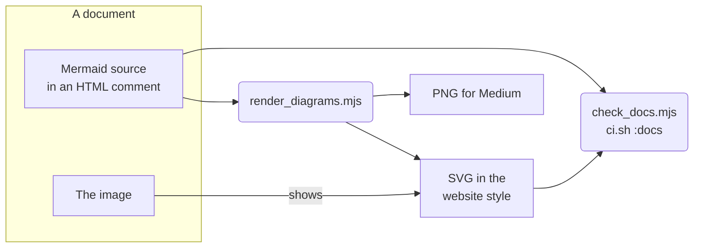

# Tom Secrets Manager documentation

The documents that explain the Tom Secrets Manager as a whole: what it is,
how its parts fit together, how it keeps secrets safe, and how its main
flows run. The package READMEs, the protocol document and the user guides
explain each part in detail; these documents tie them together.

## The documents

| Document | What it explains |
| --- | --- |
| [Diagram style](diagram_style.md) | How the diagrams look, and why |

The overview, the architecture, the security model, the flows and the
configuration reference join this list as they are written.

Each part's own documentation:

| Part | Document |
| --- | --- |
| The core library | [`tom_secrets_core` README](../tom_secrets_core/README.md) |
| The secrets service | [`tom_secrets_service` README](../tom_secrets_service/README.md) |
| The protocol between the service and its clients | [protocol document](https://github.com/al-the-bear/tom_secrets_clients/blob/main/protocol/protocol.md) |
| The command line `tsm` | [`tsm` user guide](https://github.com/al-the-bear/tom_secrets_clients/blob/main/clients/dart/tsm/doc/tsm_user_guide.md) |
| The desktop app | [app user guide](https://github.com/al-the-bear/tom_app_secrets_manager/blob/main/tom_secrets_app/doc/user_guide.md) |
| The mobile app | [mobile user guide](https://github.com/al-the-bear/tom_app_secrets_manager/blob/main/tom_secrets_mobile/doc/user_guide.md) |

## How these documents are written

**Text.**

- Markdown lines are at most 80 characters long. Tables, code blocks,
  HTML comments and lines that hold only an image or a link are the
  exceptions.
- A document describes the product as it is now. It names no work item,
  no history and no internal design id.
- Examples use demo data only: no real secret, no personal path, no real
  host name.
- Facts come from the code, the protocol document and the design, and are
  checked against the code.

**Diagrams.** A diagram explains one aspect. It has as many nodes as that
aspect needs and no more: what the text explains, not every class or call.
A diagram that no longer reads at page width is split in two.

Each diagram appears in four parts, in this order:

1. a sentence that says what the diagram shows;
2. the diagram's SVG, as an image whose alt text is the diagram's title;
3. its Mermaid source, in an HTML comment right after the image;
4. the text that explains it.

The Mermaid source stays in the document, but GitHub does not render it:
the reader sees the SVG, which has the project's diagram style
([diagram_style.md](diagram_style.md)). To change a diagram, edit its
Mermaid source and export it again. Never edit the SVG or PNG by hand.

The comment starts with `<!-- diagram <n>-<slug>`, where `<n>` numbers the
diagrams of the document and `<slug>` names this one. The export writes
`images/diagrams/<document>/<n>-<slug>.svg` and `.png` beside the document.
The PNG is for places that show no SVG, such as an article on Medium.

This diagram shows how a document's diagrams become images and how the
check keeps them current.



<!-- diagram 1-docs-tooling

-->

`render_diagrams.mjs` reads each diagram's source, renders it with
Mermaid and writes the SVG and the PNG. Each SVG carries a hash of its
source. `check_docs.mjs` renders every source again and fails when one does
not render. It also fails when an SVG is missing or older than its source,
when a relative link leads nowhere, or when a line is too long.

**One look for the same thing.** Every diagram uses the same classes,
which the export defines for every flowchart. A node names its class with
`:::<class>`, a subgraph with `class <id> <class>`:

| Class | Shape | For |
| --- | --- | --- |
| `program` | rounded box, navy | the product's programs: the service, the apps, `tsm`, the browser host |
| `library` | box, teal | a package or library inside a program |
| `client` | box, light blue | a program that asks for secrets |
| `person` | stadium `([ ])`, light blue | a person: the user, a member |
| `file` | box, amber | a file: a configuration, a share, an export |
| `vault` | cylinder `[( )]`, green | a vault, a store of secrets |
| `key` | hexagon `{{ }}`, magenta | a key, a password, a token |
| `external` | box, white | a service outside the product: GitHub, a relay |
| `zoneDevice` | subgraph, white | a trusted machine |
| `zoneSandbox` | subgraph, amber | a sandbox: a browser, an app extension |
| `zoneRemote` | subgraph, sand | a remote place: GitHub, the internet |

A solid arrow carries data. A dashed arrow (`-.->`) is an authorisation or
the way a key is used; the export draws it in magenta.

## Checking and exporting

The tools are in the `tom_app_secrets_manager` repository, in
`tom_secrets_build` (Node.js 20 or later; `npm ci` there first). From
`tom_secrets_build`, with this repository cloned beside it:

```text
node tool/render_diagrams.mjs ../../tom_secrets_manager/doc
node tool/check_docs.mjs ../../tom_secrets_manager/doc
```

`ci.sh :docs` runs the check over this folder and the user guides.
`render_diagrams.mjs --force` exports every diagram again, and `--hash`
prints each source's hash.

A diagram that leads a document can be drawn by hand in the website style
when the export falls short. Its comment then reads
`<!-- diagram <n>-<slug> hand-drawn`, and the export writes only its PNG.
The drawing's `data-tsm-source` attribute holds its source's hash (from
`--hash`), so the check still notices a changed source.
