# Architecture

How Tom Secrets Manager is built: its repositories and packages, how they
depend on each other, and the main types inside each component. It is
written for a developer who will change the code. The
[overview](overview.md) explains what the product does; this document
starts where the overview's component table ends.

Every class, function and file named here exists in the code. A name is
given as declared; a file path is relative to its package's root.

## The component map

| Component | Package | Repository |
| --- | --- | --- |
| Core library | `tom_secrets_core`, `tom_secrets_age` | `tom_secrets_manager` |
| Secrets service | `tom_secrets_service` | `tom_secrets_manager` |
| Dart client and admin library | `tom_secrets_client` | `tom_secrets_clients` |
| Command line | `tom_secrets_tsm` (`tsm`) | `tom_secrets_clients` |
| Other language clients | `clients/typescript`, `python`, `go`, `rust`, `java`, `c`, `cpp` | `tom_secrets_clients` |
| Protocol and conformance | `protocol/`, `conformance/` | `tom_secrets_clients` |
| App screens | `tom_secrets_ui` | `tom_app_secrets_manager` |
| Desktop platform code | `tom_secrets_desktop` | `tom_app_secrets_manager` |
| Desktop app | `tom_secrets_app` | `tom_app_secrets_manager` |
| Mobile app | `tom_secrets_mobile` | `tom_app_secrets_manager` |
| Browser host and extension | `tom_secrets_browser` | `tom_app_secrets_manager` |
| Windows passkey plugin | `tom_secrets_passkey_plugin` | `tom_app_secrets_manager` |
| Relay server | `tom_secrets_relay` | `tom_app_secrets_manager` |
| Manual CI and release | `tom_secrets_build`, `tom_secrets_testkit` | `tom_app_secrets_manager` |
| Post-quantum primitives | `tom_pqc` | `tom_basics` |

## The repositories and packages

The product lives in three public repositories, each BSD-3:

- **`tom_secrets_manager`** holds the core, the `age` format and the
  service, and these documents.
- **`tom_secrets_clients`** holds the protocol document with its schemas
  and test vectors, the conformance suite, and every client library,
  `tsm` included.
- **`tom_app_secrets_manager`** holds the apps, the browser host and
  extension, the passkey plugin, the relay server and the manual CI.

| Package | Kind | Language | Published as |
| --- | --- | --- | --- |
| `tom_secrets_core` | library | Dart | pub.dev `tom_secrets_core` |
| `tom_secrets_age` | library | Dart | pub.dev `tom_secrets_age` |
| `tom_secrets_service` | service | Dart | pub.dev `tom_secrets_service` |
| `tom_secrets_client` | library | Dart | pub.dev `tom_secrets_client` |
| `tsm` | tool | Dart | pub.dev `tom_secrets_tsm` |
| `clients/typescript` | library | TypeScript | npm `@al-the-bear/tom-secrets-client` |
| `clients/python` | library | Python | PyPI `tom-secrets-client` |
| `clients/go` | library | Go | Go module `github.com/al-the-bear/tom_secrets_clients/clients/go` |
| `clients/rust` | library | Rust | crate `tom-secrets-client` |
| `clients/java` | library | Java | Maven `net.kyaw.tom:tom-secrets-client` |
| `clients/c` | library | C | source, by tag (CMake) |
| `clients/cpp` | library | C++ | source, by tag (CMake) |
| `conformance/fake_service` | test tool | Dart | not published |
| `tom_secrets_ui` | library | Dart, Flutter | not published |
| `tom_secrets_desktop` | library (plugin) | Dart, Swift, C++ | not published |
| `tom_secrets_app` | app | Dart, Flutter, Swift | release archives |
| `tom_secrets_mobile` | app | Dart, Flutter, Kotlin | release APK |
| `tom_secrets_browser` | tool and extension | Dart, TypeScript | release archives, browser stores |
| `tom_secrets_passkey_plugin` | tool | C++ | inside the Windows package |
| `tom_secrets_relay` | service | Dart | container image |
| `tom_secrets_build` | tool | Dart, Node.js | not published |
| `tom_secrets_testkit` | test library | Dart | not published |
| `tom_pqc` | library | Dart, C | pub.dev `tom_pqc` |

Every package takes the others as published versions; no package reaches
into another repository by path.

This diagram shows how the Dart packages depend on each other (runtime
dependencies only).


<!-- diagram 1-dart-packages
```mermaid
flowchart BT
  pqc["tom_pqc"]:::library
  age["tom_secrets_age"]:::library
  client["tom_secrets_client"]:::library
  core["tom_secrets_core"]:::library
  service("tom_secrets_service"):::program
  tsm("tsm"):::program
  ui["tom_secrets_ui"]:::library
  desktop["tom_secrets_desktop"]:::library
  app("tom_secrets_app"):::program
  mobile("tom_secrets_mobile"):::program
  browser("tom_secrets_browser"):::program
  relay("tom_secrets_relay"):::program
  age --&gt; pqc
  core --&gt; age
  core --&gt; client
  core --&gt; pqc
  service --&gt; core
  tsm --&gt; client
  ui --&gt; core
  desktop --&gt; ui
  app --&gt; desktop
  mobile --&gt; ui
  mobile --&gt; service
  browser --&gt; client
  relay --&gt; age
```
-->

An arrow points from a package to one it depends on. Three things stand
out:

- `tom_secrets_client` depends on no other package of the product: every
  program that only asks the service (`tsm`, the browser host, any
  program) links neither the core nor KDBX.
- `tsm` takes the core and the service only as test dependencies; its
  pairing runs in the service's executable.
- The mobile app links the service's library, because a phone runs the
  service's vault code inside the app.

Beside these, the packages build on the Tom framework: `tom_kdbx_store`
(KDBX, only in the core), `tom_core_storage` (the storage port and the
GitHub backend), `tom_core_sync`, `tom_git`, `tom_github_api`,
`tom_crypto`, `tom_basics`, the Tom UI modules for the apps,
`tom_core_server` for the relay and `tom_build_base` for the tools.

This diagram shows the other languages' clients and the native parts, and
what each talks to.


<!-- diagram 2-other-parts
```mermaid
flowchart LR
  libs["TypeScript, Python, Go,<br/>Rust and Java clients"]:::library
  cpp["C++ client"]:::library --&gt; c["C client"]:::library
  plugin("Windows passkey plugin"):::program --&gt; c
  safari("Safari extension"):::program --&gt; skit["TomSecretsSafariKit"]:::library
  skit --&gt; host("tsm-browser-host"):::program
  libs -- protocol --&gt; svc("Secrets service"):::program
  c -- protocol --&gt; svc
  host -- protocol --&gt; svc
  af("macOS AutoFill extension"):::program --&gt; afkit["TomSecretsAutofillKit"]:::library
  afkit -- reads --&gt; snap["Sealed snapshot"]:::file
```
-->

Every client speaks the same protocol to the service. The C++ client is a
header-only layer over the C client, and the Windows passkey plugin is
built on the C client too. The macOS AutoFill extension never talks to
the service: it reads a sealed snapshot the desktop app writes. The Safari
extension's native handler starts the same browser host the other browsers
use.

## Layering

This diagram shows the layers and the direction every dependency must
point.


<!-- diagram 3-layers
```mermaid
flowchart TB
  apps("Apps: tom_secrets_app, tom_secrets_mobile"):::program
  plat["Platform: tom_secrets_desktop"]:::library
  ui["Screens and state: tom_secrets_ui"]:::library
  svc("Service: tom_secrets_service"):::program
  core["Core: tom_secrets_core, tom_secrets_age"]:::library
  client["Protocol: tom_secrets_client"]:::library
  apps --&gt; plat
  apps --&gt; ui
  plat --&gt; ui
  ui --&gt; core
  svc --&gt; core
  core --&gt; client
  ui --&gt; client
```
-->

The rules:

- **The core** knows vaults, keys and formats, and nothing about sockets,
  processes or screens. It decides what an operation does; the service and
  the apps decide where files live and when to sync.
- **The service** adds the endpoints, the processes it measures, the
  approvals and the timers. It never draws anything.
- **The client library** is the protocol: frames, references, values, the
  runtime directory, the admin requests. It depends on nothing of the
  product, so the lightest program can use it.
- **`tom_secrets_ui`** holds every screen and its state, and reaches the
  platform only through ports (abstract classes) that the host fills in.
- **`tom_secrets_desktop`** implements those ports for macOS, Windows and
  Linux; **the apps** only wire things together.

**The licence boundary.** KDBX is reached only through
`tom_secrets_core`, which reaches it only through `tom_kdbx_store`. No
other package imports a KDBX library. No package's dependency closure may
hold a GPL-licensed package. `tom_secrets_build`'s `:licences` stage
checks both for every package, in every language
(`lib/src/licence_boundary.dart`: `secretsBoundaryProblems`,
`secretsKdbxProblems`).

## Inside the components

### `tom_secrets_core`

One library, `lib/tom_secrets_core.dart`, exports every file of
`lib/src/` except three private helpers, and re-exports
`tom_secrets_age` and the KDBX types a caller handles. The core is pure
Dart: no Flutter, no sockets. Its tests are flat files in `test/`
(`<area>_test.dart`), with shared vaults in `test/support/vaults.dart` and
fixtures in `test/fixtures/`.

This diagram shows the core's vault model: from a stored file to a
resolved value.


<!-- diagram 4-core-vaults
```mermaid
flowchart LR
  loc["TomSecretsVaultLocator"]:::library
  codec["tomSecretsDecodeStored<br/>(outer.dart, stored_vault.dart)"]:::library
  kdbx[("KdbxFile")]:::vault
  meta["TomSecretsMetadata"]:::library
  store["TomSecretsStore"]:::library
  res["TomSecretsResolver"]:::library
  val{{"TomSecretsFieldValue"}}:::key
  loc --&gt; codec
  codec --&gt; kdbx
  kdbx --&gt; meta
  kdbx --&gt; store
  store --&gt; res
  res --&gt; val
```
-->

- **The vault model.** `TomSecretsVaultLocator` (`lib/src/locator.dart`)
  names where a vault lives: `TomSecretsFileLocator`,
  `TomSecretsGitHubLocator`, `TomSecretsGitLocator`. `tomSecretsNewVault`
  (`lib/src/new_vault.dart`) makes a KDBX 4.1 file keyed by Argon2id.
  `TomSecretsMetadata` and `TomSecretsVaultKind` (`lib/src/metadata.dart`)
  are the metadata entry; `TomSecretsConfig` (`lib/src/config.dart`) the
  shared configuration with its `TomSecretsDimension`s.
  `TomSecretsPrimaryVaults` and `TomSecretsVaultKeys`
  (`lib/src/primary.dart`) are the primary's list of further vaults with
  their keys. `TomSecretsEntryType` and `TomSecretsFieldValue`
  (`lib/src/mapping.dart`) map the product's entry types and fields onto
  KDBX.
- **Resolution.** `TomSecretsStore` (`lib/src/store.dart`) indexes one
  file: every `TomSecretsIndexedEntry` with its logical path, its overlay
  bindings and its flat key. `TomSecretsResolver`
  (`lib/src/resolution.dart`) ranks the candidates of a reference for a
  `TomSecretsMachine` and answers a `TomSecretsResolution` with its
  `TomSecretsRankedCandidate`s, or throws `TomSecretsResolveException`;
  `explain` answers a `TomSecretsExplanation` without reading a value.
  Tests: `resolution_test.dart`, `protection_test.dart`.
- **The stored-vault codec.** `tomSecretsEncodeStored` and
  `tomSecretsDecodeStored` (`lib/src/stored_vault.dart`) turn a `KdbxFile`
  into the bytes its store keeps and back. A `.kdbx.tsmx` file goes through
  `tomSecretsOuterEncrypt` / `tomSecretsOuterDecrypt` (`lib/src/outer.dart`)
  under `TomSecretsRepositoryKey`s, one slot each; `TomSecretsKeyFile`
  (`lib/src/key_file.dart`) is a KeePass 2.0 XML key file. Tests:
  `stored_vault_test.dart`, with files every later version must open in
  `test/fixtures/outer/`.

This diagram shows how a vault in a GitHub repository stays in step with
it.


<!-- diagram 5-core-sync
```mermaid
flowchart LR
  unit["TomSecretsVaultUnit"]:::library
  storage["TomStorage<br/>(tom_core_storage)"]:::external
  merge["tomSecretsMergeVaults"]:::library
  cache["TomSecretsOfflineCache"]:::library
  hist["tomSecretsClassifyMove"]:::library
  compact["tomSecretsCompact"]:::library
  unit -- read, commit --&gt; storage
  unit -- branch moved --&gt; merge
  unit -- keep the file --&gt; cache
  unit -- how it moved --&gt; hist
  compact -- rewrite history --&gt; storage
```
-->

- **The GitHub cycle.** `TomSecretsVaultUnit` (`lib/src/vault_sync.dart`)
  keeps one vault converged with its remote over a `TomStorage`. It commits
  on top of its base, and when the branch moved it merges three-way with
  `tomSecretsMergeVaults` (`lib/src/vault_merge.dart`) and commits again.
  A real conflict is a `TomSecretsEntryConflict`, settled by
  `tomSecretsSettleConflicts`. `TomSecretsOfflineCache`
  (`lib/src/offline_cache.dart`) keeps the last file fetched.
- **History.** `tomSecretsClassifyMove` (`lib/src/history.dart`) tells how
  a branch moved, as a `TomSecretsBranchMove`: ahead, compacted or
  rewritten, read through a `TomSecretsCommitReader`.
  `tomSecretsCompact` (`lib/src/compaction.dart`) writes a compaction over
  the git protocol with `tom_git`, by `TomSecretsCompactionSettings`.
  Tests: `vault_sync_test.dart`, `vault_merge_test.dart`,
  `offline_cache_test.dart`, `compaction_test.dart`.

This diagram shows the core's trust material and what is built on it.


<!-- diagram 6-core-trust
```mermaid
flowchart LR
  trust["TomSecretsTrust"]:::library
  appr{{"TomSecretsApproverKey<br/>Ed25519 + ML-DSA-65"}}:::key
  grants["TomSecretsGrantsGroup"]:::library
  codes["tomSecretsApprovalCode"]:::library
  pair["TomSecretsPairingWindow<br/>TomSecretsSpake2"]:::library
  link["TomSecretsLinkSession<br/>Noise KK + ML-KEM-768"]:::library
  rec["TomSecretsDeviceRecords"]:::library
  trust --&gt; appr
  appr -. signs .-&gt; grants
  trust --&gt; codes
  pair -- records --&gt; trust
  pair -- giver writes --&gt; rec
  trust --&gt; link
```
-->

- **Signed objects and grants.** `TomSecretsApproverKey` and
  `tomSecretsAcceptedBy` (`lib/src/signed_objects.dart`) sign and accept
  grants, revocations and key changes with Ed25519 and ML-DSA-65.
  `TomSecretsGrantsGroup` (`lib/src/grants.dart`) is the grants group of
  the primary vault. `TomSecretsTrust` (`lib/src/trust.dart`) is a
  device's trust material: its key pairs and the approvers and hosts it
  recorded. `tomSecretsApprovalCode`, `tomSecretsCodeToken` and
  `tomSecretsRedeemToken` (`lib/src/approval_code.dart`) are the approval
  codes. Tests: `approval_test.dart`, `trust_rotation_test.dart`.
- **Pairing.** `TomSecretsSpake2` (`lib/src/pairing.dart`) is SPAKE2 per
  RFC 9382, checked with the RFC's vectors in
  `test/fixtures/rfc9382_vectors.json`; `TomSecretsPairingCode`,
  `TomSecretsPairingBundle`, `tomSecretsGivePairing`,
  `tomSecretsReceivePairing` and `TomSecretsPairingWindow` run it with an
  ML-KEM-768 exchange inside. `tomSecretsReceivePairingForSetup`
  (`lib/src/pairing_setup.dart`) and `TomSecretsFirstRun`
  (`lib/src/first_run.dart`) set a new machine up from it;
  `TomSecretsDeviceRecords` (`lib/src/device_records.dart`) is what the
  primary records. Tests: `pairing_test.dart`, `pairing_setup_test.dart`,
  `first_run_test.dart`.
- **The approval link.** `TomSecretsLinkInitiator` and
  `TomSecretsLinkResponder` (`lib/src/approval_link.dart`) run the Noise
  KK handshake and give a `TomSecretsLinkSession` over a
  `TomSecretsApprovalChannel`; `lib/src/relay_link.dart` names a link's
  channels on a relay server. Tests: `approval_test.dart`,
  `relay_link_test.dart`.
- **The relays.** `TomSecretsRelay` (`lib/src/relay.dart`) is one
  interface for pairing, the link and the mailbox, with
  `TomSecretsRelayId` naming one. `TomSecretsGitHubRelay`
  (`lib/src/github_relay.dart`), `TomSecretsServerRelay`
  (`lib/src/server_relay.dart`, its requests paced by
  `TomSecretsRelayPacer` in `lib/src/relay_pacer.dart`) and
  `TomSecretsWormholeRelay` (`lib/src/wormhole_relay.dart`) implement it;
  `tomSecretsRelayFor` builds the one an id names. Tests:
  `relay_test.dart`, `server_relay_test.dart`, `relay_pacer_test.dart`,
  `wormhole_relay_test.dart`.

This diagram shows sharing: member keys, shared vaults and shares.


<!-- diagram 7-core-sharing
```mermaid
flowchart LR
  ident{{"TomSecretsMemberKey<br/>(tom_secrets_age)"}}:::key
  agefmt["tomSecretsAgeEncrypt<br/>(tom_secrets_age)"]:::library
  members["tomSecretsAddMember"]:::library
  shared["TomSecretsSharedVaultKeys<br/>tomSecretsWriteRecipientsFile"]:::library
  share["TomSecretsShare<br/>tomSecretsWriteShare"]:::library
  rot["TomSecretsRotations"]:::library
  ident --&gt; members
  members --&gt; shared
  shared --&gt; agefmt
  share --&gt; agefmt
  rot -- re-keys --&gt; shared
```
-->

- **The `age` format** is its own package, `tom_secrets_age`, so the relay
  server can check a member's proof without linking the vault code:
  `tomSecretsAgeEncrypt` and `tomSecretsAgeDecrypt`
  (`lib/src/age.dart`) with the `TomSecretsAgeIdentity` subclasses, and
  `TomSecretsAgeRecipient` and `TomSecretsMemberKey`
  (`lib/src/recipient.dart`). Tests: `test/age_test.dart`.
- **Members and shared vaults.** `tomSecretsAddMember` and
  `tomSecretsMembers` (`lib/src/member_keys.dart`) keep the member key and
  the members in the primary. `TomSecretsSharedVaultKeys`,
  `tomSecretsWriteRecipientsFile` and `tomSecretsReadRecipientsFile`
  (`lib/src/shared_vault.dart`) are a shared vault's recipients file.
- **Shares.** `TomSecretsShare`, `tomSecretsWriteShare`,
  `tomSecretsReadShare` and the inbox helpers `tomSecretsInboxPath` and
  `tomSecretsInboxExpired` (`lib/src/share.dart`).
- **Rotations.** `TomSecretsRotations` and `TomSecretsRotation`
  (`lib/src/rotation.dart`) are the rotation records that also lock a key
  against a second rotation; `tomSecretsTakeNextKeys` takes the next keys
  a device finds in the primary (`TomSecretsPrimaryNextKeys`). Tests:
  `member_keys_test.dart`, `shared_vault_test.dart`, `share_test.dart`,
  `rotation_test.dart`.

The rest of the core is a set of independent modules, each a file or two
with its own test:

| Area | Main names | Files | Tests |
| --- | --- | --- | --- |
| SSH keys and the agent's side | `tomSecretsGenerateSshKey`, `TomSecretsSshKeyInfo`, `TomSecretsSshPrivateKey`, `TomSecretsSshAgentConnection`, `TomSecretsSshAgentBackend` | `ssh_key.dart`, `ssh_private_key.dart`, `ssh_agent.dart` | `ssh_key_test.dart`, `ssh_agent_test.dart` |
| Certificates and PGP keys | `tomSecretsGenerateCertificate`, `TomSecretsCertificateInfo`, `tomSecretsGeneratePgpKey`, `TomSecretsPgpKeyInfo` | `certificate.dart`, `pgp_key.dart`, `pgp_raw.dart` | `typed_keys_test.dart` |
| Passkeys | `TomSecretsPasskey`, `tomSecretsKeepPasskey`, `tomSecretsCreatePasskey`, `tomSecretsPasskeyAssertion`, `tomSecretsRpIdValidFor` | `passkey.dart`, `webauthn.dart` | `webauthn_test.dart` |
| Imports | `tomSecretsImport`, `tomSecretsRead1Pux`, `tomSecretsReadEnpassJson`, `tomSecretsReadBitwardenJson`, `tomSecretsReadBrowserCsv`, `tomSecretsImportKdbxMerged` | `import*.dart` | `import_1password_test.dart`, `import_enpass_test.dart`, `import_export_more_test.dart` |
| Exports | `tomSecretsExportKdbx`, `tomSecretsExportCsv`, `tomSecretsExportBitwardenJson`, `tomSecretsExportEnpassJson` | `export.dart`, `export_enpass.dart` | `import_export_more_test.dart` |
| Health | `tomSecretsHealthReport`, `TomSecretsBreachCheck` | `health.dart` | `health_test.dart` |
| Device settings | `TomSecretsDeviceSettings`, `TomSecretsDeviceContainer`, `TomSecretsDeviceKeys`, `TomSecretsLockPolicy` | `device_settings.dart` | `device_settings_test.dart` |
| Logins and typing | `tomSecretsMatchLogins`, `TomSecretsTotp`, `TomSecretsPasswordGenerator`, `tomSecretsParseAutoType` | `url_match.dart`, `totp.dart`, `password_generator.dart`, `auto_type.dart` | `url_match_test.dart`, `password_generator_test.dart`, `auto_type_test.dart` |

All files are in `lib/src/`, all tests in `test/`.

### `tom_secrets_service`

The executable is `bin/tom_secrets_service.dart`. It hardens the process
(`tomSecretsHardenProcess`, `lib/src/hardening.dart`), reads one handover
line from its standard input, and either runs the pairing mode
(`tomSecretsRunPairingMode`, `lib/src/pairing_mode.dart`) or starts the
service: `TomSecretsBootstrap` (`lib/src/bootstrap.dart`) reads
`bootstrap.yaml`, `TomSecretsRuntime` prepares the runtime directory, and
`TomSecretsService.launch` (`lib/src/service.dart`) starts it with a
`TomSecretsServiceConfig`.

This diagram shows a client's request through the service.


<!-- diagram 8-service-request
```mermaid
flowchart LR
  sock["client.sock,<br/>App Group socket"]:::file
  sess["Client session<br/>(service.dart)"]:::library
  peer["TomSecretsSystemPeerMeasurer"]:::library
  rate["TomSecretsRateLimits"]:::library
  vs["TomSecretsVaultSet"]:::library
  pol["TomSecretsApprovals"]:::library
  audit["TomSecretsAuditLog"]:::library
  sock --&gt; sess
  sess -- who is it --&gt; peer
  sess -- too many --&gt; rate
  sess -- resolve --&gt; vs
  sess -- may it --&gt; pol
  sess -- record --&gt; audit
```
-->

- **Endpoints and sessions.** `TomSecretsService` binds the client and
  admin endpoints in the runtime directory and gives each accepted
  connection a private client or admin session in `lib/src/service.dart`;
  frames are read and written by `TomSecretsConnection`
  (`lib/src/connection.dart`), and a secret is written straight from
  bytes by `TomSecretsSecretSlot` (`lib/src/secret_frame.dart`). On macOS,
  `tomSecretsAppGroupClientSocketFor` (`lib/src/app_group.dart`) adds the
  client socket in the App Group container for Safari. The ssh-agent is
  `TomSecretsSshAgent` (`lib/src/agent.dart`), on Windows over
  `TomSecretsAgentPipeServer` (`lib/src/agent_pipe.dart`).
- **Peer measurement.** `TomSecretsSystemPeerMeasurer`
  (`lib/src/peer_identity.dart`) answers a `TomSecretsPeerMeasurement` per
  connection: `SO_PEERCRED` and `/proc` on Linux, `LOCAL_PEERPID` and
  libproc on macOS, the TCP table and the process snapshot on Windows.
  `TomSecretsIdentity` and `TomSecretsInterpreters`
  (`lib/src/identity.dart`) turn the process into an identity, an
  interpreted script included. Tests: `identity_test.dart`,
  `peer_service_test.dart`, `windows_test.dart`.
- **Access policy, approvals and grants.** `TomSecretsAccessPolicy`
  (`lib/src/access.dart`) decides every value; its default implementation
  is `TomSecretsApprovals` (`lib/src/approvals.dart`), which reads
  `TomSecretsGrant`s, sends prompts, issues and redeems approval codes and
  checks client tokens. Tests: `approvals_test.dart`,
  `client_token_test.dart`, `lookup_test.dart`.
- **Rate limits.** `TomSecretsRateLimits` with
  `TomSecretsRateLimitSettings` (`lib/src/rate_limits.dart`). Tests:
  `rate_limits_test.dart`.

This diagram shows the service's parts that run beside the requests.


<!-- diagram 9-service-background
```mermaid
flowchart LR
  svc("TomSecretsService"):::program
  vs["TomSecretsVaultSet"]:::library
  gh["TomSecretsGitHubOpener"]:::library
  dev["TomSecretsDeviceContainer<br/>(core)"]:::library
  lock["TomSecretsLockTimer"]:::library
  links["TomSecretsApproverLinks<br/>TomSecretsLinkServer"]:::library
  relay["TomSecretsRelayLinkHost"]:::library
  log["TomSecretsLog"]:::library
  svc --&gt; vs
  vs --&gt; gh
  svc --&gt; dev
  svc --&gt; lock
  svc --&gt; links
  links --&gt; relay
  svc --&gt; log
```
-->

- **The vault set.** `TomSecretsVaultSet` (`lib/src/vault_set.dart`) holds
  every opened store with its keys (`TomSecretsHeldKeys`) and status
  (`TomSecretsStoreStatus`), refreshes them and saves edits.
  `TomSecretsGitHubOpener` (`lib/src/github_opener.dart`) opens, commits,
  re-keys, moves, creates and compacts `github:` vaults with the core's
  vault unit and keeps the offline cache; `TomSecretsGitHubApp`
  (`lib/src/github_app.dart`) is the GitHub App sign-in.
  `TomSecretsExpiringKey` (`lib/src/key_expiry.dart`) computes the key
  reminders. Tests: `github_test.dart`, `editing_test.dart`,
  `vault_create_test.dart`.
- **The device container and its key modes.** The device settings
  container and its key (`TomSecretsDeviceContainer`,
  `TomSecretsDeviceKeys` with a `TomSecretsDeviceKeyMode`) are the core's;
  the service opens it at the unlock with the mode `bootstrap.yaml` names.
  `TomSecretsLockTimer` (`lib/src/lock_policy.dart`) relocks by the lock
  policy, reading the idle time from a `TomSecretsIdleSource` per OS.
- **Links.** `TomSecretsLinkServer` (`lib/src/link_server.dart`) is the
  host's side of the approval link; `TomSecretsApproverLinks`
  (`lib/src/approver_links.dart`) the approver's sessions to its hosts;
  `TomSecretsRelayLinkHost` (`lib/src/relay_links.dart`) the link through a
  relay server. Tests: `approver_links_test.dart`, `relay_link_test.dart`.
- **The pairing mode.** `tomSecretsRunPairingMode` receives a pairing for
  `tsm pair`, which hands it a `TomSecretsPairingHandover`, so `tsm` links
  no core. Tests: `pairing_mode_test.dart`, `pairing_service_test.dart`.
- **Logs.** `TomSecretsLog` (`lib/src/log.dart`) is the operational log;
  `TomSecretsAuditLog` (`lib/src/audit.dart`) the encrypted audit log.
- **Hardening.** `tomSecretsHardenProcess`. Test: `hardening_test.dart`.

Tests live in `test/`, with a running service built by
`test/support/setup.dart` and raw frames by `test/support/raw_client.dart`.

### `tom_secrets_client` and `tsm`

This diagram shows the Dart client library's two halves and the programs
built on them.


<!-- diagram 10-dart-client
```mermaid
flowchart LR
  subgraph lib["tom_secrets_client"]
    client["TomSecretsClient<br/>discoverTomSecrets"]:::library
    admin["TomSecretsAdminClient<br/>TomSecretsRuntime<br/>tomSecretsStartService"]:::library
  end
  tsm("tsm"):::program --&gt; client
  tsm --&gt; admin
  host("tsm-browser-host"):::program --&gt; client
  ui["tom_secrets_ui"]:::library --&gt; admin
  svc("tom_secrets_service"):::program --&gt; admin
  class lib zoneDevice
```
-->

- **The client** (`lib/tom_secrets_client.dart`): `TomSecretsClient`
  (`lib/src/client.dart`) asks for values; `discoverTomSecrets`
  (`lib/src/discovery.dart`) finds the service; `TomSecretReference`
  (`lib/src/reference.dart`) is the reference grammar; `TomSecretValue`
  and `TomSecretFile` (`lib/src/value.dart`) are masked values;
  `TomSecretsErrorKind` and `TomSecretsClientException`
  (`lib/src/errors.dart`) the errors; `TomSecretsFrameReader`
  (`lib/src/frames.dart`) the framing.
- **The admin library** (`lib/admin.dart`): `TomSecretsAdminClient`
  (`lib/src/admin/admin_client.dart`), `TomSecretsRuntime` (the runtime
  directory, `lib/src/admin/runtime.dart`, which the service uses too),
  `tomSecretsStartService` (`lib/src/admin/starter.dart`),
  `TomSecretsPairingHandover` (`lib/src/admin/pairing_mode.dart`),
  `TomSecretsIntegrations` (`lib/src/admin/integrations.dart`, the ssh,
  git, AWS and Docker configuration blocks) and `TomSecretsBrowserHosts`
  (`lib/src/admin/browser_hosts.dart`, the browsers' native-messaging
  manifests).
- **`tsm`** is a `tom_build_base` tool: `tsmTool` and `tsmMain`
  (`lib/src/tsm_tool.dart`) map each command to a function such as
  `tsmGet` or `tsmRun` (`lib/src/commands.dart`, `lib/src/helpers.dart`),
  run with a `TsmContext` (`lib/src/tsm_context.dart`). One executable has
  three names: `bin/tsm.dart` checks the name it was started under
  (`tsmInvokedName`) and runs `tsmGitCredential` as `git-credential-tsm`,
  `tsmDockerCredential` as `docker-credential-tsm`, else `tsmMain`. Tests
  run `tsm` in process against a service (`test/support/demo.dart`); the
  integration suite (`dart test --tags integration`) starts the real
  service binary.

### The other language clients

This diagram shows how the conformance suite holds every client to the
same behaviour.


<!-- diagram 11-conformance
```mermaid
flowchart LR
  cases["Case tables<br/>conformance/cases/*.json"]:::file
  driver("tool/conformance.py"):::program
  runner["A runner per language<br/>conformance/runners/"]:::library
  lib["The client library"]:::library
  fake("fake_service"):::program
  cases --&gt; driver
  driver --&gt; runner
  runner --&gt; lib
  lib -- protocol --&gt; fake
  driver -- expectations --&gt; fake
```
-->

Every client has the same shape: discovery of the runtime directory,
framing with the protocol's limits and strict JSON, `get`, `getMany` and
`getFile`, progress, rate limits waited out on request, the reference
grammar, an error carrying the protocol's kind, and a value that is masked
when printed and overwritten when closed.

| Folder | Main source | Client type |
| --- | --- | --- |
| `clients/typescript` | `src/client.ts` | `SecretsClient` |
| `clients/python` | `src/tsm/client.py`, `src/tsm/aio.py` | `Client` |
| `clients/go` | `client.go` | `Client` |
| `clients/rust` | `src/client.rs`, `src/tokio.rs` | `Client` |
| `clients/java` | `src/main/java/net/kyaw/tom/secrets/SecretsClient.java` | `SecretsClient` |
| `clients/c` | `include/tsm/tsm.h`, `src/client.c` | `tsm_client` |
| `clients/cpp` | `include/tsm/tsm.hpp` | `tsm::Client` |

The suite (`conformance/`) keeps its case tables in `cases/` and one
runner per language in `runners/<language>/` (nine: Dart, TypeScript,
JavaScript, Python, Go, Rust, Java, C, C++). `tool/conformance.py` runs
every runner against every table, with `fake_service/` playing the
service; `tool/parity_gate.sh` breaks one expectation and then one input,
and requires every runner to fail each time, so no runner passes by
ignoring a table. The protocol folder (`protocol/`) holds `protocol.md`,
a JSON schema per message in `schema/` and test vectors in `vectors/`.

### `tom_secrets_ui`

This diagram shows the app's shell, its state and the ports it reaches the
platform through.


<!-- diagram 12-ui
```mermaid
flowchart LR
  app("TomSecretsApp"):::program
  host["TomSecretsHost"]:::library
  conn["TomSecretsServiceConnection"]:::library
  sess["TomSecretsSession"]:::library
  shell["TomSecretsMainShell"]:::library
  screens["Screens:<br/>vault browser, entry editor,<br/>clients, keys, sharing, ..."]:::library
  ports["Ports:<br/>TomSecretsServiceHost,<br/>TomSecretsTray, TomSecretsNotifier, ..."]:::library
  app --&gt; host
  app --&gt; conn
  conn --&gt; sess
  app --&gt; shell
  shell --&gt; screens
  screens --&gt; sess
  host --&gt; ports
```
-->

- **The shell.** `TomSecretsApp` (`lib/src/app.dart`) runs the gates
  (connect, claim, unlock, or the First run) and then
  `TomSecretsMainShell` (`lib/src/screens/main_shell.dart`).
- **The state** (`lib/src/state/`): `TomSecretsServiceConnection`
  (`service_connection.dart`, the admin connection, store states and
  approval prompts), `TomSecretsSession` (`session_state.dart`, the open
  vaults and their entries), `TomSecretsAutofill` (`autofill.dart`),
  `TomSecretsHealth` (`health.dart`), `TomSecretsClientsApi`
  (`clients.dart`), `TomSecretsOsUnlock` (`os_unlock.dart`),
  `TomSecretsAutoTyper` and `TomSecretsQuickAccess` (`auto_type.dart`),
  `TomSecretsPairingModel` (`pairing_model.dart`), `TomSecretsReminders`
  (`reminders.dart`) and `TomSecretsEmergencySheet`
  (`emergency_sheet.dart`).
- **The ports.** `TomSecretsHost` (`lib/src/ports/desktop_ports.dart`)
  bundles every port the composition root fills in: `TomSecretsTray`,
  `TomSecretsWindowHost`, `TomSecretsNotifier`, `TomSecretsLoginItem`,
  `TomSecretsCaptureGuard`, `TomSecretsPreferences`, `TomSecretsFiles`,
  `TomSecretsPrinter`, `TomSecretsCodeScanner`, and
  `TomSecretsServiceHost` with its `TomSecretsAdminChannel`
  (`lib/src/ports/service_host.dart`). State classes declare their own
  ports, such as `TomSecretsAutofillPort`, `TomSecretsKeyboard` and
  `TomSecretsHotkeys`.
- **The screens** (`lib/src/screens/`): `TomSecretsVaultBrowser`,
  `TomSecretsEntryEditor`, `TomSecretsOverlayEditor`,
  `TomSecretsEnvironmentsView`, `TomSecretsClientsView`,
  `TomSecretsKeysView`, `TomSecretsSharingView`, `TomSecretsPairingView`,
  `TomSecretsImportView`, `TomSecretsConflictsView`,
  `TomSecretsProposalsView`, `TomSecretsHealthView`,
  `TomSecretsSettingsView`, `TomSecretsStatusView`, the
  `TomSecretsFirstRunWizard` and the `TomSecretsApprovalPromptDialog`.

Tests (`test/`) run the screens against `test/support/fake_service.dart`:
`FakeService` implements `TomSecretsAdminChannel` over real demo vaults,
and `FakeHost` implements `TomSecretsServiceHost`. The screenshots are made
by `test/screenshots/`.

### `tom_secrets_desktop` and `tom_secrets_app`

This diagram shows the desktop composition root.


<!-- diagram 13-desktop
```mermaid
flowchart LR
  main("tom_secrets_app<br/>lib/main.dart"):::program
  host["TomSecretsHost"]:::library
  sh["TomSecretsDesktopServiceHost"]:::library
  shell["TomSecretsPluginTray,<br/>TomSecretsPluginWindow,<br/>TomSecretsPluginNotifier"]:::library
  chan["Platform channels:<br/>autofill, capture, clipboard,<br/>hotkeys, login, session"]:::library
  kb["TomSecretsMacKeyboard,<br/>TomSecretsWindowsKeyboard,<br/>TomSecretsX11Keyboard"]:::library
  main --&gt; host
  host --&gt; sh
  host --&gt; shell
  host --&gt; chan
  host --&gt; kb
  main -- runApp --&gt; app("TomSecretsApp"):::program
```
-->

`tom_secrets_app` has one Dart file, `lib/main.dart`, the composition
root: it claims `TomSecretsSingleInstance`, builds a `TomSecretsHost` from
`tom_secrets_desktop`'s implementations and runs `TomSecretsApp`. The
macOS runner (`macos/Runner/`) declares no channels of its own; the
AutoFill and Safari extensions are its other targets (below).

`tom_secrets_desktop` (`lib/src/`) implements the ports:

- `TomSecretsDesktopServiceHost` (`service_host.dart`) finds the service
  and `tsm` beside the app, starts the service and attaches over
  `TomSecretsAdminClientChannel`, with the admin key in the keychain;
- `TomSecretsPluginTray`, `TomSecretsPluginWindow` and
  `TomSecretsPluginNotifier` (`shell.dart`) over `tray_manager`,
  `window_manager` and `flutter_local_notifications`;
- `TomSecretsDesktopSessionEvents`, `TomSecretsPlatformCaptureGuard` and
  `TomSecretsDesktopLoginItem` (`platform_channels.dart`) over its own
  platform channels `tom_secrets_desktop/session`, `/capture` and
  `/login` (also `/autofill`, `/clipboard` and `/hotkeys`), in Swift
  (`macos/tom_secrets_desktop/Sources/tom_secrets_desktop/`) and C++
  (`windows/tom_secrets_desktop_plugin.cpp`);
- auto-type through FFI into the OS: `TomSecretsMacKeyboard`
  (`keyboard_macos.dart`), `TomSecretsWindowsKeyboard`
  (`keyboard_windows.dart`), `TomSecretsX11Keyboard` (`keyboard_x11.dart`),
  and the hotkeys `TomSecretsChannelHotkeys` and `TomSecretsX11Hotkeys`
  (`auto_type.dart`);
- `TomSecretsMacAutofill` (`autofill.dart`) writes the AutoFill snapshot;
  `TomSecretsPluginPasskeys` (`windows_passkeys.dart`) registers the
  Windows passkey plugin.

### `tom_secrets_mobile`

This diagram shows the mobile app's engine in place of a service, and the
Android providers.


<!-- diagram 14-mobile
```mermaid
flowchart LR
  app("TomSecretsMobileApp"):::program
  ui["tom_secrets_ui screens"]:::library
  engine["TomSecretsMobileEngine<br/>implements TomSecretsAdminChannel"]:::library
  vs["TomSecretsVaultSet<br/>(tom_secrets_service)"]:::library
  af("TomSecretsAutofillService"):::program
  cred("TomSecretsCredentialService"):::program
  app --&gt; ui
  ui --&gt; engine
  engine --&gt; vs
  af -- autofillMain --&gt; engine
  cred -- passkeyMain --&gt; engine
```
-->

`TomSecretsMobileEngine` (`lib/src/mobile_engine.dart`) implements the
same `TomSecretsAdminChannel` the desktop reaches the service through, so
`tom_secrets_ui`'s screens run unchanged. It answers the admin requests
itself over the service library's `TomSecretsVaultSet`, without an offline
cache. `TomSecretsMobileApp` (`lib/src/mobile_app.dart`) is the root;
`TomSecretsMobileServiceHost` (`lib/src/mobile_host.dart`) hands the
engine to the screens.

On Android, `TomSecretsAutofillService.kt` and
`TomSecretsCredentialService.kt` (in
`android/app/src/main/kotlin/dev/enterpriseflutter/tom_secrets_mobile/`)
answer the system. When the app is not running, `AutofillUnlockActivity`
and `PasskeyUnlockActivity` start an engine of their own at the Dart entry
points `autofillMain` and `passkeyMain` (`lib/main.dart`). On the Dart
side, `TomSecretsAutofillResponder` (`lib/src/mobile_autofill.dart`) and
`TomSecretsPasskeyAnswerer` (`lib/src/mobile_passkeys.dart`) answer them.
Tests (`test/`) run the app over a fake GitHub with demo vaults
(`test/support/demo_vaults.dart`).

### The native parts

This diagram shows the native parts and where each runs.


<!-- diagram 15-native
```mermaid
flowchart LR
  subgraph mac["The macOS app"]
    af("TomSecretsAutofill"):::program
    afkit["TomSecretsAutofillKit"]:::library
    saf("TomSecretsSafari"):::program
    skit["TomSecretsSafariKit"]:::library
  end
  snap["AutoFill snapshot"]:::file
  host("tsm-browser-host"):::program
  plugin("tsm-passkey-plugin.exe"):::program
  svc("Secrets service"):::program
  af --&gt; afkit
  afkit --&gt; snap
  saf --&gt; skit
  skit --&gt; host
  host --&gt; svc
  plugin --&gt; svc
  class mac zoneSandbox
```
-->

- **The macOS AutoFill provider** (`tom_secrets_app/macos/`): the
  extension `TomSecretsAutofill/` (`CredentialProviderViewController`, its
  SwiftUI list) over the Swift package `TomSecretsAutofillKit/`:
  `TomSecretsAutofillSnapshot` (`Snapshot.swift`) opens the sealed
  snapshot, `TomSecretsServiceIdentifier` (`Matching.swift`) matches a
  site, `TomSecretsWebAuthn` (`Passkey.swift`) answers passkeys. Its tests
  (`swift test`) read vectors the Dart code seals.
- **The Safari extension** (`tom_secrets_app/macos/`):
  `TomSecretsSafari/` with its `SafariWebExtensionHandler`, over the Swift
  package `TomSecretsSafariKit/`: `SafariBridge` (`SafariBridge.swift`)
  and `HostSession` (`HostSession.swift`), which runs one browser host per
  session.
- **The Windows passkey plugin** (`tom_secrets_passkey_plugin/`, C++,
  CMake): `Authenticator` (`src/windows/authenticator.cpp`) is the COM
  server Windows' passkey dialog asks; `WebAuthnApi`
  (`src/windows/webauthn_api.cpp`) decodes and encodes CTAP2 with
  `webauthn.dll`; `ClientService` (`src/client_service.cpp`) implements
  the platform-free `PasskeyService` (`src/core.h`) over the C client.
  Tests: `tests/core_tests.cpp`, `tests/windows_tests.cpp`.
- **`tom_pqc`** (`tom_ai/basics/tom_pqc`): the vendored C code in
  `native/mlkem-native/` and `native/mldsa-native/`, compiled for the
  target by the build hook `hook/build.dart`, behind the Dart types
  `MlKem768`, `MlDsa65`, `MlKem768X25519` and `MlDsa65Ed25519`
  (`lib/src/`).

### The browser extension and host

This diagram shows the extension's scripts and the host.


<!-- diagram 16-extension
```mermaid
flowchart LR
  subgraph page["The page"]
    content["ContentScript<br/>content.ts"]:::library
    webauthn["installPasskeys<br/>webauthn-page.ts"]:::library
  end
  bg["Background<br/>background.ts"]:::library
  pages["popup.ts, list.ts, bar.ts"]:::library
  hs["HostSession<br/>host.ts"]:::library
  host("TomSecretsBrowserHost<br/>tsm-browser-host"):::program
  content --&gt; bg
  webauthn --&gt; content
  pages --&gt; bg
  bg --&gt; hs
  hs -- native messaging --&gt; host
  class page zoneSandbox
```
-->

The extension (`tom_secrets_browser/extension/src/`) is TypeScript with
no runtime dependency:

- `Background` (`background.ts`) is the only part that talks to the host,
  through `HostSession` (`host.ts`); it checks every message's sender and
  sends a fill to one frame.
- `ContentScript` (`content.ts`) finds the login fields (`detect.ts`),
  puts the icons in them (`icons.ts`) and fills (`fill.ts`).
- `installPasskeys` (`webauthn-page.ts`) runs in the page's own world and
  takes over `navigator.credentials`.
- The extension's pages: the popup (`popup.ts`), the list (`list.ts`) and
  the save bar (`bar.ts`), drawn by `view.ts`.
- `extensionApi` (`api.ts`) is the shim over `browser` and `chrome`.

`tool/build.mjs` bundles the Chromium, Firefox and Safari builds with
esbuild; the tests are `test/*.test.ts` (`npm test`).

The host (`tom_secrets_browser/`, Dart) is `bin/tsm_browser_host.dart`:
`TomSecretsBrowserHost` (`lib/src/host.dart`) reads native messaging's
frames (`lib/src/framing.dart`), checks the caller
(`TomSecretsBrowserCaller`, `lib/src/caller.dart`) and asks the service
through `TomSecretsClientBrowserService`, a `TomSecretsClient`.

### `tom_secrets_relay`

This diagram shows the relay server's parts.


<!-- diagram 17-relay
```mermaid
flowchart LR
  req["Requests"]:::client
  guard["TomSecretsRelayAddressGuard"]:::library
  api["TomSecretsRelayServer<br/>relay_api.dart"]:::library
  rv["TomSecretsRelayRendezvous"]:::library
  mb["TomSecretsRelayMailbox"]:::library
  disk[("Storage directory")]:::vault
  req --&gt; guard
  guard --&gt; api
  api -- pairing, links --&gt; rv
  api -- mailbox --&gt; mb
  mb --&gt; disk
  guard -- blocks --&gt; disk
```
-->

A `tom_core_server` application started by
`bin/tom_secrets_relay.dart`. `TomSecretsRelayServer`
(`lib/src/relay_api.dart`) implements the routes: pairing nameplates, the
pairing and link WebSockets, and the mailbox with its challenge.
`TomSecretsRelayRendezvous` (`lib/src/rendezvous.dart`) joins two sides of
a channel. `TomSecretsRelayMailbox` (`lib/src/mailbox.dart`) stores items
with their expiry, `TomSecretsRelayProofs` checks a recipient's proof.
`TomSecretsRelayAddressGuard` (`lib/src/address_guard.dart`) applies the
allow and deny lists, the per-address limits and the blocks.
`TomSecretsRelayConfig` (`lib/src/config.dart`) reads `relay:` from the
YAML configuration. The package's `Dockerfile` builds the image.

### `tom_secrets_build`

This diagram shows the manual CI's stages in the order `:all` runs them.


<!-- diagram 18-ci
```mermaid
flowchart TB
  a["analyze: every package, every language"]:::program
  t["test: the unit tests"]:::program
  i["integration: against the real service"]:::program
  l["licences: the licence boundary"]:::program
  c["conformance: every runner, every table"]:::program
  s["standalone: no path into another repository"]:::program
  d["docs: diagrams, links, line lengths"]:::program
  r["release, mobile, relay:<br/>run on their own"]:::file
  a --&gt; t
  t --&gt; i
  i --&gt; l
  l --&gt; c
  c --&gt; s
  s --&gt; d
```
-->

`ci.sh` (`ci.ps1` on Windows) runs `bin/tom_secrets_build.dart`, whose
stages are defined in `lib/src/ci_stages.dart` (`secretsCiStages`).
`SecretsCiWorkspace` (`lib/src/ci_workspace.dart`) finds the three
repositories; `lib/src/licence_boundary.dart` is the licence check;
`SecretsRelease` (`lib/src/release.dart`) and `secretsMsixManifest`
(`lib/src/msix.dart`) build a platform's release. The documentation tools
are `tool/check_docs.mjs` and `tool/render_diagrams.mjs`.
`tom_secrets_testkit` gives every package's tests a scratch directory
(`secretsScratchDir`).

## Runtime views

### A desktop

This diagram shows the processes on a desktop and how they connect.


<!-- diagram 19-run-desktop
```mermaid
flowchart LR
  subgraph user["One OS user"]
    app("Desktop app"):::program
    svc("tom_secrets_service"):::program
    tsm("tsm"):::program
    host("tsm-browser-host"):::program
    prog["Programs, ssh, git"]:::client
    browser["Browser"]:::client
  end
  gh["GitHub"]:::external
  peer["Paired devices"]:::external
  app -- admin.sock --&gt; svc
  tsm -- client.sock, admin.sock --&gt; svc
  prog -- client.sock, agent.sock --&gt; svc
  browser -- native messaging --&gt; host
  host -- client.sock --&gt; svc
  svc -- HTTPS --&gt; gh
  svc -- approval link --&gt; peer
  class user zoneDevice
```
-->

One service runs per OS user. The app starts it from its `tsm/bin` folder
and attaches; `tsm` and every client find it through the runtime
directory. The only network listener is the approval link, and only when
it is on.

### A headless server

This diagram shows a server without a screen.


<!-- diagram 20-run-server
```mermaid
flowchart LR
  subgraph server["The server"]
    tsm("tsm start, tsm unlock"):::program
    svc("tom_secrets_service"):::program
    prog["Programs"]:::client
  end
  desk("The user's desktop service"):::program
  gh["GitHub"]:::external
  tsm -- admin.sock --&gt; svc
  prog -- client.sock --&gt; svc
  svc -- HTTPS --&gt; gh
  desk -- approval link --&gt; svc
  class server zoneDevice
```
-->

On a server, `tsm` starts and unlocks the service; there is no app. The
prompts go over the approval link to the desktop that approves for this
host.

### A phone

This diagram shows the phone, where the app is the only process.


<!-- diagram 21-run-phone
```mermaid
flowchart LR
  subgraph phone["The phone"]
    app("Mobile app<br/>with its engine"):::program
    prov["Autofill and passkey<br/>services (Android)"]:::client
  end
  gh["GitHub"]:::external
  prov --&gt; app
  app -- HTTPS --&gt; gh
  class phone zoneDevice
```
-->

No service runs on a phone and no program asks it for secrets: the app
holds the vaults in memory while it is unlocked, and the Android providers
reach it or start their own engine.

## Cross-cutting concerns

**Errors.** The protocol defines the error kinds once (`locked`,
`denied`, `not_found`, `ambiguous`, `needs_unlock`, `unavailable`,
`offline`, `token_expired`, `malformed`, `timeout`, `rate_limited`,
`unsupported`, `internal`), each with a `reason` in its details. The core
throws `TomSecretsResolveException` with the same kinds; the service
answers them as `error` frames; every client library maps them to its own
error type (`TomSecretsErrorKind` in Dart) and adds `not_running`. A
receiver treats a kind it does not know as `internal`, so a new kind never
breaks an older client. A message is for people and never holds a value,
a token or a key.

**Logging.** The service's `TomSecretsLog` never writes a value,
password, key or token; an exception is logged by its type and code, not
its message; references and identities only at the debug level. The audit
log holds the reference and the decision, never the value, encrypted
per record. The client libraries do not log.

**Memory hygiene.** A secret stays in bytes, never a string, wherever the
language allows: the core's `TomSecretsFieldValue` is zeroed after use;
the service writes a secret into its frame from bytes
(`TomSecretsSecretSlot`) and zeroes the frame once flushed; held keys are
`tom_crypto`'s protected values, zeroed at the lock; every client's value
type is overwritten when closed and masked when printed.

**Formats and their versions.** The formats fixed in the first phase are
the KDBX mapping (a vault carries `tsm.format` `1.0`), the outer file
(`TSMX`, format byte 1), the reference grammar, the grant format and the
protocol (`protocol` 1). A change to any of them is a migration. The
protocol grows without a new version: an additive change is a **feature**
named in `welcome.features` (`binary`, `getFile`, `match`, `propose`,
`passkey`), a receiver ignores members it does not know, and the integer
`protocol` is raised only for an incompatible change.

## Extending it

- **A new client language:** a folder under `clients/`, written from
  `protocol.md` and the vectors; a runner under `conformance/runners/`
  with its `runner.json`; then every case table and the parity gate must
  pass, and `tom_secrets_build` learns its build and licence check.
- **A new client request:** the message in `protocol.md` with its schema
  in `protocol/schema/`; a feature name in `welcome.features` when it is
  new; the client session in `lib/src/service.dart`, decided by the
  access policy; the request in `TomSecretsClient` and the other clients;
  conformance cases.
- **A new admin request:** `protocol.md` section 6, the admin session in
  `lib/src/service.dart`, `TomSecretsAdminClient`, and in the app the
  `TomSecretsAdminChannel`, which the mobile engine implements too.
- **A new vault kind or entry type:** `TomSecretsVaultKind`
  (`lib/src/metadata.dart`) or `TomSecretsEntryType`
  (`lib/src/mapping.dart`), the places that treat kinds differently (the
  browser and autofill refuse system vaults), the merge, and the entry
  editor in `tom_secrets_ui`.
- **A new integration:** a tool that asks for credentials gets a `tsm`
  command or name (`lib/src/tsm_tool.dart`, `bin/tsm.dart`) and its
  configuration block in `TomSecretsIntegrations`; an OS dialog gets a
  port in `tom_secrets_ui` and its implementation in
  `tom_secrets_desktop` or the mobile app.
- **A new relay:** a `TomSecretsRelay` implementation, a relay id kind in
  `TomSecretsRelayId`, and `tomSecretsRelayFor`.
