<!-- Generated from doc/overview.md by tom_secrets_build/tool/export_article.mjs: edit the overview and export again. -->

# Tom Secrets Manager

*One place for the secrets of people and of programs: a password manager for desktop, phone and browser, and a local service that hands API keys and tokens to the programs on a machine, both working on KeePass files kept in private GitHub repositories, with post-quantum protection from the start.*

## The problem

A developer's machine holds more keys every month. There are the cloud accounts, the LLM providers, the bots, the package registries, the databases, the SSH keys for the servers. Most of them end up in environment variables: in a shell profile, in `.env` files beside the code, in the settings of an editor. From there every program the user starts can read them, they are copied from machine to machine by hand, and nobody knows which machine still holds an old one.

The same person also has a password manager for the websites, a commercial one with its own cloud. So there are two places for secrets, with two sets of rules: one careful, for people, and one careless, for programs.

Tom Secrets Manager puts both into one place. The same files hold a person's logins and a machine's API keys, the same app edits both, and the same rules decide who may read them: a person unlocks them, and a program must be allowed before it gets a value.

## The idea in one picture

This diagram shows the main pieces: people and programs on each machine, one service per machine, and the vaults in private GitHub repositories.

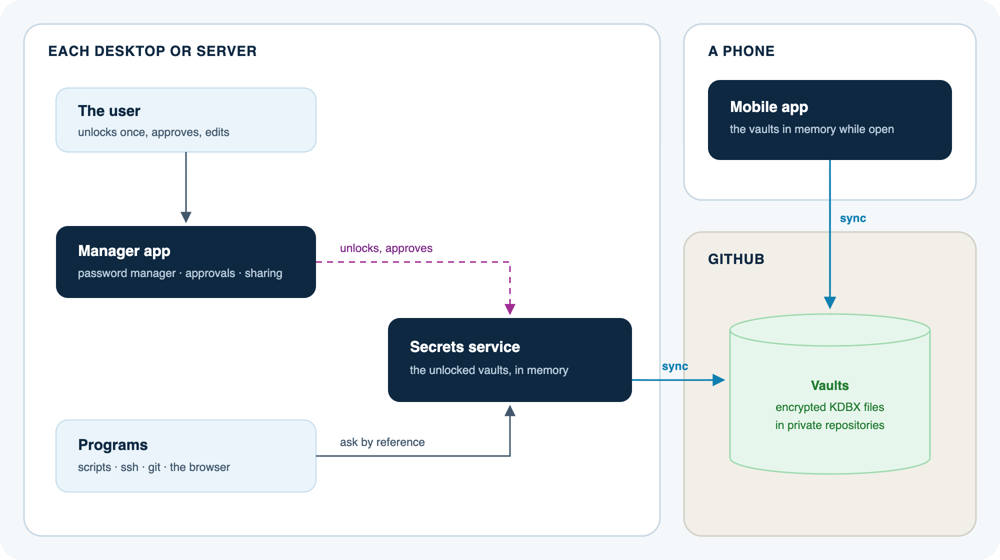

The secrets live in **vaults**: KDBX files, the format of KeePass, so any KeePass app can still open them. Each vault sits in a private GitHub repository (or in a local folder), encrypted before it leaves the machine.

On every desktop and server, one **secrets service** runs for the user. It holds the unlocked vaults in memory and answers the programs on that machine over a local socket. A program asks by a **reference** such as `[env:prod]db.main`; the service checks which program is asking, whether it may have the value, and answers.

The **manager app** is the user's window into all of it: a full password manager, the place where programs are approved, and the tool that pairs machines and shares vaults with other people. On a phone the app opens the vaults itself, since a phone runs no background service.

There is no server of the product's own in this picture. GitHub stores the encrypted files and keeps their history; the devices merge each other's changes entry by entry.

## The components

Every component, where it runs, and what it is for:

| Component | Runs on | What it does |
| --- | --- | --- |
| Secrets service | macOS, Linux, Windows | holds the unlocked vaults, answers programs, decides approvals |
| Desktop app | macOS, Linux, Windows | password manager, approvals, pairing, sharing, keys |
| Mobile app | iOS, iPadOS, Android | password manager on the phone, autofill on Android |
| `tsm` | macOS, Linux, Windows | the command line: read secrets, run commands, set up headless hosts |
| Client libraries | wherever a program runs beside the service | ask the service from Dart, TypeScript, JavaScript, Python, Go, Rust, Java, C and C++ |
| Browser extension and host | Chrome, Edge, Brave, Chromium, Firefox | fills logins and passkeys in web pages |
| Safari extension | macOS | the same in Safari |
| OS integrations | macOS, Android, Windows; the developer tools everywhere | AutoFill, Android Autofill, Windows passkeys, ssh-agent, git, AWS, Docker, kubectl |
| Relay | a server, or GitHub, or a magic-wormhole server | carries pairing, approvals and shares between devices that cannot reach each other |
| Vault repositories | GitHub | store the encrypted vaults and compact their history |

### The secrets service

This diagram shows the service's three local endpoints and what it reaches.

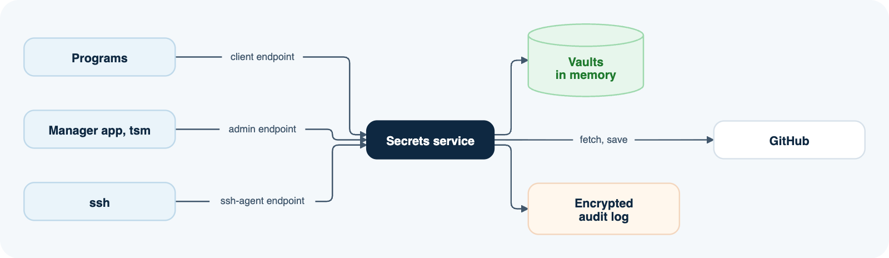

One service runs per user on a desktop or server. It has no window of its own. Programs connect to its **client endpoint**, a Unix socket only the user can open (a localhost port with a per-start token on Windows). The manager app and `tsm` start, unlock and administer it over a second, authenticated **admin endpoint**. A third endpoint is an **ssh-agent**: ssh signs with keys kept in the vaults, without the key ever leaving the service.

The service never takes a program's word for who it is: it asks the operating system which process is on the other end of the socket, and reads that process's executable (or, for a Python or Node.js program, the script it runs). Every value it hands out is written to an encrypted audit log, without the value itself. It locks itself when the user is idle, if the user wants that, and forgets every key when it locks.

### The desktop app

This diagram shows the desktop app between the user, the service and the operating system.

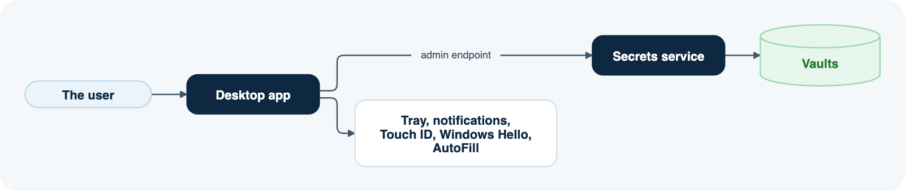

The desktop app is a full password manager: a vault browser, an entry editor with a password generator and one-time codes, typed entries for SSH keys, certificates and PGP keys, imports from 1Password, Enpass, Bitwarden and the browsers, a health report, auto-type and a quick-access popup. It is also where everything else is decided: which program may read which secret, which machines are paired, who shares a vault, when a key is rotated. It holds no vault itself; it edits them through the service, so the service and the app always see the same files. The app is built with Flutter and ships with `tsm` and the service in one archive.

### The mobile app

This diagram shows the phone app opening the vaults itself.

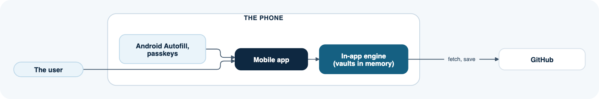

A phone runs no background service, so the mobile app carries the service's engine inside it. At the unlock it fetches the vaults from GitHub and holds them in memory only; at the lock they are gone. While it is open it refreshes them, writes an edit at once, and merges what other devices changed. A phone is set up by pairing with the desktop app, usually by scanning a QR code, and after the first unlock Face ID, Touch ID or the fingerprint opens it. On Android it is also the system's Autofill service and passkey provider. System vaults, the ones meant for programs, are read-only on the phone.

### `tsm`, the command line

This diagram shows `tsm` between a shell or script and the service.

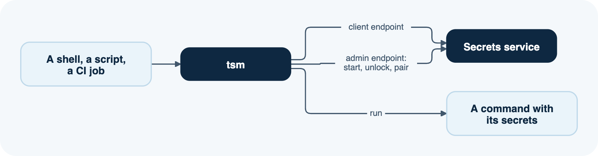

`tsm` is the command line. `tsm get db.main` prints a value; `tsm run --map DB_PASSWORD=db.main -- ./deploy.sh` starts a command with secrets in its environment instead of keeping them in a shell profile. On a server without a screen, `tsm` starts and unlocks the service, pairs the machine with the user's desktop, shows the status and the keys that are due, and handles approvals by code. Under other names it is git's and Docker's credential helper, and it answers AWS's and kubectl's credential requests.

### The client libraries

This diagram shows a program asking the service through a client library.

A program that wants its secrets directly, instead of in its environment, uses a client library: for Dart, TypeScript and JavaScript (one npm package), Python, Go, Rust, Java, C and C++. All of them speak one documented protocol: length-prefixed JSON frames over the local socket, a `get` for one value, a `getMany` for several, a `getFile` for a key file or an attachment. A shared conformance suite runs every library against the same tables of cases, so they behave alike. The libraries keep a value masked when it is printed or logged, and overwrite it when it is closed.

### The browser extension and its host

This diagram shows how a web page's login reaches the vaults, and that the extension never sees anything the user did not choose.

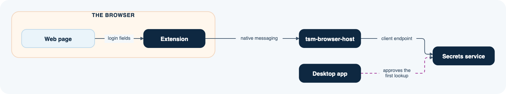

The extension, for the Chromium browsers and Firefox, finds the login fields of a page and puts a small shield in them. A click, a shortcut or the toolbar button opens the page's logins in the extension's own list, drawn where the page cannot read it; nothing is filled by itself. The extension talks to `tsm-browser-host`, a small program the browser starts, which asks the service like any other client: the service decides which logins match the page's site and hands over only the one the user picked. The first time a browser asks, the app asks the user to approve it. When the user signs in with a login the vaults do not hold, or changes a password, the extension offers to save it, and the app takes it as a proposal. The extension also answers a site's passkey requests with passkeys from the vaults. Logins of system vaults never reach a browser.

### Safari

This diagram shows the Safari extension's longer way to the service.

Safari runs extensions only inside a signed app. The same extension code is built for Safari and shipped inside the macOS app, whose native handler starts the browser host. Both are sandboxed, so the service also offers its client socket in the app's shared container, where they may reach it. Passkeys in Safari go through the macOS AutoFill provider instead.

### The OS integrations

This diagram shows the developer tools that ask the service.

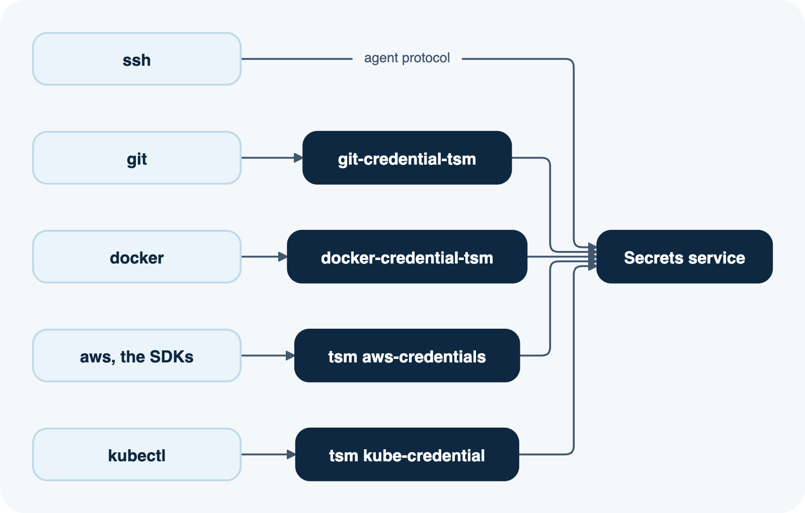

The developer tools already have ways to ask for credentials, and the product answers each of them. The service is an **ssh-agent**: ssh signs with the vaults' SSH keys, per destination host, and a forwarded agent gets a key only when the user allowed forwarding. `tsm` is **git**'s and **Docker**'s credential helper, **AWS**'s `credential_process` and **kubectl**'s exec plugin. `tsm integrations` and the app's settings write the lines these tools need into their configuration files.

This diagram shows the operating systems' own autofill and passkey dialogs.

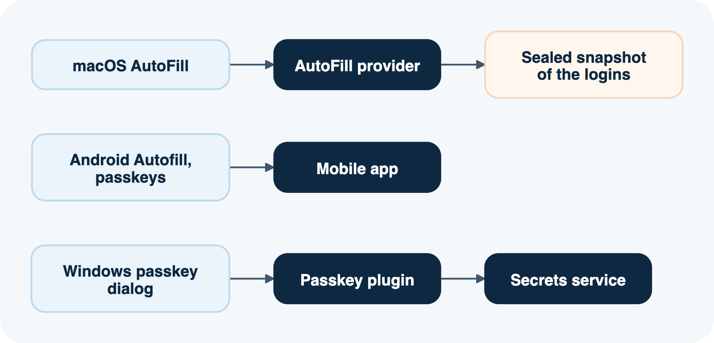

On **macOS** an AutoFill provider fills logins, one-time codes and passkeys in every app. It reads a snapshot the desktop app writes after each unlock, sealed under a key the keychain releases only to Touch ID (or the login password on a Mac without it), and never sees a system vault. On **Android** the mobile app is the Autofill service and the passkey provider. On **Windows 11** a passkey plugin answers Windows' own passkey dialog, in any browser or app, by asking the service to sign; the key never leaves the service.

### The relay

This diagram shows a relay between two devices that cannot reach each other.

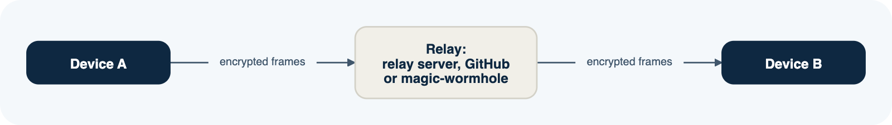

Most of the time the user's devices find each other on the same network or over a VPN. When they cannot, a **relay** carries what they send: a pairing, the approval link, a share for another person. Everything it carries is encrypted end to end, so the relay learns only that two devices talked. The product has its own relay server, which anyone can host; a GitHub repository the devices can both reach serves as one too, and so does a public magic-wormhole server, for pairing only.

### The vault repositories

This diagram shows what a vault repository holds and who writes it.

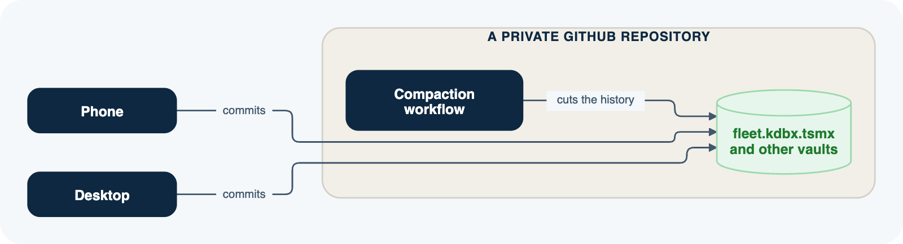

A vault repository is an ordinary private GitHub repository. The devices read and commit through GitHub's REST API, without a clone. Every save is a commit, so the history is a backup; but the history also keeps old states of the vaults, encrypted under old keys. A small workflow in each vault repository therefore cuts the history at the retention the user chose (90 days by default), and the app cuts it at once after every key change, so an old key cannot open anything that is still kept. The workflow holds no key: it only rewrites commits.

## How a program gets a secret

This diagram shows a program's first request for a secret no grant covers yet, approved once and then for good.

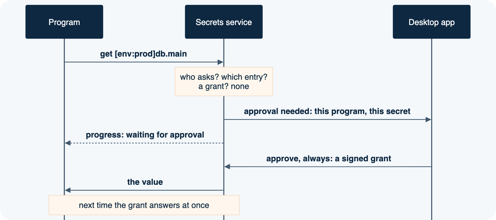

A **reference** names a secret: a path (`fleet/Cloud/AWS/root`), an entry's flat key (`db.main`) or its id, a field (`#UserName`; the password by default) and, in brackets, the values of dimensions such as the environment (`[env:prod]`). The program sends it and waits; it never sees the vault.

The service first measures who is asking: the executable, or the script and its interpreter. Then it resolves the reference to one entry and looks for a **grant**: a signed line in the primary vault that says "this program may read this secret (or this vault, or everything) on this host". If none answers, it asks the user's approvers: the desktop app on this machine, and, for a server without a screen, the desktop app of a paired machine over the approval link. The user sees the program and the secret, and allows it once, always, or for a folder, or refuses it. A lasting answer is written as a new grant, signed by the approving device's key, so it holds on the next request and survives restarts.

With no approver within reach, the request shows an **approval code** that a trusted device can answer. A request that nobody answers ends with a refusal, never with a value.

The [flows](https://github.com/al-the-bear/tom_secrets_manager/blob/main/doc/flows.md#a-clients-get) show every variant step by step.

## How a person uses it

This diagram shows the ways a person reaches the same vaults.

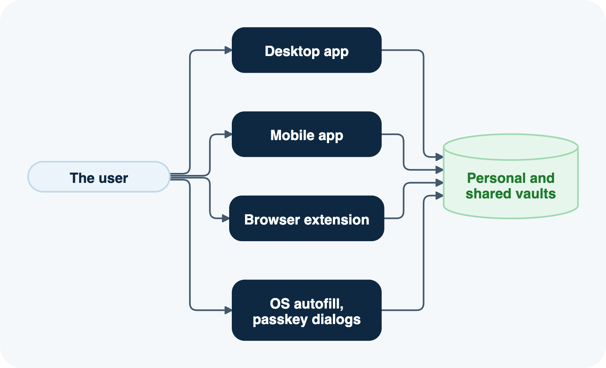

For a person, Tom Secrets Manager is a password manager. On the desktop the app browses and edits the vaults, generates passwords, shows one-time codes, types a login into any window, and warns about weak, reused, old or breached passwords; a breach check sends only the first characters of a password's hash to Have I Been Pwned. On the phone the same screens work in a phone or tablet layout. In the browser the extension fills logins, suggests new passwords and offers to save new ones. Where the operating system has its own autofill or passkey dialog, the product answers it.

Passkeys are kept in the login of their site, in the fields KeePassXC uses, so they are in the same vaults, synced and backed up like everything else.

## Vaults and environments

A vault has a **kind**. A **personal** vault holds one person's secrets; a **shared** vault is shared with other people; a **system** vault holds the secrets of programs, which never reach a browser or an autofill dialog and which the phone does not edit.

One vault is the **primary**. It lists every other vault with its keys, and holds the grants, the paired devices and the shared configuration. Unlocking the primary with the master password opens everything else.

The shared configuration declares the **dimensions** a value may depend on: the built-in `host`, `platform` and `env`, and any the user adds. A group named `@env:prod` or `@host:build-01` in a vault is an **overlay**: every entry below it holds only for that value. One logical path can so hold a value per environment and per machine.

This diagram shows how the service picks the value for `fleet/Db/main`, asked with `env` set to `prod` on the host `build-01`.

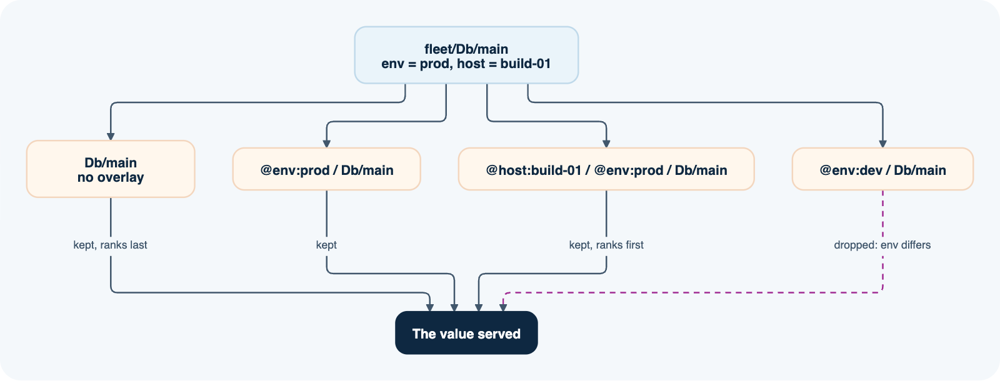

Every entry at that logical path is a candidate. A candidate bound to another value of a dimension is dropped. The others are ranked dimension by dimension, in the configured order (host before platform before environment): bound to the asked value beats bound to the default, which beats unbound. The best one serves the request. When two rank equal, the service refuses the request as ambiguous rather than guess; the app's overlay editor shows each step for any host, platform and environment.

## Machines and people

### Pairing a new device

A new machine joins by **pairing** with one the user already has. The giving side opens a pairing window and shows a short code such as `7-guitar-orbit`; the user types it on the new machine (or a phone scans it as a QR code). The two run SPAKE2, a password-authenticated key exchange, with a post-quantum ML-KEM-768 exchange inside it, so the short code is enough and an eavesdropper learns nothing. The giving side then sends a bundle: the vaults, their keys, the tokens and the public keys of the approvers. The new device is recorded in the primary vault. The window closes after five minutes.

This diagram shows pairing on the same network, where the code finds the other device by itself.

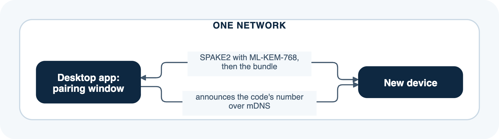

This diagram shows pairing over a VPN, where the user types the giving side's address.

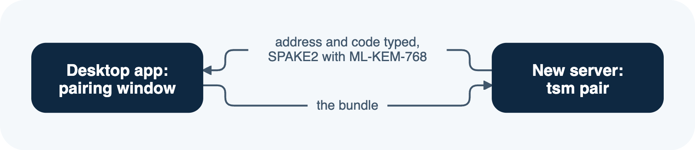

This diagram shows pairing through a relay, for devices with no way to each other.

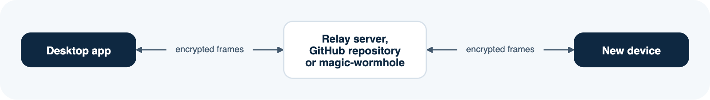

The relay carries the same exchange, frame by frame, and sees only encrypted bytes. The code's number names the slot on the relay; the relay itself is chosen on both sides, or read from the QR code.

Each route is drawn step by step in the [flows](https://github.com/al-the-bear/tom_secrets_manager/blob/main/doc/flows.md#pairing-a-new-device).

### The approval link

This diagram shows a server's approval prompt reaching the user's desktop.

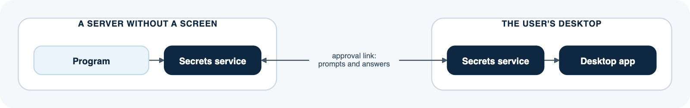

Paired machines keep an **approval link**: while the user's desktop is unlocked, its service holds an encrypted connection to every paired host it approves for, directly or through a relay server. When a program on a server asks for a secret no grant covers, the prompt appears in the desktop app, and the answer goes back the same way. The link is a Noise KK handshake, which both sides authenticate with keys exchanged at pairing, with an ML-KEM-768 exchange beside every Diffie-Hellman.

### Sharing with other people

This diagram shows a shared vault and the file that lets each member open it.

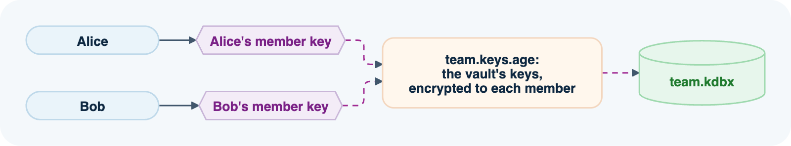

Each person has a **member key**, a hybrid `age` key (X25519 and ML-KEM-768) kept in their primary vault, and shares its public half as text, a file or a QR code. A **shared vault** keeps its keys in a recipients file beside it, encrypted to every member's key; the standard `age` tool can open it too. Adding a member writes that file again; removing one re-keys the vault and offers to rotate the secrets they saw.

A single entry can be shared without a shared vault: as an encrypted **share** for chosen members, or under a passphrase, handed over as text, a QR code, a file, or dropped into the member's inbox folder of a shared vault or a relay server's mailbox, where it expires after 30 days.

## Security in brief

This diagram shows the layers around a vault as it lies on GitHub.

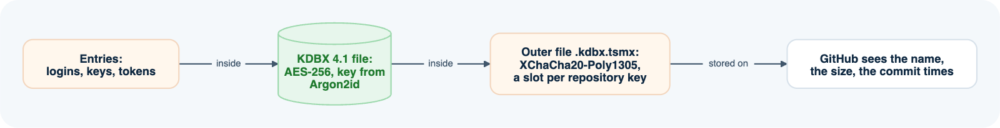

A vault is a KDBX 4.1 file. Its key comes from the master password (and a key file, if the vault has one) through Argon2id with 64 MiB and 3 iterations, so each guess at the password costs an attacker real work. A vault in a repository can also be wrapped in an **outer** encryption: one random file key, wrapped under each repository key in its own slot, so GitHub and anyone with access to the repository see only an encrypted blob.

This diagram shows who holds which key.

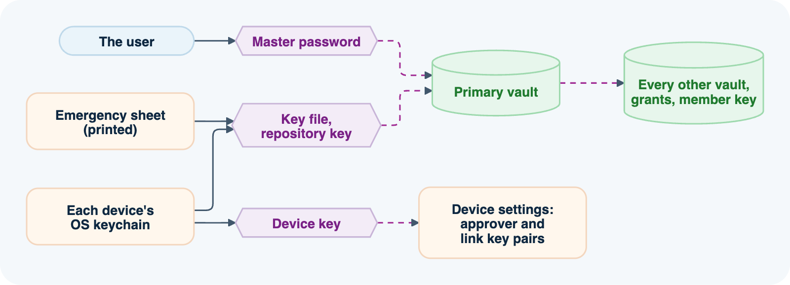

The **master password** is only in the user's head; the app can keep the primary's unlocked key behind Touch ID or Windows Hello, never the password itself. The **key files** and **repository keys** are in each device's OS keychain and on a printed **emergency sheet** as QR codes. Each device has its own key pairs for approving and for the approval link, kept in its device settings under a key in the keychain, and never synced. The primary vault holds the keys of every other vault, so one unlock opens them all.

**Post-quantum from the start.** Everything that travels between devices and could be recorded today is protected against a future quantum computer: pairing, the approval link and member keys use ML-KEM-768 beside the classical exchange, and grants are signed with both Ed25519 and ML-DSA-65. The reason is "harvest now, decrypt later": a pairing bundle carries vault keys, and someone who records it now must not be able to read it in ten years. The vault files themselves use symmetric ciphers with 256-bit keys, which a quantum computer does not break. What lies outside the product stays classical: GitHub's TLS, SSH keys and passkeys, whose algorithms the servers choose.

**What it does not protect against.** The product protects the vaults at rest, on GitHub and in transit, and decides which program reads which secret. It cannot protect against:

- someone with administrator rights on an unlocked machine, or code running inside a program the user approved;
- a keylogger that catches the master password;
- a lost master password together with a lost emergency sheet: the vaults cannot be opened again;
- what GitHub sees around the files: their names, sizes and commit times.

The [security model](https://github.com/al-the-bear/tom_secrets_manager/blob/main/doc/security.md) treats every layer, every key, the trust between programs and machines, and the threat model in depth.

## Sync without a server

This diagram shows a save that meets another device's change on GitHub.

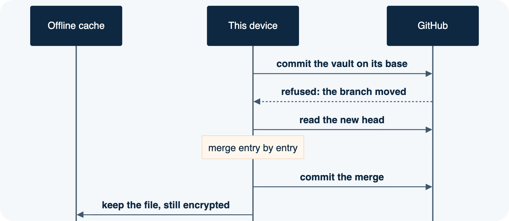

The devices never talk to a server of the product's own to sync: GitHub is the store. A save is a commit on top of the version the device last read. When another device saved first, the device reads the new version, merges the two **entry by entry** and commits again. A field only one side changed takes that side; a real conflict keeps the newer value, puts the other into the entry's history and shows it in the app's Conflicts view until the user settles it.

Each desktop keeps the last file it fetched of every vault, still encrypted, in an **offline cache**, so the vaults open without a network; an edit waits until GitHub is back (a desktop saves nothing to an offline copy, the phone keeps the edit in memory and writes it then). The service refreshes the vaults every five minutes by default, at the cost of one small request when nothing moved. The **history compaction** keeps the repository from holding old keys' files forever; a history that was rewritten any other way is shown to the user, who decides which side wins.

The [flows](https://github.com/al-the-bear/tom_secrets_manager/blob/main/doc/flows.md#sync) show the refresh, a save, the offline cache, a conflict, the compaction and the force-push question step by step.

## Open source and licences

Every package of the product is open source under the BSD 3-Clause licence, in three public repositories: the core, the service and the `age` format; the apps, the browser extension and the relay; the protocol and the client libraries. No GPL-licensed package is in the dependency closure of any of them, and the build checks this for every package and every language. The KDBX layer it builds on and the post-quantum package `tom_pqc` (ML-KEM-768, ML-DSA-65 and their hybrids, over vendored C code tested against the official vectors) are BSD-3 as well.

The Dart packages are on pub.dev: `tom_secrets_client`, `tom_secrets_tsm` (`tsm`), `tom_secrets_core`, `tom_secrets_age`, `tom_secrets_service` and `tom_pqc`. The Go client is a Go module, the C and C++ clients are fetched as source by CMake, and the npm, Python, Rust and Java clients are built and checked for their registries.

## Where it stands and what comes next

The product was built in three phases, and all three are implemented:

- **Phase A, the fleet:** the user's desktops and servers share their secrets through GitHub, pair over the network and approve each other's programs; the vault format, the protocol, the service, the desktop app, `tsm`, the Dart and TypeScript clients, the offline cache and the compaction, and the post-quantum package.
- **Phase B, password-manager comfort:** the mobile app, the browser extension, the macOS AutoFill provider and Android Autofill, the OS unlock, GitHub sign-in, SSH keys with the ssh-agent, git's credential helper, auto-type, the health report, more imports and exports, and the client libraries for Python, Go, Rust, Java, C and C++.
- **Phase C, sharing between people:** member keys, shared vaults, rotation with a migration period, single-entry shares, certificates and PGP keys, the relays, the AWS, Docker and kubectl helpers, passkeys everywhere, and Safari.

The macOS build is released. What comes next is finishing: the live checks on real devices and browsers, the Windows and Linux releases, the team-signed macOS build that embeds the AutoFill provider and the Safari extension, the browser stores, the remaining package registries, and moving the user's own passwords over from the commercial password managers.

## Where to go next

- [The configuration reference](https://github.com/al-the-bear/tom_secrets_manager/blob/main/doc/configuration.md): every file, setting, field and environment variable.
- [The flows](https://github.com/al-the-bear/tom_secrets_manager/blob/main/doc/flows.md): every flow of the product step by step, with its failures.
- [The security model](https://github.com/al-the-bear/tom_secrets_manager/blob/main/doc/security.md): the encryption layers, every key and its lifecycle, trust, and the threat model.
- [The architecture](https://github.com/al-the-bear/tom_secrets_manager/blob/main/doc/architecture.md): the repositories, the packages and the main types inside each component, for a developer.
- [The documentation index](https://github.com/al-the-bear/tom_secrets_manager/blob/main/doc/README.md): every document about the whole product, and how they are made.
- [The protocol document](https://github.com/al-the-bear/tom_secrets_clients/blob/main/protocol/protocol.md): the wire format, references, approvals and grants.
- [The desktop app's user guide](https://github.com/al-the-bear/tom_app_secrets_manager/blob/main/tom_secrets_app/doc/user_guide.md).
- [The mobile app's user guide](https://github.com/al-the-bear/tom_app_secrets_manager/blob/main/tom_secrets_mobile/doc/user_guide.md).
- [The `tsm` user guide](https://github.com/al-the-bear/tom_secrets_clients/blob/main/clients/dart/tsm/doc/tsm_user_guide.md).
- [The core library](https://github.com/al-the-bear/tom_secrets_manager/blob/main/tom_secrets_core/README.md) and [the service](https://github.com/al-the-bear/tom_secrets_manager/blob/main/tom_secrets_service/README.md).

## Glossary

| Term | Meaning |
| --- | --- |
| Approval code | A short code a waiting request shows when no approver is within reach; a trusted device answers it |
| Approval link | The encrypted connection over which a paired desktop approves a server's requests |
| Approval token | What a trusted device turns an approval code into; the waiting machine redeems it once |
| Approver | A device whose app may answer approval prompts, recorded at pairing |
| Desktop app | The manager app on macOS, Windows and Linux; the guides also call it the manager app |
| Dimension | Something a value may depend on: `host`, `platform`, `env` or one the user declares |
| Emergency sheet | A printout of a vault's keys (as QR codes) and a blank line for its master password |
| Grant | A signed line in the primary vault allowing (or refusing) a program a secret on a host |
| Inbox, mailbox | Where a share waits for its member: an inbox folder beside a shared vault, or a mailbox on a relay server |
| Key file | A KeePass key file that adds to the master password |
| Member key | A person's hybrid `age` key, to which shared vaults and shares are encrypted |
| Overlay | A group named `@<dimension>:<value>` whose entries hold only for that value |
| Pairing | Joining a new device to the user's devices with a short code |
| Primary | The vault that lists every other vault with its keys, the grants and the devices |
| Reference | The name a program asks by: a path, a flat key or an id, a field and dimension values |
| Relay | A server, a GitHub repository or a magic-wormhole server that carries encrypted traffic between devices |
| Repository key | The key of a vault's outer encryption |
| Secrets service | The background program on each desktop and server that holds the unlocked vaults |
| Share | Chosen entries encrypted for chosen members or a passphrase |
| Store | A vault as the service serves it, by its name (`team` in `team/Api/Token`) |
| Vault | A KDBX file of secrets: personal, shared or system |
