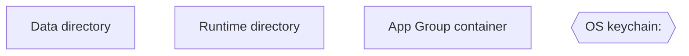

# The configuration reference

Everything that configures Tom Secrets Manager, in one place: where its
files are, every key of every configuration file, every setting, every
field the vaults carry, every environment variable, the files the
integrations write, and the build's settings. Each entry names its type,
its default, where it is set and which component reads it.

The reference is complete by construction: `ci.sh :docs` runs
`tom_secrets_build/tool/check_configuration.mjs`, which collects every
environment variable, setting key, preference key and `tsm.*` field name the
code reads and fails when one is missing here.

## Where things are

This diagram shows a desktop's folders and what each holds.



<!-- diagram 1-folders

-->

The data directory holds what lasts; the runtime directory exists only
while the service runs and is the user's alone; the App Group container is
where the sandboxed macOS extensions reach the service; the keychain holds
every key and token.

### The data directory

| OS | Path |
| --- | --- |
| macOS | `$HOME/Library/Application Support/TomSecretsManager` |
| Windows | `%LOCALAPPDATA%\TomSecretsManager` |
| Linux | `$XDG_DATA_HOME/tom-secrets-manager`, else `$HOME/.local/share/tom-secrets-manager` |

`TSM_DATA_DIR` overrides it. The service takes the folder of the
`bootstrap.yaml` it starts with as its data directory. Read by
`tomSecretsDataDirectory` (`tom_secrets_client`'s admin library), used by the
app and `tsm`.

It is the user's alone: the First run, `tsm pair`, the app and every start
of the service make it mode 0700 (on Windows, the inheritance cut and only
the user and SYSTEM), the service's files are written 0600 (umask 077), and
a start tightens a looser folder and everything in it (logged as
`data_directory_tightened`). A data directory another user owns stops the
start (exit code 8). A cache directory set outside it is treated the same
way.

| File | Holds | Written by |
| --- | --- | --- |
| `bootstrap.yaml` | the service's start configuration (below) | the First run, `tsm pair`, the service |
| `device-settings.kdbx` | the device settings and trust material (KDBX) | the service |
| `device-settings.kdbx.key` | the container's key in key-file mode (mode 0600) | the service |
| `service-identity.json` | the service's identity key (mode 0600): the secret key, the public key, when it was made, and the statements of the keys it replaced | the service, at its first start; the First run and `tsm pair` when the machine is set up by pairing |
| `cache/` | the offline cache, while `offlineCache` is on: `<owner>/<repository>/<path>` and `<path>.tsm-cache.json` beside each file (locator, head, blob id, fetch time) | the service |
| `audit/<yyyy-mm-dd>.log` | the audit log, one encrypted record per line, kept 90 days | the service |
| `service.log`, `service.log.1` to `.3` | the operational log, rotated at 1 MiB | the service |
| `agent_keys.json` | the public keys the ssh-agent lists while locked | the service |
| `app-preferences.json` | the desktop app's preferences (below) | the app |

`service-identity.json` is what the app and `tsm` know the service by
(protocol.md 6.1). Keep it with the data directory when you move or restore
one; a service that starts without it makes a new key, and every program
that pinned the old one then refuses it (`service_key_changed`).

### The pins

The app and `tsm` keep the identity keys of the services they know in one
file, `services`, in the product's configuration directory:

| OS | Path |
| --- | --- |
| Linux, macOS | `$XDG_CONFIG_HOME/tsm/services`, else `~/.config/tsm/services` |
| Windows | `%APPDATA%\tsm\services` |

`TSM_CONFIG_DIR` overrides the directory. The file is JSON, the user's
alone (mode 0600 in a 0700 directory): `{"version": 1, "services":
[{"host", "runtime"?, "key", "source", "at"}]}`. `host` is the machine's
name, `runtime` the runtime directory the service answers in (none: that
host's service wherever it answers, a pin from a device record), `key` the
public key in base64, `source` how the pin came to be (`start`, `pairing`,
`trust`, `rotation`). `tsm trust --list` shows it; `tsm trust --remove`
removes this machine's pin.

### The runtime directory

| OS | Path |
| --- | --- |
| macOS | `$TMPDIR/tsm` |
| Linux | `$XDG_RUNTIME_DIR/tsm` |
| macOS and Linux, without either | `/tmp/tsm-<uid>` |
| Windows | `%LOCALAPPDATA%\TomSecretsManager\run`, else `%USERPROFILE%\AppData\Local\TomSecretsManager\run` |

`TSM_RUNTIME_DIR` overrides it for the service and every client; the
service's `runtime_dir` in `bootstrap.yaml` overrides it for the service. It
is made mode 0700 (on Windows, the user and SYSTEM only), and the service
refuses to start in one that another user owns or others can read.

| File | Holds |
| --- | --- |
| `service.lock` | the single-instance lock, released when the service ends |
| `service.json` | `pid`, `start`, `protocol`, and the endpoints `client`, `admin`, `agent` (each `{socket}`, `{port}` or `{pipe}`) |
| `client.sock`, `admin.sock`, `agent.sock` | the endpoints on macOS and Linux |
| `client.port`, `client.token`, `admin.port` | the endpoints on Windows: localhost ports and the per-start client token |

On Windows the ssh-agent is the named pipe `\\.\pipe\tsm-ssh-agent`.

### The App Group container (macOS)

When the service runs from the team-signed app's `tsm/bin` folder and the
app's `Info.plist` names a group (`TSMAppGroup`), the service also offers its
client endpoint at `~/Library/Group Containers/<group>/tsm/client.sock`. The
AutoFill provider's files are there too:
`TomSecretsAutofill/snapshot.tsmaf` and
`TomSecretsAutofill/pending-passkeys.tsmaf`. The group's name comes from the
build (`TSM_APP_GROUP`, below); a group starting with `.` (no team) counts as
none.

### The keychain

The desktop keychain items use the service name `tom-secrets-manager` (the
macOS login keychain, the Secret Service on Linux, the Windows Credential
Manager).

| Item | Holds | Written and read by |
| --- | --- | --- |
| `tsm.key-file.<id>` | a vault's key file; `<id>` is the first 16 hex digits of SHA-256 over the vault's identity | the First run, the service |
| `tsm.repository-key.<id>` | a repository key (a vault's outer encryption) | the First run, the service |
| `tsm.key-file.<id>.next`, `tsm.repository-key.<id>.next` | the next keys of a rotation | the service |
| `tsm.device-settings.<host>` | the device settings container's key (keychain mode) | the service |
| `tsm.admin.<serviceStart>`, `tsm.admin.index` | the admin key of each service start, and the list of starts | the app, `tsm` |
| `tsm.github-token.<owner>:<repo>`, `tsm.github-token-expiry.<owner>:<repo>` | a pasted GitHub token and its expiry (ISO 8601) | the First run, the service |
| `tsm.github-app.session` | the GitHub App's access and refresh tokens | the service |
| `tsm.relay-token.<relay>` | a relay server's instance token (`<relay>` base64url, unpadded) | the service |

The OS unlock keeps `tom_secrets.os_unlock.<store>` in the store Touch ID or
Windows Hello guards. The macOS AutoFill provider's keys are the items
`snapshot-key` and `pending-key` of the service `tom.secrets.autofill`, in the
AutoFill keychain group. On a phone each handle is kept as `tsm_<base64url of
the handle>` in the iOS keychain or an Android Keystore-encrypted file.

## `bootstrap.yaml`

Plain text, no secret: the only configuration the service reads before it
is unlocked. Read by `TomSecretsBootstrap` (`tom_secrets_service`). Every
value is a non-empty string, except `admin_executables`.

| Key | Type | Default | Meaning |
| --- | --- | --- | --- |
| `primary` | locator | required | the primary vault: `file:<path>` or `github:<owner>/<repository>/<path>` |
| `cache_dir` | path | `<data>/cache` | the offline cache (used while `offlineCache` is on) |
| `runtime_dir` | path | the OS's runtime directory | where the endpoints are |
| `device_key` | `auto`, `keychain`, `vault`, `keyfile` | `auto` | where the device settings container's key is kept |
| `device_container` | path | `<data>/device-settings.kdbx` | the device settings container |
| `host` | string | the OS host name | this machine's name (grants, overlays) |
| `log_level` | `info`, `debug` | `info` | the operational log's level |
| `admin_executables` | list of paths | none | further executables that may administer the service |

The device key modes: `keychain` refuses to start without a keychain;
`vault` keeps the key in the primary's entry `@host:<host>/.tom-secrets/device`;
`keyfile` keeps it in `<container>.key` (mode 0600); `auto` takes the
keychain where one answers, else the vault.

```yaml
primary: github:example-org/vaults/primary.kdbx.tsmx
device_key: auto
host: workstation1
log_level: info
```

## The device settings

Kept per machine, never synced, in the device settings container. The app's
Settings screen reads and writes them with the admin requests `settings.get`
and `settings.set`; a value applies at once where it can, the rest at the
next unlock. Read by `TomSecretsDeviceSettings` (`tom_secrets_core`).

| Setting | Type | Default | Meaning |
| --- | --- | --- | --- |
| `serviceLock` | lock policy | `idle`, 30 minutes | when the service locks itself |
| `appLock` | lock policy | `idle`, 10 minutes | when the app locks its window |
| `defaultEnvironment` | string | none | this machine's default `env` value |
| `servedStores` | list of store names | every store | the vaults this machine serves |
| `refreshMinutes` | int, 0 or more | 5 | the refresh interval; 0 switches the timer off |
| `offlineCache` | bool | `false` | whether fetched files are also kept on the disk, so the service starts without GitHub; off, the vaults are in memory only and a save GitHub cannot take waits in memory; turning it off overwrites and deletes the files |
| `memoryOnlyApplied` | bool | `true` | set once the in-memory default was applied; settings stored without it take it at the next unlock (the cache turned off and deleted) |
| `keyExpiryWarningDays` | int | 14 | days before a GitHub token's expiry the reminders start |
| `approvalTimeoutSeconds` | int | 60 | how long a request waits for an unlock or an approval |
| `codeTimeoutSeconds` | int | 300 | how long an approval code is valid |
| `approvalLink` | `address:port` | no link | where this host's approval link listens (a VPN or LAN address, never all interfaces) |
| `otherKeyWarningDays` | int | 30 | days before its due date the reminders of every other key start |
| `keyPairAgeMonths` | int | 24 | rotation age of the approver and approval-link key pairs |
| `primaryKeyAgeMonths` | int | 24 | rotation age a new key file or repository key of the primary gets |
| `vaultKeyAgeMonths` | int | 12 | rotation age a new key file or repository key of every other vault gets |
| `memberKeyAgeMonths` | int | 24 | rotation age of the member key |

A lock policy holds:

| Key | Type | Default | Meaning |
| --- | --- | --- | --- |
| `mode` | `never`, `idle`, `osUnlock` | `idle` | (a) never relock; (b) relock after the idle time; (c) relock when idle or at the screen lock, unlock with Touch ID or Windows Hello |
| `idleSeconds` | int | 1800 (service), 600 (app) | the input idle time |
| `maxUnlockedSeconds` | int | off | the longest unlocked time, whatever the input |
| `lockOnSleep` | bool | `false` | the app locks the service when the system sleeps |

```json
{
  "serviceLock": {"mode": "osUnlock", "idleSeconds": 900, "lockOnSleep": true},
  "refreshMinutes": 5,
  "approvalLink": "10.8.0.2:47901"
}
```

## The shared configuration `tsm.config`

YAML in the primary vault's metadata entry (`tsm.config`), the same on every
device. Read by `TomSecretsConfig` (`tom_secrets_core`).

| Key | Type | Default | Meaning |
| --- | --- | --- | --- |
| `dimensions` | list | `host`, `platform`, `env` | the dimensions a value may depend on, in priority order |
| `dimensions[].name` | `[a-z][a-z0-9_-]*` | required | the dimension's name; the built-ins not listed come first |
| `dimensions[].default` | string | none | its default value (`platform` takes `macos`, `linux`, `windows`, `ios`, `android` or `default`) |
| `dimensions[].fallback_to_default` | bool | `false` | an entry bound to the default value still serves when no value matches |
| `stores` | map of environment to list | none | the vaults each environment uses |
| `stores.<env>[].name` | `[a-z0-9][a-z0-9_-]*` | required | the store's name |
| `stores.<env>[].path` | path | — | a local file |
| `stores.<env>[].github` | `{repository, path}` | — | a file in a GitHub repository (one of `path` and `github`) |

The value `default` is reserved.

```yaml
dimensions:
  - name: env
    default: dev
    fallback_to_default: true
  - name: region
stores:
  prod:
    - name: fleet
      github: {repository: example-org/vault, path: fleet.kdbx.tsmx}
  dev:
    - name: dev
      path: /srv/tsm/dev.kdbx
```

## Entry and vault metadata

### Fields the user sets on an entry

| Field | Values | Default | Read by |
| --- | --- | --- | --- |
| `tsm.key` | a dotted flat key, `telegram.bot_token` | none | the resolver: a reference may name the entry by it |
| `tsm.type` | `login`, `api-token`, `note`, `ssh-key`, `certificate`, `pgp-key`, `member-key`, `member` | `login` | the app, the ssh-agent, `getFile` |
| `tsm.urlMatch` | `domain`, `host`, `exact`, `never` | `domain` | login matching (browser, autofill, helpers) |
| `tsm.breachCheck` | `off` | checked | the health report's breach check |
| `KP2A_URL`, `KP2A_URL_1`, ... | URLs | none | login matching: further addresses of the login |
| `KeeAgent.settings` | an attachment | none | the ssh-agent: which attachment is the key, whether each use is confirmed |
| `otp`, `OTPAuth`, `TimeOtp-Secret-Base32`, `TimeOtp-Length`, `TimeOtp-Period`, `TimeOtp-Algorithm` | TOTP | none | the one-time code, in KeePassXC's, AuthPass's or KeePass's form |
| `KPEX_PASSKEY_RELYING_PARTY`, `_CREDENTIAL_ID`, `_PRIVATE_KEY_PEM`, `_USER_HANDLE`, `_USERNAME` | a passkey | none | the passkey providers; never served to a client |

Tags: `favorite`, and `rotate` (with Expires today), which the app sets on a
shared vault's entries after a member left. Expires carries an API token's
or a typed key's expiry.

### The vault's metadata entry

Every vault has a metadata entry, `.tom-secrets`, in its root group.

| Field | Values | Meaning |
| --- | --- | --- |
| `tsm.format` | `1` | the metadata's format |
| `tsm.store` | `[a-z0-9][a-z0-9_-]*` | the store's name |
| `tsm.kind` | `personal`, `shared`, `system` | the vault's kind (default `personal`) |
| `tsm.purpose` | text | what the vault is for |
| `tsm.dimensions` | `env=prod;region=eu` | a binding for the whole file |
| `tsm.config` | YAML | the shared configuration (primary only) |
| `tsm.keys-due` | ISO 8601 date | when the primary's keys are due |
| `tsm.ssh-confirm` | `true` | every use of this vault's SSH keys is confirmed |
| `tsm.github-app-client-id` | the App's client id | GitHub sign-in (primary only) |
| `tsm.mailbox-relay` | `github:<owner>/<repo>` or `tsm:<url>` | where a shared vault's shares go |

### What the product writes itself

| Where | Fields | Meaning |
| --- | --- | --- |
| The file's custom data | `tsm.format` (`1.0`) | the product's format version |
| An entry's custom data | `tsm.conflict` | an unsettled merge conflict |
| An imported entry | `tsm.import.<source>.id` (also `.updated`, `.imported`, `.category`) | matching on a later import |
| `.tom-secrets/vaults` (primary) | `tsm.locator`, `tsm.outer-key`, `tsm.github-token`, `tsm.github-token-expires`, `tsm.next-password`, `tsm.next-outer-key`, `tsm.previous-outer-key`; attachments `keyfile`, `next-keyfile` | every further vault and its keys, with a rotation's next and previous keys |
| `.tom-secrets/next-keys` (primary) | the primary's own next keys | a guided rotation of the primary |
| `.tom-secrets/devices` (primary) | `tsm.platform`, `tsm.paired`, `tsm.paired-by`, `tsm.key-ids`, `tsm.approver-key-id`, `tsm.link-key-since`, `tsm.approver-key-since`, `tsm.revoked`, `tsm.github-auth` (`app`, `token`), `tsm.github-token-expires`, `tsm.service-key` (the public identity key of the device's secrets service, base64) | the device records |
| `.tom-secrets/rotations` | `tsm.rotation.kind`, `tsm.rotation.target`, `tsm.rotation.old-key-id`, `tsm.rotation.new-key-id`, `tsm.rotation.started`, `tsm.rotation.switched`, `tsm.rotation.ends`, `tsm.rotation.by`, `tsm.rotation.pending` | the rotation records (kinds `member-key`, `shared-vault`, `vault-keys`, `repository-key`) |
| `tsm.grants/<host>` (primary) | `tsm.kind`, the signatures, `lastUsed` | the grants of each host |
| `tsm.sharing` (primary) | the `member-key` entry; `member` entries with `tsm.recipient`, `tsm.fingerprint`, `tsm.checked` | the member key and the members |
| `@host:<host>/.tom-secrets/device` | the device key (vault mode) | the device settings container's key |

A share is a JSON document of the format `tsm.share`, version 1.

## Environment variables

### Read by the product

| Variable | Read by | Meaning | Default |
| --- | --- | --- | --- |
| `TSM_RUNTIME_DIR` | the service, every client, the app | the runtime directory | the OS's (above) |
| `TSM_DATA_DIR` | the app, `tsm` | the data directory | the OS's (above) |
| `TSM_CONFIG_DIR` | the app, `tsm` | the directory of the pin file | the OS's (above) |
| `TSM_SERVICE` | `tsm`, the app | the service executable to start, and one an admin expects to answer on the admin endpoint (protocol.md 6.0) | `tom_secrets_service` beside `tsm` or in the app's `tsm/bin` |
| `TSM_LOGIN_ITEM` | the desktop app | `off`: a development run; no login item is registered, an old one is removed | on |
| `TSM_RELAY_CONFIG` | the relay server | its configuration file | `config=` argument, else `./relay.yaml` |
| `TSM_NOW` | the compaction script in each vault repository | the clock in epoch seconds, for tests | the current time |
| a name given to `--token-env` | `tsm pair` | the relay's instance token or the GitHub token, by convention `TSM_PAIR_TOKEN` | — |
| `KUBERNETES_EXEC_INFO` | `tsm kube-credential` | the `apiVersion` kubectl asks for | `v1` |

### System variables the product reads

| Variable | Read by | For |
| --- | --- | --- |
| `HOME`, `USERPROFILE` | `tsm`, the app, the service | the home folder: integrations, `~/.ssh/known_hosts`, the data directory |
| `LOCALAPPDATA`, `APPDATA` | the clients, the app | the runtime and data directories, the browser manifests on Windows |
| `USERNAME` | the service, the core | the user-only permissions on Windows |
| `TMPDIR` | the clients, the service | the runtime directory on macOS |
| `XDG_RUNTIME_DIR` | the clients, the service | the runtime directory on Linux |
| `XDG_DATA_HOME` | the app, `tsm` | the data directory on Linux |
| `XDG_CONFIG_HOME` | the desktop app | the autostart entry on Linux (`$XDG_CONFIG_HOME/autostart`) |
| `XDG_SESSION_ID`, `DISPLAY`, `WAYLAND_DISPLAY` | the service | whether a desktop session exists to measure idle time in |
| `XDG_SESSION_TYPE`, `DISPLAY`, `WAYLAND_DISPLAY` | the desktop app | whether auto-type is possible (X11 only) |
| `PATH` | `tsm integrations` | finding git for the credential helper |

### For the build and the tests only

| Variable | Read by | Meaning |
| --- | --- | --- |
| `TSM_ANDROID_SIGNING` | the Android build, `ci.sh :mobile` | the Android signing properties (below) |
| `TSM_WINDOWS_SIGNING` | `ci.ps1 :release` | the Windows signing properties (below) |
| `FLUTTER_ROOT` | `ci.sh`, `ci.ps1`, the screenshot tests | the Flutter SDK; else `flutter` or `dart` on `PATH` |
| `TSM_UPDATE_TRANSCRIPTS`, `TSM_UPDATE_VECTORS`, `TSM_PASSKEY_VECTOR_OUT`, `TSM_LIVE_GITHUB_TOKEN`, `TSM_LIVE_GITHUB_REPO`, `TSM_WORMHOLE_SERVER`, `TSM_WORMHOLE_TWIST` | tests | writing transcripts and vectors, and the live checks against GitHub and a wormhole server |

## The integrations' files

`tsm integrations [install | uninstall] <ssh | git | aws | docker>` and the
app's Settings › Integrations write these. In every file but Docker's, the
product's lines stand between `# >>> tom secrets >>>` and
`# <<< tom secrets <<<`; nothing outside the block changes.

| Integration | File | Block |
| --- | --- | --- |
| ssh | `~/.ssh/config` (at the top) | `Host <patterns>` (default `*`, `--hosts`) and `IdentityAgent <agent endpoint>`; on Windows every backslash doubled |
| git | `~/.gitconfig` (at the end) | `[credential]` with `helper = tsm`; `git-credential-tsm` placed beside `tsm` |
| aws | `~/.aws/config` (at the end) | per profile (`--profile`, `--ref`) `[profile <name>]` (or `[default]`) and `credential_process = <tsm> aws-credentials <reference>` |
| docker | `~/.docker/config.json` | `credHelpers` entries `"<registry>": "tsm"` (`--registry`), or `"credsStore": "tsm"` (`--every-registry`); `docker-credential-tsm` beside `tsm` |

```text
# >>> tom secrets >>>
Host *
  IdentityAgent /run/user/1000/tsm/agent.sock
# <<< tom secrets <<<
```

**The browsers.** The app writes the native-messaging manifest
`net.tom.secrets.json` (`name` `net.tom.secrets`, `type` `stdio`, `path` the
`tsm-browser-host` beside the service; `allowed_origins` for the Chromium
browsers, `allowed_extensions` `tom-secrets@enterprise-flutter.dev` for
Firefox) into each browser's folder:

| OS | Folder |
| --- | --- |
| macOS | `~/Library/Application Support/<browser>/NativeMessagingHosts/` (`Google/Chrome`, `Chromium`, `Microsoft Edge`, `BraveSoftware/Brave-Browser`, `Mozilla`) |
| Linux | `~/.config/<browser>/NativeMessagingHosts/`; Firefox `~/.mozilla/native-messaging-hosts/` |
| Windows | `%LOCALAPPDATA%\TomSecretsManager\NativeMessagingHosts\<browser>\`, named by the registry key `HKCU\Software\<browser>\NativeMessagingHosts\net.tom.secrets` |

**kubectl.** `tsm` writes nothing; the user adds:

```yaml
users:
- name: prod-admin
  user:
    exec:
      apiVersion: client.authentication.k8s.io/v1
      command: tsm
      args: [kube-credential, team/Kube/prod-admin]
      interactiveMode: Never
```

## A Tom server's `secrets.local`

A Tom server that registers `tom_secrets_provider`'s
`TomLocalSecretsProvider.fromConfiguration()` reads its configuration
values written as `secret:local:<reference>#<field>` from the secrets
service, and takes its settings from the `secrets.local` key of the
server's configuration; every one is optional:

| Setting | Meaning | Default |
| --- | --- | --- |
| `clientName` | the name shown in the approval prompt (shown, never trusted) | the executable's name |
| `dimensions` | dimension values sent with every request, for example `{env: prod}` | none |
| `timeoutSeconds` | how long a request may wait for an unlock or an approval; the service caps it | the service's |
| `waitForUnlock` | `false`: a locked service is answered at once (kind `locked`) | `true` |

The service is found as every client finds it (`TSM_RUNTIME_DIR`, else the
OS's runtime directory).

## The relay server's `relay.yaml`

Read by `TomSecretsRelayConfig` (`tom_secrets_relay`) from `config=<path>`,
`TSM_RELAY_CONFIG` or `./relay.yaml`. The top level holds
`tom_core_server`'s keys (`port`, default `47910`; `host`; `logLevel`); the
relay's own keys are under `relay:`.

| Key | Type | Default | Meaning |
| --- | --- | --- | --- |
| `mode` | `token`, `open` | `token` | whether puts and links need an instance token |
| `tokens` | map of name to token | none | the instance tokens, each 16 characters or more |
| `deny`, `allow` | CIDR lists | empty | addresses refused; with `allow` set, only those admitted |
| `trustedProxies` | list | `127.0.0.1`, `::1` | proxies whose `X-Forwarded-For` is believed |
| `storage` | path | `relay-data` | the mailbox and the block list |
| `dos.perSecond`, `dos.perMinute`, `dos.perDay` | int | 10, 120, 2000 | requests per address |
| `dos.blockHours` | list of hours | `[24, 48, 168]` | the blocks; each further one doubles |
| `dos.rememberDays` | int | 90 | how long a block is remembered |
| `pairing.nameplatesPerHour` | int | 10 | nameplates per address |
| `pairing.minutes` | int | 10 | a nameplate's lifetime |
| `pairing.frameBytes`, `pairing.channelBytes` | int | 65536, 1048576 | frame and channel limits |
| `link.perToken` | int | 10 | links per instance token |
| `link.frameBytes` | int | 65536 | the link's frame limit |
| `link.aloneHours` | int | 24 | how long one side waits alone |
| `mailbox.putsPerHour` | int | 30 | puts per instance token (in open mode per address) |
| `mailbox.itemBytes` | int | 1048576 | an item's size limit |
| `mailbox.itemsPerRecipient`, `mailbox.bytesPerRecipient` | int | 200, 52428800 | a recipient's limits |
| `mailbox.maxExpiryDays` | int | 30 | an item's longest life |
| `proof.challengesPerHour` | int | 20 | proof challenges per recipient |
| `proof.minutes` | int | 5 | a proof's lifetime |
| `expiryMinutes` | int | 10 | how often expired items are removed |

```yaml
port: 47910
relay:
  mode: token
  tokens:
    team-a: replace-with-a-long-random-token
  storage: relay-data
  dos:
    perSecond: 10
    perMinute: 120
    perDay: 2000
```

## The build

**`repositories.yaml`.** Optional, beside `tom_secrets_build`: where the
other two repositories are.

| Key | Type | Meaning |
| --- | --- | --- |
| `secrets_manager` | path | the `tom_secrets_manager` clone |
| `secrets_clients` | path | the `tom_secrets_clients` clone |

Without it, the CI looks in the maintainers' workspace layout, then for
side-by-side clones
(`../tom_secrets_manager`, `../tom_secrets_clients`).

**The macOS build settings**, in the app's
`macos/Runner/Configs/Autofill.xcconfig`:

| Setting | Default | Used for |
| --- | --- | --- |
| `TSM_TEAM_ID` | empty | the Apple team; `DEVELOPMENT_TEAM` of every target |
| `TSM_APP_GROUP` | `$(TSM_TEAM_ID).tom.secrets` | the App Group (`TSMAppGroup` in the app's and Safari's `Info.plist`) |
| `TSM_AUTOFILL_APP_GROUP` | `$(TSM_APP_GROUP)` | the AutoFill provider's group |
| `TSM_AUTOFILL_KEYCHAIN_GROUP` | `$(TSM_TEAM_ID).tom.secrets.autofill` | the AutoFill keychain group |

While `TSM_TEAM_ID` is empty the groups start with `.` and count as none.

**Signing.** `TSM_ANDROID_SIGNING` names a properties file with `storeFile`,
`storePassword`, `keyAlias` and `keyPassword`; without it a release build is
signed with the debug key and `ci.sh :mobile` refuses to run.
`TSM_WINDOWS_SIGNING` names a properties file with `certificateFile` (a
PKCS#12 file), `certificatePassword` and `publisher`;
`tom_secrets_build/windows/new_signing_certificate.ps1` makes one. On Windows
the tools are `tsm.exe` and `tom_secrets_service.exe`.

## The apps' own settings

### The mobile app

Kept by the mobile app in its preferences.

| Key | Default | Range | Meaning |
| --- | --- | --- | --- |
| `mobile.refreshMinutes` | 15 | 5 or more (5, 15, 30, 60 offered) | the refresh interval while open |
| `mobile.lockSeconds` | 30 | 0 or more (0, 30, 60, 300 offered) | the lock after going to the background |
| `mobile.clipboardSeconds` | 30 | 15, 30, 60, 120 offered | when a copied value is cleared |
| `mobile.biometric` | on | `off` | the biometric unlock |
| `mobile.primary` | set at setup | — | the primary vault's location |
| `mobile.device` | set at setup | — | this device's name |
| `mobile.tokenExpires` | — | JSON of `owner/repo` to date | the GitHub tokens' expiry, for the reminder two weeks ahead |

### The desktop app's preferences

Kept in `app-preferences.json` in the data directory.

| Key | Default | Meaning |
| --- | --- | --- |
| `window.captureExcluded` | on | the window is excluded from screen capture |
| `loginItem.initialised` | — | the login item was set up once |
| `view.layout` | `list` | the vault browser's `list` or `tree` |
| `view.vaults` | `aware` | vault-aware or `uniform` views |
| `autofill.enabled`, `autofill.quickType` | on | the macOS AutoFill snapshot and its QuickType identities |
| `health.breachCheck` | on | the breach check |
| `health.oldAfterDays` | 365 | when a password counts as old |
| `health.breachRecord` | — | when each password was checked |
| `quickAccess.hotkey`, `autoType.hotkey` | the defaults | the global hotkeys (`off` disables) |
| `osUnlock.items` | — | which vaults the OS unlock keeps |
| `relays.list`, `relays.pairing` | — | the relays and the one used for pairing |
| `reminders.snoozed`, `reminders.notifiedOn` | — | the key reminders' state |
