# The flows

Each of Tom Secrets Manager's flows, step by step: who takes part, which
messages pass in which order, and how it fails. Why a step is safe is the
[security model](security.md)'s subject, and where each part lives is the
[architecture](architecture.md)'s. The order is the code's; the message
names are those of the protocol document:

- [The protocol document](https://github.com/al-the-bear/tom_secrets_clients/blob/main/protocol/protocol.md)

The participants: the **app** (the desktop manager app, or the mobile app),
the **service** (the secrets service of a machine), a **client** (any
program asking through a client library), `tsm`, **GitHub**, and the other
devices.

## First run

The First run wizard sets a machine up. It writes the primary vault itself,
before any service runs, then starts the service and unlocks it.

### A new primary on this disk

This diagram shows a new primary stored as a local file.

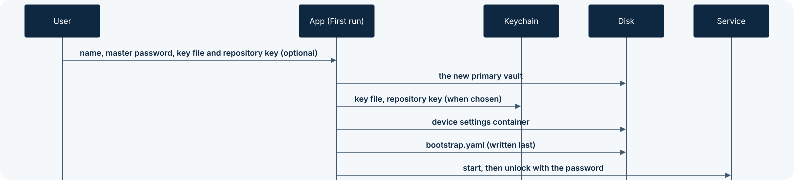

<!-- diagram 1-first-run-local
```mermaid
sequenceDiagram
  participant U as User
  participant A as App (First run)
  participant K as Keychain
  participant D as Disk
  participant S as Service
  U-&gt;&gt;A: name, master password, key file and repository key (optional)
  A-&gt;&gt;D: the new primary vault
  A-&gt;&gt;K: key file, repository key (when chosen)
  A-&gt;&gt;D: device settings container
  A-&gt;&gt;D: bootstrap.yaml (written last)
  A-&gt;&gt;S: start, then unlock with the password
```
-->

The order matters: `bootstrap.yaml` is written last, so a machine whose
first run broke off is not taken for set up. The key file and repository
key go to the keychain, where the service takes them at every unlock.

Fails with: `alreadySetUp` (a `bootstrap.yaml` exists), `primaryExists`,
`inconsistent` (a repository key and a plain file name, or the reverse),
`keychainNeeded` (keys to keep but no keychain). The wizard goes back to
the step concerned.

### A new primary on GitHub

This diagram shows a new primary in a GitHub repository.

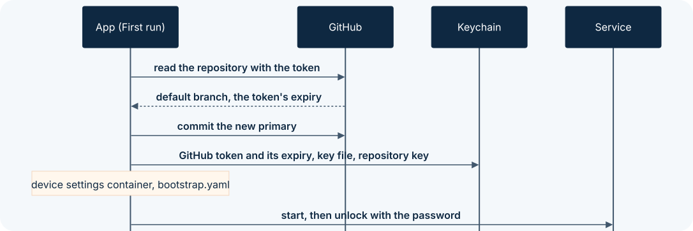

<!-- diagram 2-first-run-github
```mermaid
sequenceDiagram
  participant A as App (First run)
  participant G as GitHub
  participant K as Keychain
  participant S as Service
  A-&gt;&gt;G: read the repository with the token
  G--&gt;&gt;A: default branch, the token's expiry
  A-&gt;&gt;G: commit the new primary
  A-&gt;&gt;K: GitHub token and its expiry, key file, repository key
  Note over A: device settings container, bootstrap.yaml
  A-&gt;&gt;S: start, then unlock with the password
```
-->

The repository check runs before anything is written. Fails with:
`tokenRefused`, `repositoryNotFound`, `unreachable`, and the failures of
the local case.

### Opening an existing primary

This diagram shows a machine set up on a primary that exists already.

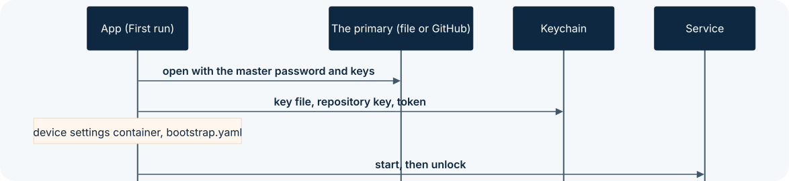

<!-- diagram 3-first-run-open
```mermaid
sequenceDiagram
  participant A as App (First run)
  participant V as The primary (file or GitHub)
  participant K as Keychain
  participant S as Service
  A-&gt;&gt;V: open with the master password and keys
  A-&gt;&gt;K: key file, repository key, token
  Note over A: device settings container, bootstrap.yaml
  A-&gt;&gt;S: start, then unlock
```
-->

Fails with: `primaryNotFound`, `wrongPassword`, `repositoryKeyWrong`
(`repositoryKeyNeeded` when the file is outer encrypted and no key was
given), `notAVault`. A machine can also be set up by pairing (below).

## Unlock and lock

### Starting the service and attaching

This diagram shows the app starting the service and attaching to it.

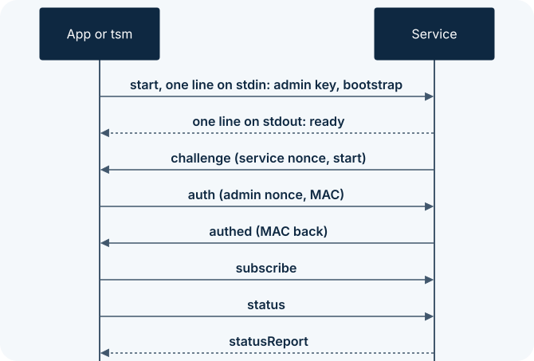

<!-- diagram 4-start-attach
```mermaid
sequenceDiagram
  participant A as App or tsm
  participant S as Service
  A-&gt;&gt;S: start, one line on stdin: admin key, bootstrap
  S--&gt;&gt;A: one line on stdout: ready
  S-&gt;&gt;A: challenge (service nonce, start)
  A-&gt;&gt;S: auth (admin nonce, MAC)
  S-&gt;&gt;A: authed (MAC back)
  A-&gt;&gt;S: subscribe
  A-&gt;&gt;S: status
  S--&gt;&gt;A: statusReport
```
-->

The starter makes a fresh admin key, hands it over on standard input and
keeps it in the keychain. The service checks the admin's executable before
the MAC.

Fails with: `already_running` (exit 3: attach to the running service, or
`claim` it with the master password), `denied` with `wrong_executable` or
`bad_mac` (failures are delayed 1, 2, 4 seconds up to a minute), and on the
admin's side `service_impostor` when `authed` does not check out.

### Unlocking with the master password

This diagram shows an unlock with the master password.

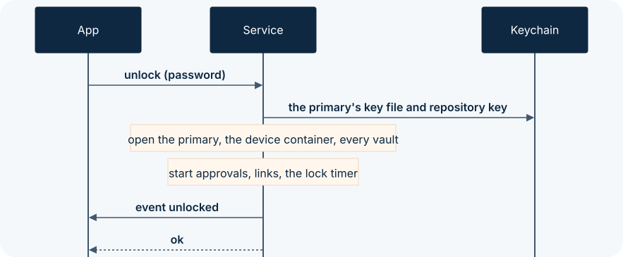

<!-- diagram 5-unlock-password
```mermaid
sequenceDiagram
  participant A as App
  participant S as Service
  participant K as Keychain
  A-&gt;&gt;S: unlock (password)
  S-&gt;&gt;K: the primary's key file and repository key
  Note over S: open the primary, the device container, every vault
  Note over S: start approvals, links, the lock timer
  S-&gt;&gt;A: event unlocked
  S--&gt;&gt;A: ok
```
-->

A vault whose key does not open is `needs_unlock`; the others are served.
Fails with: `denied` `bad_password` (counted as a failed authentication),
`malformed` `password`.

### Unlocking with Touch ID or Windows Hello

This diagram shows the OS unlock.

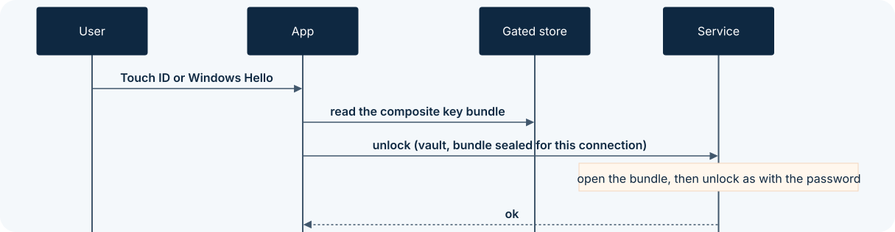

<!-- diagram 6-unlock-os
```mermaid
sequenceDiagram
  participant U as User
  participant A as App
  participant B as Gated store
  participant S as Service
  U-&gt;&gt;A: Touch ID or Windows Hello
  A-&gt;&gt;B: read the composite key bundle
  A-&gt;&gt;S: unlock (vault, bundle sealed for this connection)
  Note over S: open the bundle, then unlock as with the password
  S--&gt;&gt;A: ok
```
-->

Fails with: `denied` `bad_bundle` (counted as a failed authentication);
`denied` `bad_password` when the vault was re-keyed, after which the app
forgets the item and asks for the password; `not_found` when the bundle
names another vault; `unsupported` on a connection that claimed the
service.

### Locking

This diagram shows what locks the service and what locking does.

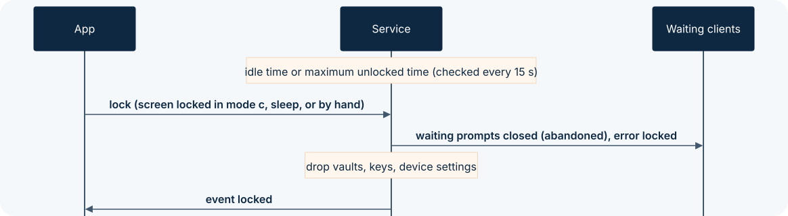

<!-- diagram 7-lock
```mermaid
sequenceDiagram
  participant A as App
  participant S as Service
  participant C as Waiting clients
  Note over S: idle time or maximum unlocked time (checked every 15 s)
  A-&gt;&gt;S: lock (screen locked in mode c, sleep, or by hand)
  S-&gt;&gt;C: waiting prompts closed (abandoned), error locked
  Note over S: drop vaults, keys, device settings
  S-&gt;&gt;A: event locked
```
-->

The service locks itself after the idle time (mode b) or the maximum
unlocked time; the app sends `lock` when the screen locks in mode (c), at
sleep when "lock at sleep" is on, and for "Lock completely" (which first
forgets the OS unlock's session item). A server without a desktop session
never locks itself.

**A client while the service is locked.** With `wait` set and an admin
subscribed to events, the service sends the admins `unlock_needed`, the
client `progress` (`unlock`), and answers once unlocked, or `locked` after
the approval timeout (60 seconds by default). With no subscribed admin, or
`wait` false, the client gets `locked` at once.

## A client's `get`

### Granted at once

This diagram shows a request a grant answers.

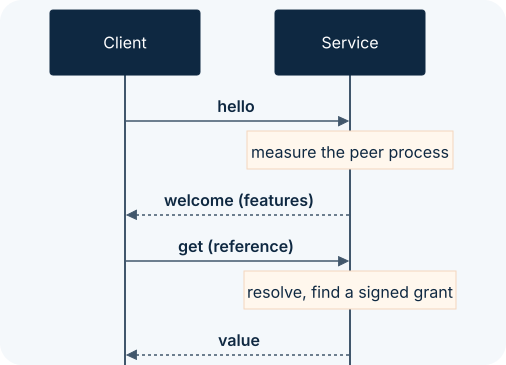

<!-- diagram 8-get-granted
```mermaid
sequenceDiagram
  participant C as Client
  participant S as Service
  C-&gt;&gt;S: hello
  Note over S: measure the peer process
  S--&gt;&gt;C: welcome (features)
  C-&gt;&gt;S: get (reference)
  Note over S: resolve, find a signed grant
  S--&gt;&gt;C: value
```
-->

The service checks in this order: the frame, the rate limit, the lock, the
resolution, the allow list. Fails with: `unsupported` (a protocol it does
not speak), `denied` (`bad_token` on Windows, `other_user`,
`unidentifiable`, `never`), `rate_limited`, `not_found`, `ambiguous`,
`unavailable`, `denied` `reserved_field` (a passkey field).

### Asking the approver

This diagram shows a request no grant answers, approved in the app.

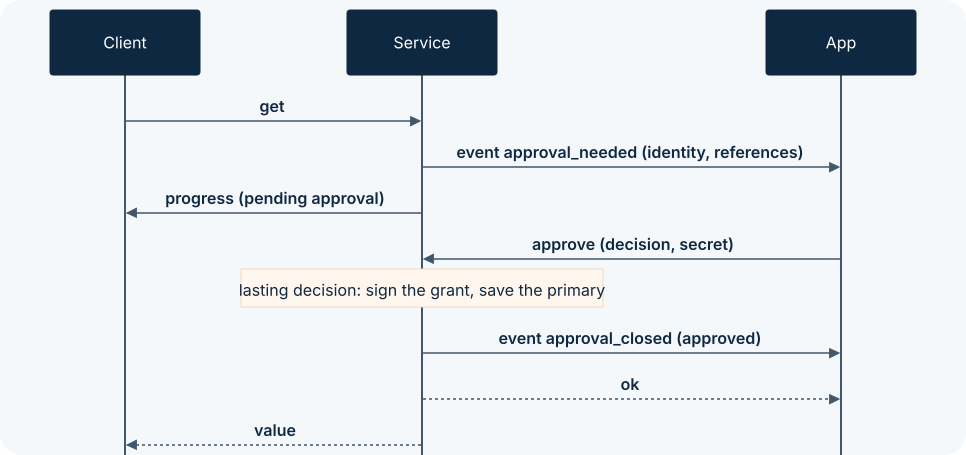

<!-- diagram 9-get-approver
```mermaid
sequenceDiagram
  participant C as Client
  participant S as Service
  participant A as App
  C-&gt;&gt;S: get
  S-&gt;&gt;A: event approval_needed (identity, references)
  S-&gt;&gt;C: progress (pending approval)
  A-&gt;&gt;S: approve (decision, secret)
  Note over S: lasting decision: sign the grant, save the primary
  S-&gt;&gt;A: event approval_closed (approved)
  S--&gt;&gt;A: ok
  S--&gt;&gt;C: value
```
-->

`once` answers this request only; `always` and `folder` write a grant;
`never` refuses. The first approver to answer wins. Fails with: `denied`
`refused` (three refusals in ten minutes hold the identity back),
`timeout` (60 seconds by default), `locked` when the service locks
meanwhile, `rate_limited` `too_many_prompts`.

### An approval code

This diagram shows a request answered by an approval code, when no
approver is within reach.

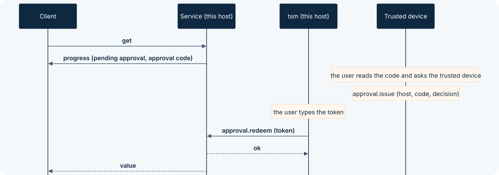

<!-- diagram 10-get-code
```mermaid
sequenceDiagram
  participant C as Client
  participant H as Service (this host)
  participant T as tsm (this host)
  participant P as Trusted device
  C-&gt;&gt;H: get
  H-&gt;&gt;C: progress (pending approval, approval code)
  Note over P: the user reads the code and asks the trusted device
  Note over P: approval.issue (host, code, decision)
  Note over T: the user types the token
  T-&gt;&gt;H: approval.redeem (token)
  H--&gt;&gt;T: ok
  H--&gt;&gt;C: value
```
-->

A code is shown only when no app is attached and no approval link is
connected. The trusted device's service answers `approval.issue` with an
`approvalToken`. Fails with: `denied` `bad_token` (a wrong or reused
token; the third ends the request), `denied` `no_approver` when the code
times out (5 minutes by default). A code never issues a client token.

### A server's prompt on the user's desktop

This diagram shows a request on a server approved on the user's desktop
over the approval link.

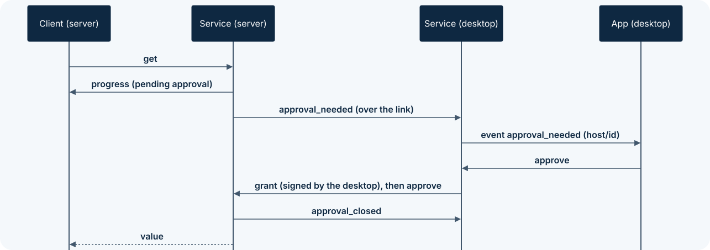

<!-- diagram 11-get-headless
```mermaid
sequenceDiagram
  participant C as Client (server)
  participant H as Service (server)
  participant D as Service (desktop)
  participant A as App (desktop)
  C-&gt;&gt;H: get
  H-&gt;&gt;C: progress (pending approval)
  H-&gt;&gt;D: approval_needed (over the link)
  D-&gt;&gt;A: event approval_needed (host/id)
  A-&gt;&gt;D: approve
  D-&gt;&gt;H: grant (signed by the desktop), then approve
  H-&gt;&gt;D: approval_closed
  H--&gt;&gt;C: value
```
-->

The desktop's service holds the link open to every host it approves for
and passes the host's prompts to its app with the id qualified as
`<host>/<id>`. A lasting decision is signed on the desktop, written into
the host's grants group and sent as `grant`; the host checks the signature
against the approver keys it recorded. `once` goes as `approve` only.
Fails with: `unavailable` (the host cannot be reached), `approval_closed`
`unreachable` when the link drops, `abandoned` when the desktop locks.

## Pairing a new device

Every route runs the same exchange; only the way the two devices reach
each other differs.

This diagram shows the exchange every route runs.

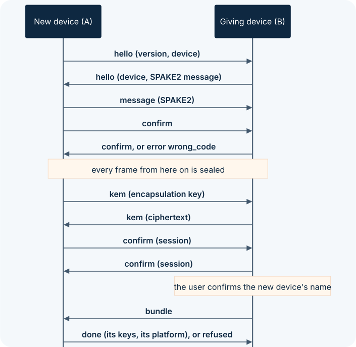

<!-- diagram 12-pair-exchange
```mermaid
sequenceDiagram
  participant N as New device (A)
  participant G as Giving device (B)
  N-&gt;&gt;G: hello (version, device)
  G-&gt;&gt;N: hello (device, SPAKE2 message)
  N-&gt;&gt;G: message (SPAKE2)
  N-&gt;&gt;G: confirm
  G-&gt;&gt;N: confirm, or error wrong_code
  Note over N,G: every frame from here on is sealed
  N-&gt;&gt;G: kem (encapsulation key)
  G-&gt;&gt;N: kem (ciphertext)
  N-&gt;&gt;G: confirm (session)
  G-&gt;&gt;N: confirm (session)
  Note over G: the user confirms the new device's name
  G-&gt;&gt;N: bundle
  N-&gt;&gt;G: done (its keys, its platform), or refused
```
-->

The window accepts the first connection only and burns the code, right or
wrong. Fails with: `wrongCode`, `declined` (the user said no on the giving
side), `version`, `protocol`, `closed` (the window closed, after 5 minutes,
or a step timed out), `refused` (the new device cannot use the bundle).

### On the same network

This diagram shows pairing on the LAN, where the code finds the window.

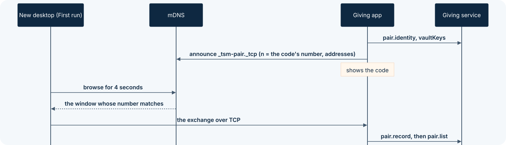

<!-- diagram 13-pair-lan
```mermaid
sequenceDiagram
  participant N as New desktop (First run)
  participant M as mDNS
  participant G as Giving app
  participant S as Giving service
  G-&gt;&gt;S: pair.identity, vaultKeys
  G-&gt;&gt;M: announce _tsm-pair._tcp (n = the code's number, addresses)
  Note over G: shows the code
  N-&gt;&gt;M: browse for 4 seconds
  M--&gt;&gt;N: the window whose number matches
  N-&gt;&gt;G: the exchange over TCP
  G-&gt;&gt;S: pair.record, then pair.list
```
-->

The new desktop picks the one announcement whose number equals the typed
code's. None, or more than one: the user types the address instead.

### Over a VPN

This diagram shows pairing over a VPN, which mDNS does not cross.

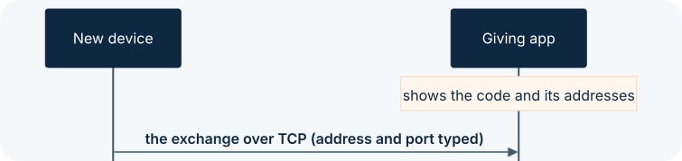

<!-- diagram 14-pair-vpn
```mermaid
sequenceDiagram
  participant N as New device
  participant G as Giving app
  Note over G: shows the code and its addresses
  N-&gt;&gt;G: the exchange over TCP (address and port typed)
```
-->

Fails, besides the exchange's failures, with `closed` "cannot reach …"
when the address does not answer; a relay named too is tried next.

### A phone scanning the QR code

This diagram shows a phone set up from the desktop's QR code.

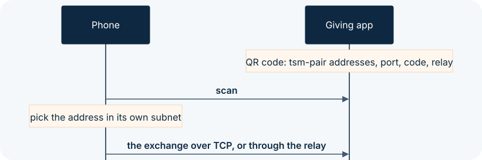

<!-- diagram 15-pair-qr
```mermaid
sequenceDiagram
  participant P as Phone
  participant G as Giving app
  Note over G: QR code: tsm-pair addresses, port, code, relay
  P-&gt;&gt;G: scan
  Note over P: pick the address in its own subnet
  P-&gt;&gt;G: the exchange over TCP, or through the relay
```
-->

The QR code holds one line: `tsm-pair:<addresses>:<port>?code=<code>`,
with `&relay=<relay id>` when the window also waits on a relay. When the
address does not answer and a relay is named, the phone uses the relay.

### `tsm pair` on a server

This diagram shows a server set up with `tsm pair`, which links no core:
the service's executable does the pairing.

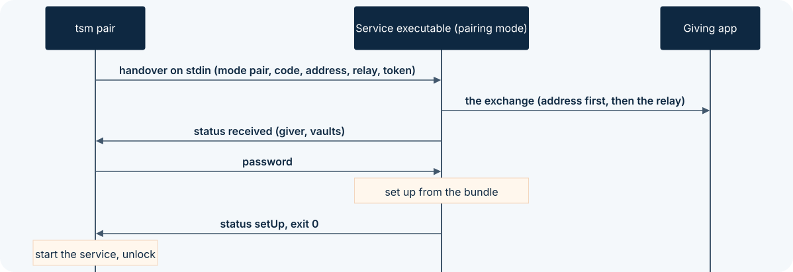

<!-- diagram 16-pair-tsm
```mermaid
sequenceDiagram
  participant T as tsm pair
  participant S as Service executable (pairing mode)
  participant G as Giving app
  T-&gt;&gt;S: handover on stdin (mode pair, code, address, relay, token)
  S-&gt;&gt;G: the exchange (address first, then the relay)
  S-&gt;&gt;T: status received (giver, vaults)
  T-&gt;&gt;S: password
  Note over S: set up from the bundle
  S-&gt;&gt;T: status setUp, exit 0
  Note over T: start the service, unlock
```
-->

`--relay` names a relay (`github:` needs `--token-env`, the variable holding
this machine's own token), `--link` switches this machine's approval link
on. Fails with: exit 2 (a bad handover), exit 6 (`pairing`, with the
exchange's failure), exit 7 (setup), `wrong_password` (three tries), and
`denied` when the machine is set up already.

### Through a GitHub repository

This diagram shows pairing through a repository both devices can reach.

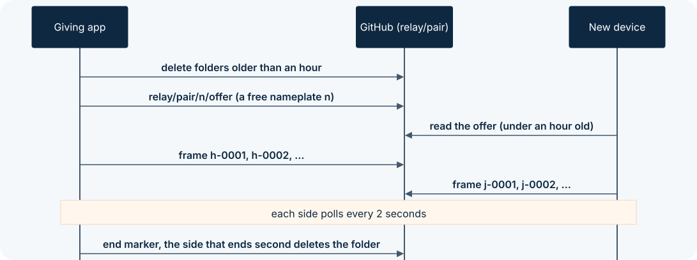

<!-- diagram 17-pair-github
```mermaid
sequenceDiagram
  participant G as Giving app
  participant R as GitHub (relay/pair)
  participant N as New device
  G-&gt;&gt;R: delete folders older than an hour
  G-&gt;&gt;R: relay/pair/n/offer (a free nameplate n)
  N-&gt;&gt;R: read the offer (under an hour old)
  G-&gt;&gt;R: frame h-0001, h-0002, ...
  N-&gt;&gt;R: frame j-0001, j-0002, ...
  Note over G,N: each side polls every 2 seconds
  G-&gt;&gt;R: end marker, the side that ends second deletes the folder
```
-->

Each frame is one file and one commit; the code's number is the nameplate.
The new device needs a token of its own for the repository. Fails with:
"no pairing waits under n", "no free nameplate", "the pairing n is gone",
polling or writing failures.

### Through a relay server

This diagram shows pairing through the product's relay server.

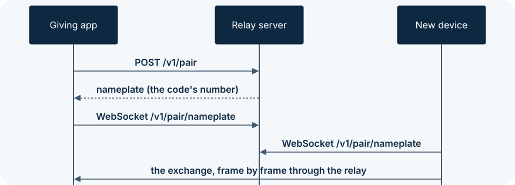

<!-- diagram 18-pair-relay
```mermaid
sequenceDiagram
  participant G as Giving app
  participant R as Relay server
  participant N as New device
  G-&gt;&gt;R: POST /v1/pair
  R--&gt;&gt;G: nameplate (the code's number)
  G-&gt;&gt;R: WebSocket /v1/pair/nameplate
  N-&gt;&gt;R: WebSocket /v1/pair/nameplate
  N-&gt;&gt;G: the exchange, frame by frame through the relay
```
-->

The app builds the code from the nameplate the relay gave. Fails with: 401
(an instance token is needed), 404 (no pairing under that number), 409
(two devices are there already), 429 (retried once after `Retry-After`),
no answer within 30 seconds.

### Through a magic-wormhole server

This diagram shows pairing through a magic-wormhole mailbox server.

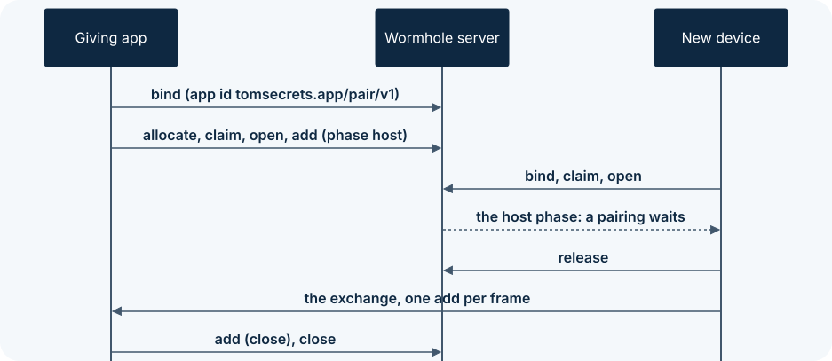

<!-- diagram 19-pair-wormhole
```mermaid
sequenceDiagram
  participant G as Giving app
  participant W as Wormhole server
  participant N as New device
  G-&gt;&gt;W: bind (app id tomsecrets.app/pair/v1)
  G-&gt;&gt;W: allocate, claim, open, add (phase host)
  N-&gt;&gt;W: bind, claim, open
  W--&gt;&gt;N: the host phase: a pairing waits
  N-&gt;&gt;W: release
  N-&gt;&gt;G: the exchange, one add per frame
  G-&gt;&gt;W: add (close), close
```
-->

The server's own `welcome` may ask for a proof of work, which is answered.
Fails with: "no pairing is open under n", the server's welcome error, and
the host's ten-minute limit.

### What the bundle carries and what the giver records

The bundle carries the chosen vaults (name, location, whether primary, key
file, repository key), the shared configuration, the GitHub tokens with
their expiry, and the giver's public keys with its link address and, when
agreed, the relay and link id of the approval link. Never a private key,
the master password, the allow list or the audit log. The new device
answers `done` with its own public keys and its platform (`macos`,
`windows`, `linux`, `ios`, `android`), which the giver keeps in the new
device's record.

This diagram shows what the giving side records.

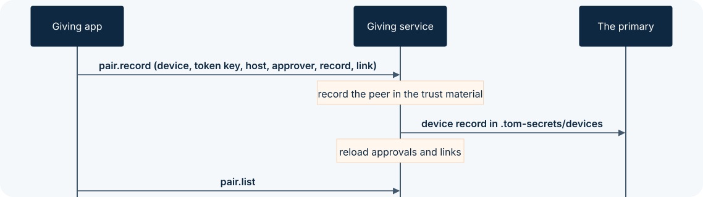

<!-- diagram 20-pair-record
```mermaid
sequenceDiagram
  participant G as Giving app
  participant S as Giving service
  participant P as The primary
  G-&gt;&gt;S: pair.record (device, token key, host, approver, record, link)
  Note over S: record the peer in the trust material
  S-&gt;&gt;P: device record in .tom-secrets/devices
  Note over S: reload approvals and links
  G-&gt;&gt;S: pair.list
```
-->

`pair.revoke`, from the app only, ends a pairing.

## The approval link

### Opened directly

This diagram shows an approver opening the link to a host's address.

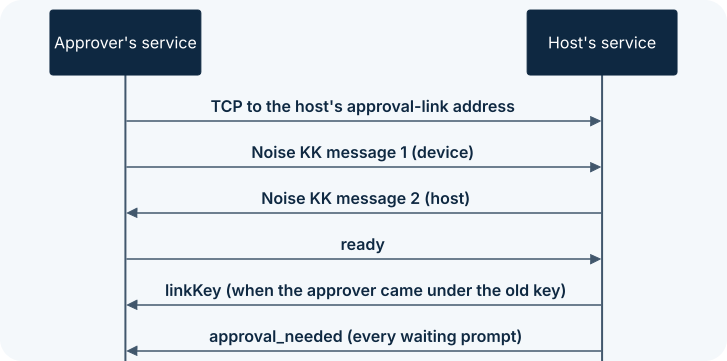

<!-- diagram 21-link-direct
```mermaid
sequenceDiagram
  participant D as Approver's service
  participant H as Host's service
  D-&gt;&gt;H: TCP to the host's approval-link address
  D-&gt;&gt;H: Noise KK message 1 (device)
  H-&gt;&gt;D: Noise KK message 2 (host)
  D-&gt;&gt;H: ready
  H-&gt;&gt;D: linkKey (when the approver came under the old key)
  H-&gt;&gt;D: approval_needed (every waiting prompt)
```
-->

Afterwards the host sends `approval_needed`, `approval_closed` and
`linkKey`; the approver sends `approve`, `grant`, `revoke`, `keychange`
and `linkKey`, each answered `ok` or `error`; either side sends `rekey`
after 2^20 frames or an hour. The host listens only on its configured
approval-link address and only while unlocked. A link that ends is opened
again after 5 seconds, doubling up to 5 minutes.

### Through a relay server

This diagram shows the link through a relay server, when the host's
address does not answer.

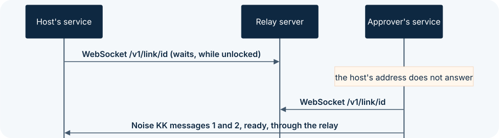

<!-- diagram 22-link-relay
```mermaid
sequenceDiagram
  participant H as Host's service
  participant R as Relay server
  participant D as Approver's service
  H-&gt;&gt;R: WebSocket /v1/link/id (waits, while unlocked)
  Note over D: the host's address does not answer
  D-&gt;&gt;R: WebSocket /v1/link/id
  D-&gt;&gt;H: Noise KK messages 1 and 2, ready, through the relay
```
-->

The pairing agreed on the relay and a random link id; the channels are
`<id>-g` (the giving device as host) and `<id>-r`. In token mode both sides
send the relay's instance token. A relay that refuses is shown as
`unreachable` with the relay's reason. The relay ends a channel after 24
hours alone; the host opens it again.

## Sync

### The refresh of a vault on GitHub

This diagram shows the service's refresh of a `github:` vault.

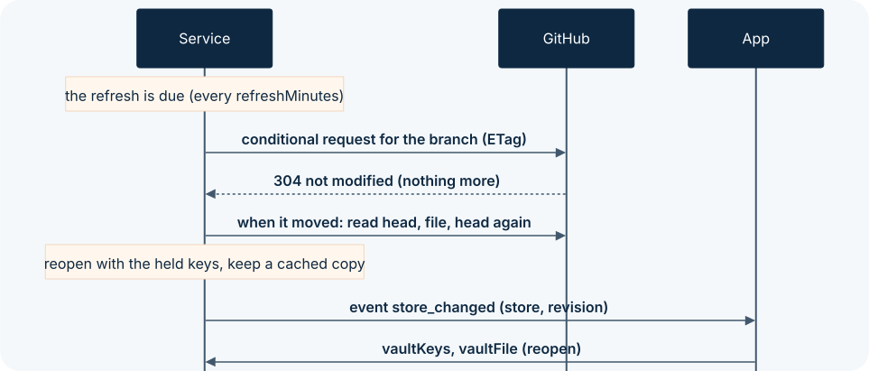

<!-- diagram 23-sync-refresh
```mermaid
sequenceDiagram
  participant S as Service
  participant G as GitHub
  participant A as App
  Note over S: the refresh is due (every refreshMinutes)
  S-&gt;&gt;G: conditional request for the branch (ETag)
  G--&gt;&gt;S: 304 not modified (nothing more)
  S-&gt;&gt;G: when it moved: read head, file, head again
  Note over S: reopen with the held keys, keep a cached copy
  S-&gt;&gt;A: event store_changed (store, revision)
  A-&gt;&gt;S: vaultKeys, vaultFile (reopen)
```
-->

A branch that did not move costs one conditional request and no API quota.
A vault the primary lists anew, or with new keys, is opened; one it no
longer lists is dropped. Every change of a store's state is sent as
`store_state`. The refresh never runs during a save.

### A save while another device moved the branch

This diagram shows a save that meets another device's commit.

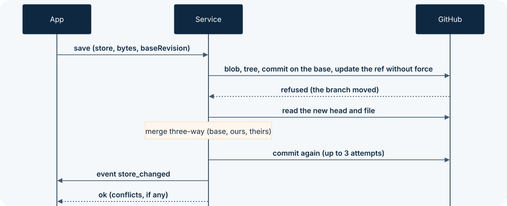

<!-- diagram 24-sync-save
```mermaid
sequenceDiagram
  participant A as App
  participant S as Service
  participant G as GitHub
  A-&gt;&gt;S: save (store, bytes, baseRevision)
  S-&gt;&gt;G: blob, tree, commit on the base, update the ref without force
  G--&gt;&gt;S: refused (the branch moved)
  S-&gt;&gt;G: read the new head and file
  Note over S: merge three-way (base, ours, theirs)
  S-&gt;&gt;G: commit again (up to 3 attempts)
  S-&gt;&gt;A: event store_changed
  S--&gt;&gt;A: ok (conflicts, if any)
```
-->

Fails with: `denied` `stale_base` (the app saved over a revision the file
has moved past: it reopens and the user saves again), `branch_moving` (the
branch kept moving through every attempt), `history_rewritten` (below),
`needs_unlock` (the vault's key changed), `offline` and `token_expired`
(the store is on its cached copy).

### Offline

This diagram shows a vault opened from the offline cache.

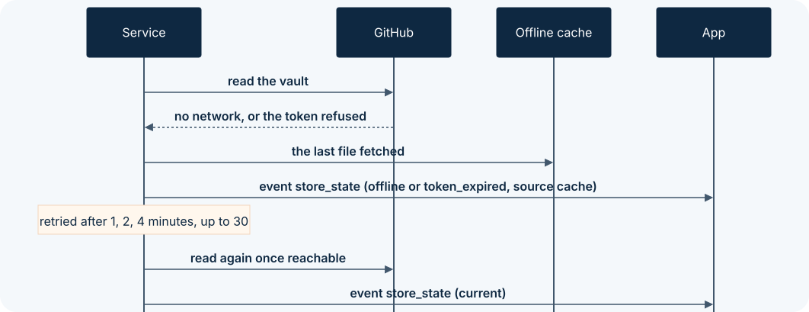

<!-- diagram 25-sync-offline
```mermaid
sequenceDiagram
  participant S as Service
  participant G as GitHub
  participant C as Offline cache
  participant A as App
  S-&gt;&gt;G: read the vault
  G--&gt;&gt;S: no network, or the token refused
  S-&gt;&gt;C: the last file fetched
  S-&gt;&gt;A: event store_state (offline or token_expired, source cache)
  Note over S: retried after 1, 2, 4 minutes, up to 30
  S-&gt;&gt;G: read again once reachable
  S-&gt;&gt;A: event store_state (current)
```
-->

A refused token is not tried again until `reload` or the next unlock. While
a store is on its cached copy the service serves it but refuses a `save`
(`offline`, `token_expired`); only the service's own writes to the primary
wait and are written at the next refresh. The phone keeps no cache: it
holds an unwritten save in memory and merges it at the next refresh that
reaches GitHub (below).

### A conflict

This diagram shows a conflict from the merge to its settling.

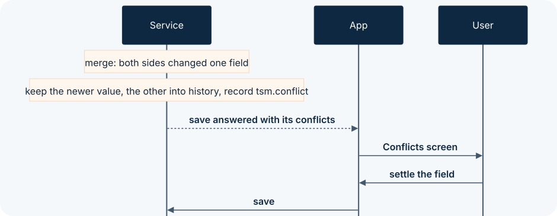

<!-- diagram 26-sync-conflict
```mermaid
sequenceDiagram
  participant S as Service
  participant A as App
  participant U as User
  Note over S: merge: both sides changed one field
  Note over S: keep the newer value, the other into history, record tsm.conflict
  S--&gt;&gt;A: save answered with its conflicts
  A-&gt;&gt;U: Conflicts screen
  U-&gt;&gt;A: settle the field
  A-&gt;&gt;S: save
```
-->

A field only one side changed takes that side; only a real conflict is
recorded, in the entry's custom data, until it is settled.

### History compaction

This diagram shows a compaction and how other devices follow it.

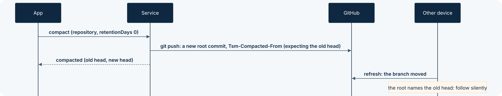

<!-- diagram 27-sync-compaction
```mermaid
sequenceDiagram
  participant A as App
  participant S as Service
  participant G as GitHub
  participant O as Other device
  A-&gt;&gt;S: compact (repository, retentionDays 0)
  S-&gt;&gt;G: git push: a new root commit, Tsm-Compacted-From (expecting the old head)
  S--&gt;&gt;A: compacted (old head, new head)
  O-&gt;&gt;G: refresh: the branch moved
  Note over O: the root names the old head: follow silently
```
-->

The app compacts with retention 0 after every key change; `tsm compact`
and "Compact now" use the repository's retention. Each vault repository's
workflow runs the same cut daily by its `.tsm/compaction.yaml` (90 days
kept by default). Fails with `denied` `branch_moving` when saves kept
landing (three attempts).

### The force-push question

This diagram shows a branch rewritten without a compaction.

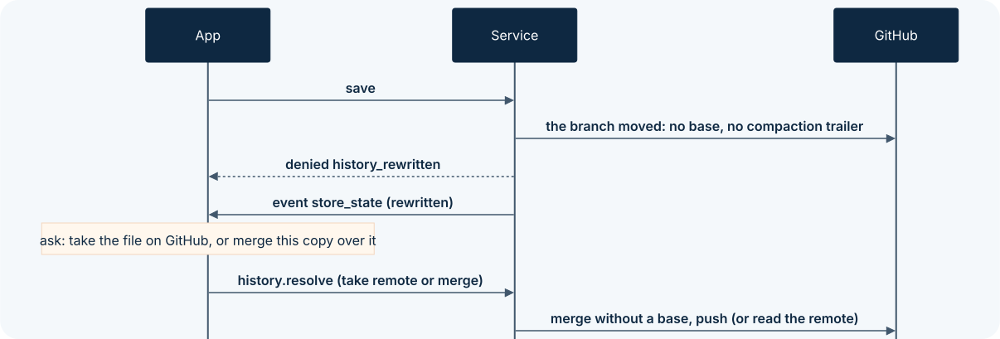

<!-- diagram 28-sync-force-push
```mermaid
sequenceDiagram
  participant A as App
  participant S as Service
  participant G as GitHub
  A-&gt;&gt;S: save
  S-&gt;&gt;G: the branch moved: no base, no compaction trailer
  S--&gt;&gt;A: denied history_rewritten
  S-&gt;&gt;A: event store_state (rewritten)
  Note over A: ask: take the file on GitHub, or merge this copy over it
  A-&gt;&gt;S: history.resolve (take remote or merge)
  S-&gt;&gt;G: merge without a base, push (or read the remote)
```
-->

Until the user answers, the store is not refreshed. "Merge" keeps
everything of both sides, since without a base nothing counts as deleted.

### The phone's refresh

This diagram shows the phone's refresh in the foreground and the
background.

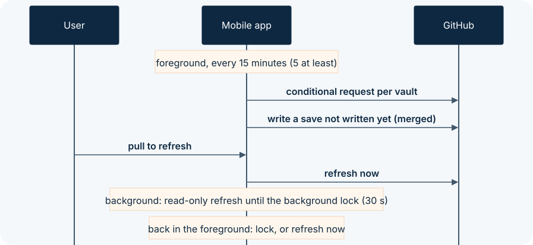

<!-- diagram 29-sync-phone
```mermaid
sequenceDiagram
  participant U as User
  participant P as Mobile app
  participant G as GitHub
  Note over P: foreground, every 15 minutes (5 at least)
  P-&gt;&gt;G: conditional request per vault
  P-&gt;&gt;G: write a save not written yet (merged)
  U-&gt;&gt;P: pull to refresh
  P-&gt;&gt;G: refresh now
  Note over P: background: read-only refresh until the background lock (30 s)
  Note over P: back in the foreground: lock, or refresh now
```
-->

In the background the copies in memory follow other devices, but nothing is
written to GitHub or the device, and next keys and pending saves wait for
the foreground.

## Sharing

### A member key made and exchanged

This diagram shows two people exchanging member keys.

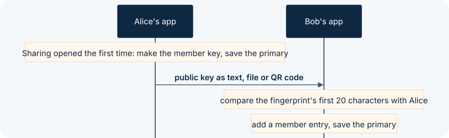

<!-- diagram 30-share-member-key
```mermaid
sequenceDiagram
  participant A as Alice's app
  participant B as Bob's app
  Note over A: Sharing opened the first time: make the member key, save the primary
  A-&gt;&gt;B: public key as text, file or QR code
  Note over B: compare the fingerprint's first 20 characters with Alice
  Note over B: add a member entry, save the primary
```
-->

The member key lives in the primary's `tsm.sharing` group; the check marks
the member entry as compared.

### A shared vault created and opened

This diagram shows a shared vault created by one member and opened by
another.

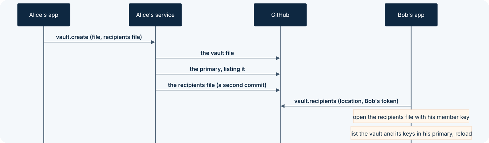

<!-- diagram 31-share-vault
```mermaid
sequenceDiagram
  participant A as Alice's app
  participant S as Alice's service
  participant G as GitHub
  participant B as Bob's app
  A-&gt;&gt;S: vault.create (file, recipients file)
  S-&gt;&gt;G: the vault file
  S-&gt;&gt;G: the primary, listing it
  S-&gt;&gt;G: the recipients file (a second commit)
  B-&gt;&gt;G: vault.recipients (location, Bob's token)
  Note over B: open the recipients file with his member key
  Note over B: list the vault and its keys in his primary, reload
```
-->

The primary is written after the vault file, so it never lists a vault
that does not exist. Fails with: `target_exists` (a file is there already),
`notAMember` (the recipients file is not encrypted to Bob's key).

### A member added and removed

This diagram shows a member added and another removed.

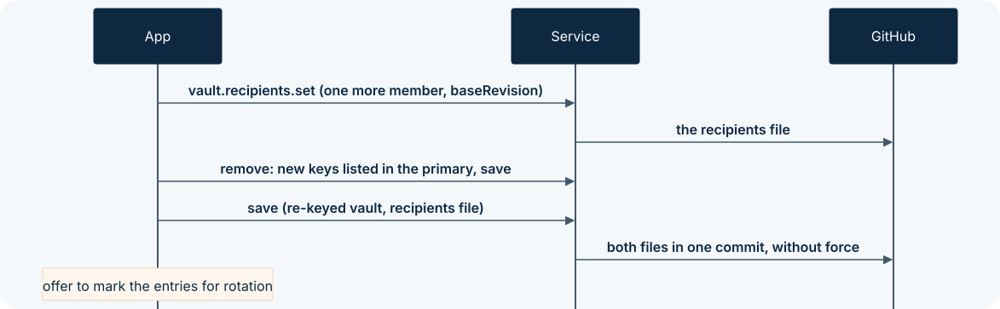

<!-- diagram 32-share-members
```mermaid
sequenceDiagram
  participant A as App
  participant S as Service
  participant G as GitHub
  A-&gt;&gt;S: vault.recipients.set (one more member, baseRevision)
  S-&gt;&gt;G: the recipients file
  A-&gt;&gt;S: remove: new keys listed in the primary, save
  A-&gt;&gt;S: save (re-keyed vault, recipients file)
  S-&gt;&gt;G: both files in one commit, without force
  Note over A: offer to mark the entries for rotation
```
-->

Fails with `denied` `stale_base` when the recipients file or the vault
moved meanwhile. The other members take the new keys when their app reads
the recipients file again.

### A single entry shared

This diagram shows an entry shared through a shared vault's inbox folder.

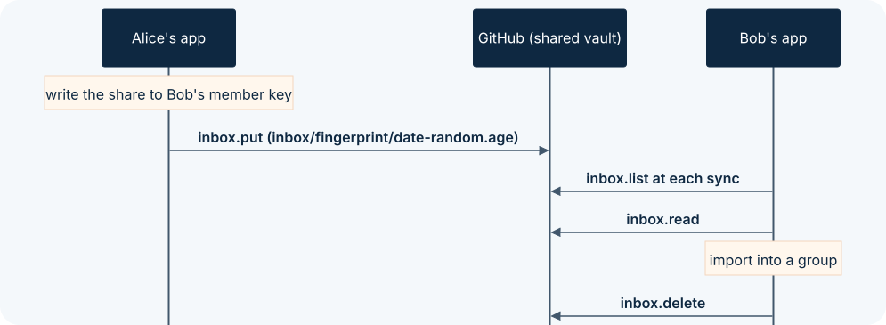

<!-- diagram 33-share-inbox
```mermaid
sequenceDiagram
  participant A as Alice's app
  participant G as GitHub (shared vault)
  participant B as Bob's app
  Note over A: write the share to Bob's member key
  A-&gt;&gt;G: inbox.put (inbox/fingerprint/date-random.age)
  B-&gt;&gt;G: inbox.list at each sync
  B-&gt;&gt;G: inbox.read
  Note over B: import into a group
  B-&gt;&gt;G: inbox.delete
```
-->

A share can also go as armoured text, a QR code (while it fits, 2,953
characters) or a `.tsmshare` file, imported from a paste, a file or a scan.
A package older than 30 days is deleted by whichever member syncs next.

This diagram shows an entry shared through a relay server's mailbox.

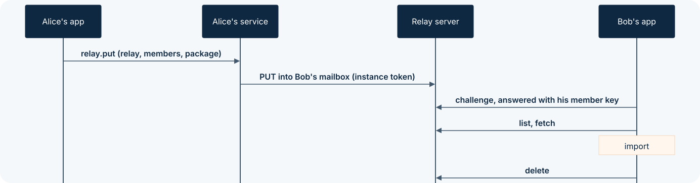

<!-- diagram 34-share-mailbox
```mermaid
sequenceDiagram
  participant A as Alice's app
  participant S as Alice's service
  participant R as Relay server
  participant B as Bob's app
  A-&gt;&gt;S: relay.put (relay, members, package)
  S-&gt;&gt;R: PUT into Bob's mailbox (instance token)
  B-&gt;&gt;R: challenge, answered with his member key
  B-&gt;&gt;R: list, fetch
  Note over B: import
  B-&gt;&gt;R: delete
```
-->

Fails with `unavailable` `relay` (no instance token, or the relay's
limits).

## Rotation

### A vault's keys by hand

This diagram shows the Keys screen rotating a vault's keys at once.

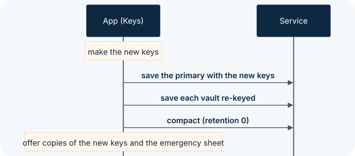

<!-- diagram 35-rotate-hand
```mermaid
sequenceDiagram
  participant A as App (Keys)
  participant S as Service
  Note over A: make the new keys
  A-&gt;&gt;S: save the primary with the new keys
  A-&gt;&gt;S: save each vault re-keyed
  A-&gt;&gt;S: compact (retention 0)
  Note over A: offer copies of the new keys and the emergency sheet
```
-->

A re-keyed save is never merged: a moved file is `stale_base`. An
interrupted run is finished at the next start.

### The guided rotation across devices

This diagram shows a guided rotation across two devices.

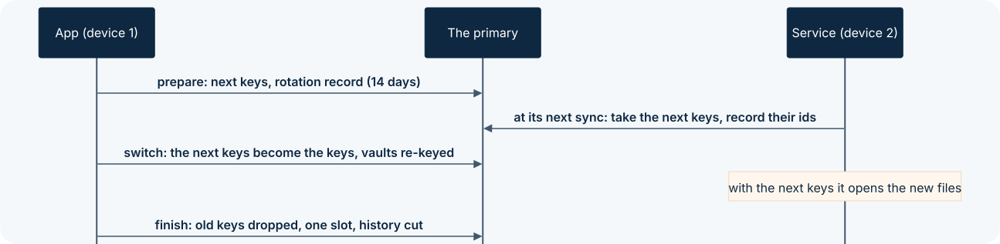

<!-- diagram 36-rotate-guided
```mermaid
sequenceDiagram
  participant A as App (device 1)
  participant P as The primary
  participant D as Service (device 2)
  A-&gt;&gt;P: prepare: next keys, rotation record (14 days)
  D-&gt;&gt;P: at its next sync: take the next keys, record their ids
  A-&gt;&gt;P: switch: the next keys become the keys, vaults re-keyed
  Note over D: with the next keys it opens the new files
  A-&gt;&gt;P: finish: old keys dropped, one slot, history cut
```
-->

The app lists the devices still pending. A device holding only the old key
serves its last copy read-only and refuses saves until the key arrives.
Cancel is possible before the switch only. A second rotation of the same key
is refused while the first runs.

### A member key

This diagram shows a member key rotated.

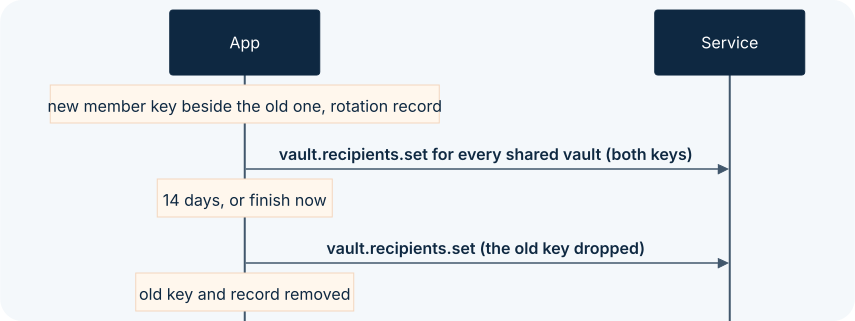

<!-- diagram 37-rotate-member
```mermaid
sequenceDiagram
  participant A as App
  participant S as Service
  Note over A: new member key beside the old one, rotation record
  A-&gt;&gt;S: vault.recipients.set for every shared vault (both keys)
  Note over A: 14 days, or finish now
  A-&gt;&gt;S: vault.recipients.set (the old key dropped)
  Note over A: old key and record removed
```
-->

### A shared vault's keys

This diagram shows a shared vault's keys rotated.

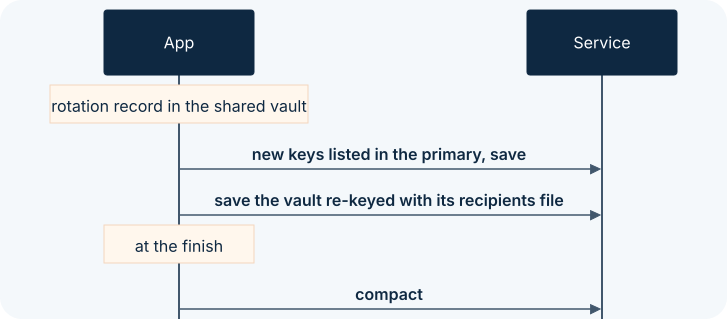

<!-- diagram 38-rotate-shared
```mermaid
sequenceDiagram
  participant A as App
  participant S as Service
  Note over A: rotation record in the shared vault
  A-&gt;&gt;S: new keys listed in the primary, save
  A-&gt;&gt;S: save the vault re-keyed with its recipients file
  Note over A: at the finish
  A-&gt;&gt;S: compact
```
-->

### The device's own key pairs

This diagram shows a device rotating its approver and link key pairs.

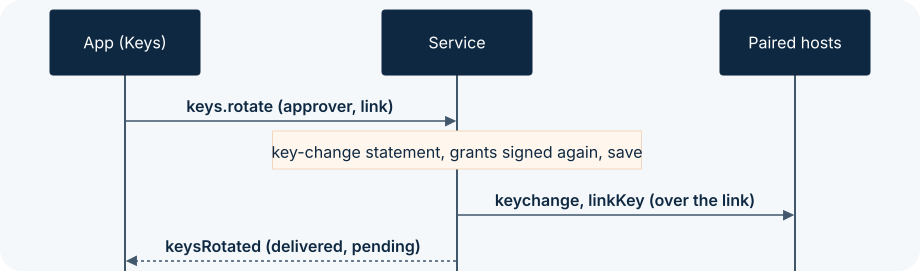

<!-- diagram 39-rotate-device
```mermaid
sequenceDiagram
  participant A as App (Keys)
  participant S as Service
  participant H as Paired hosts
  A-&gt;&gt;S: keys.rotate (approver, link)
  Note over S: key-change statement, grants signed again, save
  S-&gt;&gt;H: keychange, linkKey (over the link)
  S--&gt;&gt;A: keysRotated (delivered, pending)
```
-->

Hosts not reached get the new keys at later refreshes, at most every 15
minutes; the previous link key stays usable for 14 days.

## GitHub access

### Signing in with the GitHub App

This diagram shows the device flow sign-in.

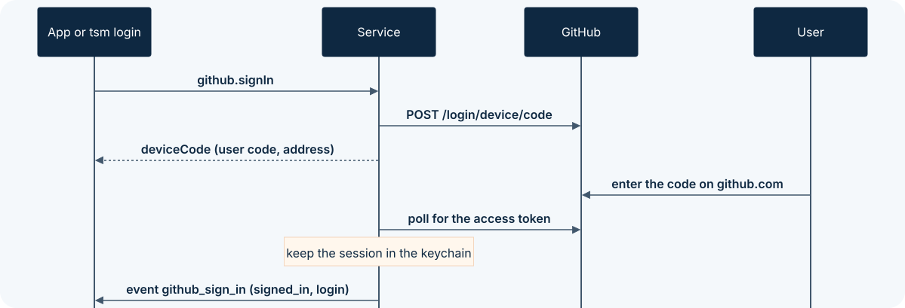

<!-- diagram 40-github-sign-in
```mermaid
sequenceDiagram
  participant A as App or tsm login
  participant S as Service
  participant G as GitHub
  participant U as User
  A-&gt;&gt;S: github.signIn
  S-&gt;&gt;G: POST /login/device/code
  S--&gt;&gt;A: deviceCode (user code, address)
  U-&gt;&gt;G: enter the code on github.com
  S-&gt;&gt;G: poll for the access token
  Note over S: keep the session in the keychain
  S-&gt;&gt;A: event github_sign_in (signed_in, login)
```
-->

The service renews the access token 5 minutes before its 8 hours end, and
after a refused request (at most once a minute). Fails with: `expired`,
`denied`, `bad_client_id` while polling; `not_found` `no_github_app`,
`unsupported` `no_keychain`, `offline` for the request; a refused refresh
token leaves the state `sign_in_again`. `github.signOut` (`tsm logout`)
returns to the pasted tokens.

### A pasted token and its renewal

This diagram shows a pasted token checked and kept.

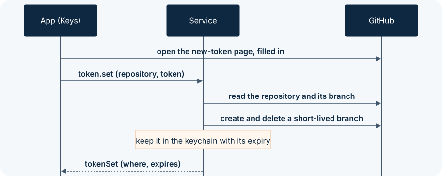

<!-- diagram 41-github-token
```mermaid
sequenceDiagram
  participant A as App (Keys)
  participant S as Service
  participant G as GitHub
  A-&gt;&gt;G: open the new-token page, filled in
  A-&gt;&gt;S: token.set (repository, token)
  S-&gt;&gt;G: read the repository and its branch
  S-&gt;&gt;G: create and delete a short-lived branch
  Note over S: keep it in the keychain with its expiry
  S--&gt;&gt;A: tokenSet (where, expires)
```
-->

The expiry starts the reminders (`key_expiry`, from 14 days before). Fails
with `denied` `token_refused`, `token_no_access` or `token_read_only`.

## The browser

### The list at a field

This diagram shows the page's logins listed at a field.

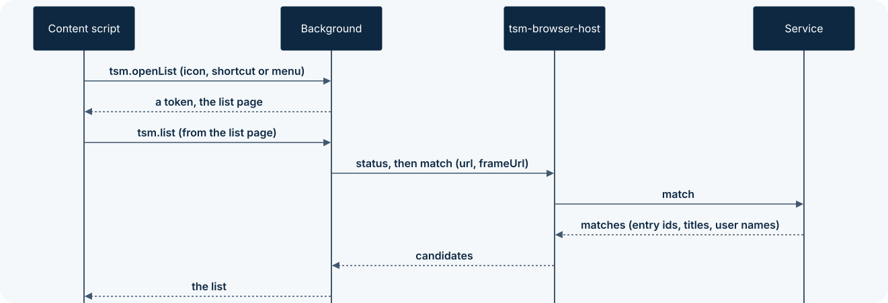

<!-- diagram 42-browser-list
```mermaid
sequenceDiagram
  participant P as Content script
  participant B as Background
  participant H as tsm-browser-host
  participant S as Service
  P-&gt;&gt;B: tsm.openList (icon, shortcut or menu)
  B--&gt;&gt;P: a token, the list page
  P-&gt;&gt;B: tsm.list (from the list page)
  B-&gt;&gt;H: status, then match (url, frameUrl)
  H-&gt;&gt;S: match
  S--&gt;&gt;H: matches (entry ids, titles, user names)
  H--&gt;&gt;B: candidates
  B--&gt;&gt;P: the list
```
-->

The background takes the frame and its address from the browser, never
from the page. Each host request is a short-lived host process. No values
travel in this step. Fails with: no host (`unreachable`), `not_running`,
`locked`, `malformed` `url`.

### The fill

This diagram shows a login filled.

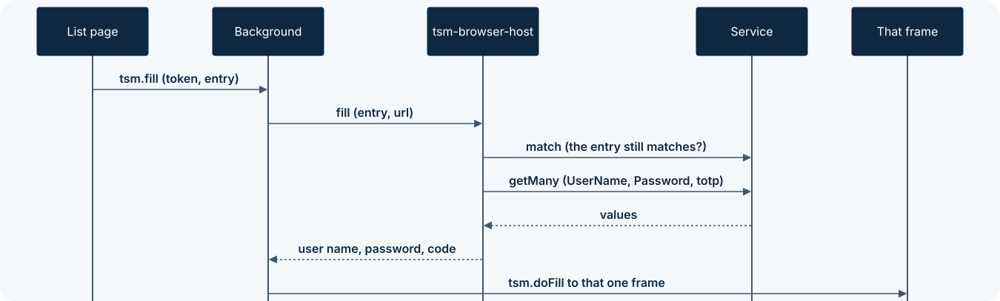

<!-- diagram 43-browser-fill
```mermaid
sequenceDiagram
  participant L as List page
  participant B as Background
  participant H as tsm-browser-host
  participant S as Service
  participant P as That frame
  L-&gt;&gt;B: tsm.fill (token, entry)
  B-&gt;&gt;H: fill (entry, url)
  H-&gt;&gt;S: match (the entry still matches?)
  H-&gt;&gt;S: getMany (UserName, Password, totp)
  S--&gt;&gt;H: values
  H--&gt;&gt;B: user name, password, code
  B-&gt;&gt;P: tsm.doFill to that one frame
```
-->

Fails with `denied` `not_matched` when the entry no longer matches the
page.

### The browser approval

This diagram shows a browser's first lookup approved.

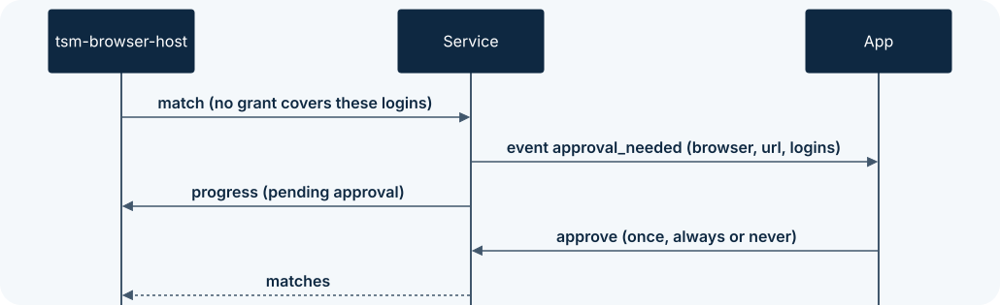

<!-- diagram 44-browser-approval
```mermaid
sequenceDiagram
  participant H as tsm-browser-host
  participant S as Service
  participant A as App
  H-&gt;&gt;S: match (no grant covers these logins)
  S-&gt;&gt;A: event approval_needed (browser, url, logins)
  S-&gt;&gt;H: progress (pending approval)
  A-&gt;&gt;S: approve (once, always or never)
  S--&gt;&gt;H: matches
```
-->

"Always in this browser" ("Always" on Windows) writes grants for the host as
started by that browser; "This time" lets the logins be read for ten minutes,
across the list's and the fill's host processes; the lock forgets it. With no
approver connected, or refused, the list is empty.

### A proposal saved

This diagram shows a new login offered and saved.

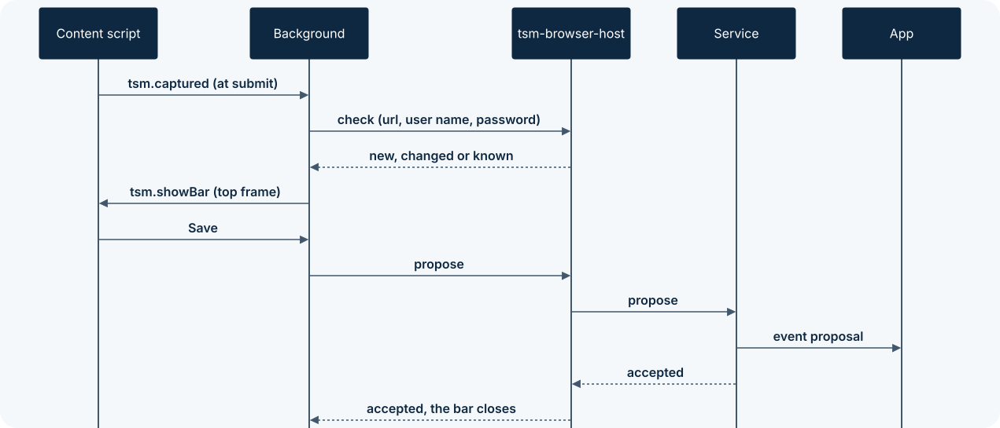

<!-- diagram 45-browser-proposal
```mermaid
sequenceDiagram
  participant P as Content script
  participant B as Background
  participant H as tsm-browser-host
  participant S as Service
  participant A as App
  P-&gt;&gt;B: tsm.captured (at submit)
  B-&gt;&gt;H: check (url, user name, password)
  H--&gt;&gt;B: new, changed or known
  B-&gt;&gt;P: tsm.showBar (top frame)
  P-&gt;&gt;B: Save
  B-&gt;&gt;H: propose
  H-&gt;&gt;S: propose
  S-&gt;&gt;A: event proposal
  S--&gt;&gt;H: accepted
  H--&gt;&gt;B: accepted, the bar closes
```
-->

A known login brings no bar; a site in the never-list neither. The bar
also appears on the page the form led to; the password stays in the
background for two minutes at most. In the app the proposal updates a
login, becomes a new one, or is dropped. Fails with `unavailable`
`no_app` (no app attached) and `denied` `not_allowed_op`.

### Safari

This diagram shows a request from Safari.

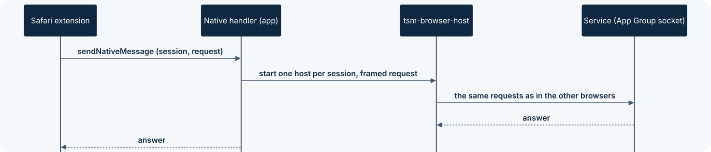

<!-- diagram 46-browser-safari
```mermaid
sequenceDiagram
  participant E as Safari extension
  participant N as Native handler (app)
  participant H as tsm-browser-host
  participant S as Service (App Group socket)
  E-&gt;&gt;N: sendNativeMessage (session, request)
  N-&gt;&gt;H: start one host per session, framed request
  H-&gt;&gt;S: the same requests as in the other browsers
  S--&gt;&gt;H: answer
  N--&gt;&gt;E: answer
```
-->

## Passkeys

### In the browser: signing in

This diagram shows a sign-in with a passkey in the browser.

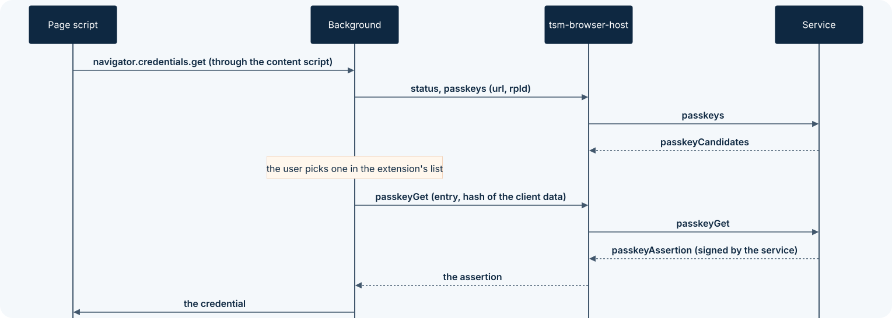

<!-- diagram 47-passkey-get
```mermaid
sequenceDiagram
  participant W as Page script
  participant B as Background
  participant H as tsm-browser-host
  participant S as Service
  W-&gt;&gt;B: navigator.credentials.get (through the content script)
  B-&gt;&gt;H: status, passkeys (url, rpId)
  H-&gt;&gt;S: passkeys
  S--&gt;&gt;H: passkeyCandidates
  Note over B: the user picks one in the extension's list
  B-&gt;&gt;H: passkeyGet (entry, hash of the client data)
  H-&gt;&gt;S: passkeyGet
  S--&gt;&gt;H: passkeyAssertion (signed by the service)
  H--&gt;&gt;B: the assertion
  B-&gt;&gt;W: the credential
```
-->

The background builds the client data with the frame's origin from the
browser. None, or the service not running: the browser's own WebAuthn
takes over. Fails with `denied` `rp_id`, `not_matched`, `unavailable`
`key`.

### In the browser: creating a passkey

This diagram shows a passkey created in the browser.

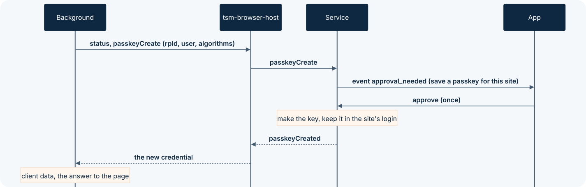

<!-- diagram 48-passkey-create
```mermaid
sequenceDiagram
  participant B as Background
  participant H as tsm-browser-host
  participant S as Service
  participant A as App
  B-&gt;&gt;H: status, passkeyCreate (rpId, user, algorithms)
  H-&gt;&gt;S: passkeyCreate
  S-&gt;&gt;A: event approval_needed (save a passkey for this site)
  A-&gt;&gt;S: approve (once)
  Note over S: make the key, keep it in the site's login
  S--&gt;&gt;H: passkeyCreated
  H--&gt;&gt;B: the new credential
  Note over B: client data, the answer to the page
```
-->

The service checks the algorithm first, then the excluded credentials,
then asks. Fails with: `unsupported` `algorithm`, `denied` `excluded` (the
page gets `InvalidStateError`), `no_approver`, `refused`, `timeout`,
`unavailable` `no_vault` or `offline`.

### On macOS through AutoFill

This diagram shows the AutoFill provider signing in and creating a passkey.

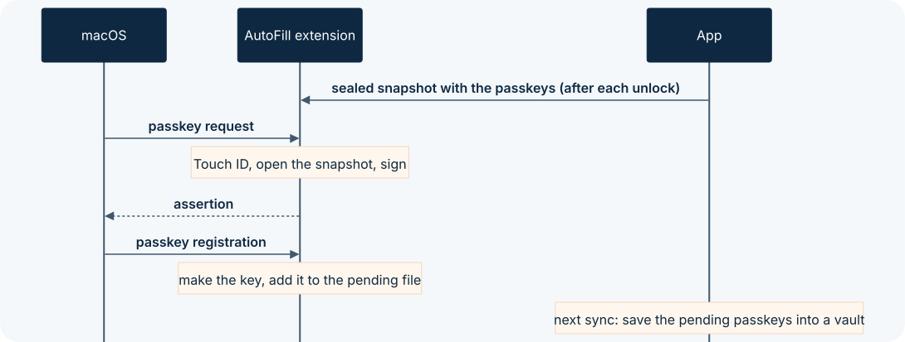

<!-- diagram 49-passkey-macos
```mermaid
sequenceDiagram
  participant M as macOS
  participant X as AutoFill extension
  participant A as App
  A-&gt;&gt;X: sealed snapshot with the passkeys (after each unlock)
  M-&gt;&gt;X: passkey request
  Note over X: Touch ID, open the snapshot, sign
  X--&gt;&gt;M: assertion
  M-&gt;&gt;X: passkey registration
  Note over X: make the key, add it to the pending file
  Note over A: next sync: save the pending passkeys into a vault
```
-->

The extension signs itself; the service is not involved. A pending passkey
works at once, before the app saves it.

### On Android

This diagram shows a passkey request on Android.

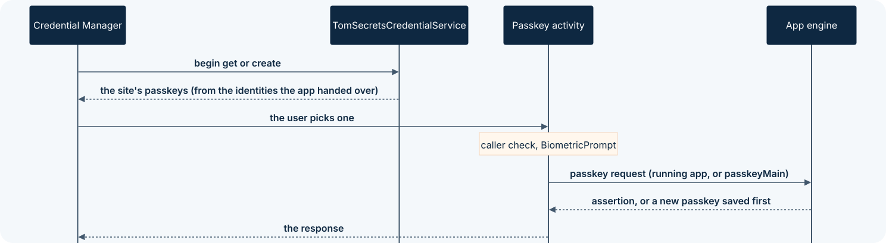

<!-- diagram 50-passkey-android
```mermaid
sequenceDiagram
  participant M as Credential Manager
  participant C as TomSecretsCredentialService
  participant P as Passkey activity
  participant E as App engine
  M-&gt;&gt;C: begin get or create
  C--&gt;&gt;M: the site's passkeys (from the identities the app handed over)
  M-&gt;&gt;P: the user picks one
  Note over P: caller check, BiometricPrompt
  P-&gt;&gt;E: passkey request (running app, or passkeyMain)
  E--&gt;&gt;P: assertion, or a new passkey saved first
  P--&gt;&gt;M: the response
```
-->

The caller check: a browser on the privileged-browser list names the
origin; an app must be named by the site's Digital Asset Links. A new
passkey is saved (written to GitHub, or kept as a change not yet written)
before the site gets its answer.

### On Windows through the plugin

This diagram shows Windows' passkey dialog asking the plugin.


<!-- diagram 51-passkey-windows
```mermaid
sequenceDiagram
  participant W as Windows passkey dialog
  participant P as Passkey plugin
  participant S as Service
  participant A as App
  W-&gt;&gt;P: GetAssertion or MakeCredential (signed request)
  Note over P: verify the request's signature, decode CTAP2
  P-&gt;&gt;S: passkeys, then passkeyGet (or passkeyCreate)
  S-&gt;&gt;A: approval prompt when no grant covers it
  S--&gt;&gt;P: passkeyAssertion or passkeyCreated
  P--&gt;&gt;W: the CTAP2 response
```
-->

Fails with: `NTE_BAD_SIGNATURE` (a request not signed by Windows), and the
service's refusals mapped to cancelled or excluded.

## Tools

### The ssh-agent

This diagram shows ssh signing with a key from the vaults.


<!-- diagram 52-ssh-agent
```mermaid
sequenceDiagram
  participant H as ssh
  participant S as Service (agent.sock)
  participant A as App
  H-&gt;&gt;S: session-bind (the server's host key)
  H-&gt;&gt;S: REQUEST_IDENTITIES
  S--&gt;&gt;H: IDENTITIES_ANSWER (the keys its grants allow)
  H-&gt;&gt;S: SIGN_REQUEST
  S-&gt;&gt;A: prompt (no grant for this host, or a key that asks to confirm)
  A-&gt;&gt;S: approve (this signature, or always for this host)
  S--&gt;&gt;H: SIGN_RESPONSE
```
-->

A forwarded agent (a later `session-bind` with forwarding) is offered only
keys with a forwarding grant, and every signature through it is confirmed
in the app. Locked, the agent waits for an unlock. Refusals are an agent
`FAILURE`; SHA-1 RSA signatures are refused.

### git's credential helper

This diagram shows git asking `git-credential-tsm` for a login.


<!-- diagram 53-git-helper
```mermaid
sequenceDiagram
  participant G as git
  participant T as git-credential-tsm
  participant S as Service
  participant A as App
  G-&gt;&gt;T: get (host, user)
  T-&gt;&gt;S: match (pick)
  S-&gt;&gt;A: pick a login (when no grant decides)
  T-&gt;&gt;S: get (the picked entry)
  T--&gt;&gt;G: username, password
  G-&gt;&gt;T: store (a new credential)
  T-&gt;&gt;S: propose
```
-->

"Always this login" writes a grant for the helper as started by git.
`erase` is ignored; a known credential is not proposed.

### `tsm run --file`

This diagram shows a command run with a key file from the vaults.


<!-- diagram 54-tsm-run-file
```mermaid
sequenceDiagram
  participant T as tsm run
  participant S as Service
  participant C as The command
  T-&gt;&gt;S: getMany (the --map references)
  T-&gt;&gt;S: getFile (each --file reference)
  S--&gt;&gt;T: file, chunks, end (SHA-256)
  Note over T: write to a temporary file (600 in a 700 folder)
  T-&gt;&gt;C: run with the variables
  Note over T: overwrite and delete the files
```
-->

### AWS, Docker and kubectl

This diagram shows the three tools' helpers.


<!-- diagram 55-tool-helpers
```mermaid
sequenceDiagram
  participant W as aws, docker, kubectl
  participant T as tsm (helper)
  participant S as Service
  W-&gt;&gt;T: aws-credentials, docker get, kube-credential
  T-&gt;&gt;S: getMany (or match and get for Docker)
  S--&gt;&gt;T: values
  T--&gt;&gt;W: credential_process JSON, Docker JSON, ExecCredential
```
-->

- **AWS** reads `UserName`, `Password` and `SessionToken` and answers
  `{"Version":1, "AccessKeyId", "SecretAccessKey", ...}`.
- **Docker** picks the registry's login as git does; `list` answers without
  secrets, `store` proposes, `erase` is ignored; an unknown registry is
  Docker's "credentials not found".
- **kubectl** gets an `ExecCredential` with the certificate and key, or the
  password as a token, and the expiry.

## Import and export

This diagram shows an import.


<!-- diagram 56-import
```mermaid
sequenceDiagram
  participant U as User
  participant A as App (Import)
  participant S as Service
  U-&gt;&gt;A: the export file (format detected)
  Note over A: read it (Bitwarden's password when needed)
  U-&gt;&gt;A: map its vaults to vaults or groups
  Note over A: preview (a dry run)
  A-&gt;&gt;S: save each changed vault
  A-&gt;&gt;U: report (added, updated, unchanged, not imported)
  U-&gt;&gt;A: delete the export
```
-->

The import reads the export with the core, matches entries imported before
by their source id, and writes only through `save`. The report names
entries, never values.

This diagram shows an export.


<!-- diagram 57-export
```mermaid
sequenceDiagram
  participant U as User
  participant A as App
  U-&gt;&gt;A: Export (a vault or a group)
  A-&gt;&gt;U: KDBX needs a new password, CSV and JSON warn that they are plain text
  Note over A: write the file with the core
  A-&gt;&gt;U: save it where the user chooses
```
-->

An export runs in the app; nothing goes through the service.
