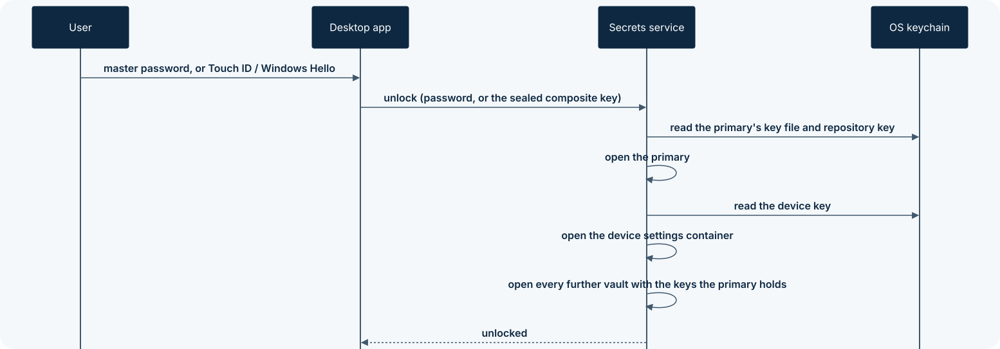
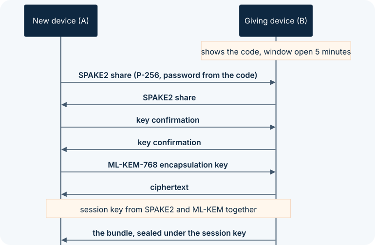
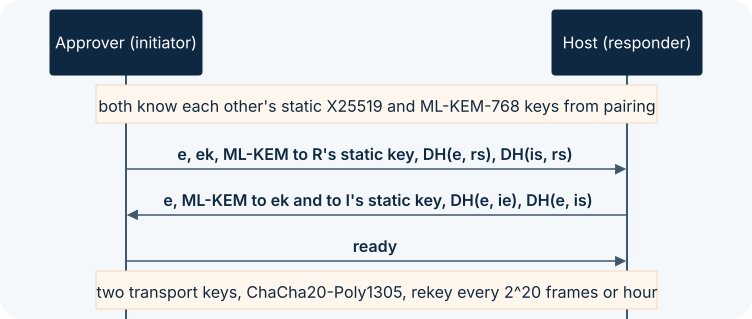

# The security model

How Tom Secrets Manager protects secrets: the layers around a stored vault,
every key with its lifecycle, how a program and a machine come to be
trusted, what is post-quantum and what is not, and what the product does
not protect against. The [overview](overview.md) gives the short version;
the [architecture](architecture.md) names the code. Each section names the
files that implement what it says, relative to their package's root:

- `core/` is `tom_secrets_core/lib/src/`;
- `service/` is `tom_secrets_service/lib/src/`;
- `client/` is `tom_secrets_client/lib/src/`;
- `ui/` is `tom_secrets_ui/lib/src/`.

`protocol.md` is the
[protocol document](https://github.com/al-the-bear/tom_secrets_clients/blob/main/protocol/protocol.md).

## The encryption layers of a stored vault

This diagram shows what surrounds the entries of a vault on GitHub.



<!-- diagram 1-layers
```mermaid
flowchart LR
  e["Entries"]:::file
  kdbx[("KDBX 4.1<br/&gt;AES-256, inner stream ChaCha20,<br/&gt;key: Argon2id over the<br/&gt;master password and key file")]:::vault
  outer["Outer file .kdbx.tsmx<br/&gt;XChaCha20-Poly1305 (default)<br/&gt;or AES-256-GCM,<br/&gt;one slot per repository key"]:::file
  gh["GitHub sees: the path,<br/&gt;the size, the commits"]:::external
  e --&gt; kdbx
  kdbx --&gt; outer
  outer --&gt; gh
```
-->

**KDBX 4.1.** Every vault is a KDBX 4.1 file, the format of KeePass, so
KeePass and KeePassXC open it. A new vault's data cipher is AES-256, its
inner stream (for protected fields) ChaCha20, and its key derivation
Argon2id with 64 MiB of memory, 4 iterations and 1 lane, the same on
every device (about a second to unlock on a phone, a third of one on a
desktop); a vault keeps the parameters it was made with, and one keyed by
anything but Argon2id is refused at creation. The key is the KeePass
composite key: SHA-256 over the password's hash and the key file's hash.
(`core/new_vault.dart`; the defaults of `tom_kdbx_store` and its KDBX
library.)

**The outer file.** A vault in a repository can be stored as
`<vault>.kdbx.tsmx`. Its content is encrypted once under a fresh random
32-byte file key, and the file key is wrapped under each valid repository
key in a slot of its own. The default cipher is XChaCha20-Poly1305;
AES-256-GCM can be chosen, and a rewrite keeps the file's cipher. The
authenticated data binds every slot and the content to the header and to
the file's path in the repository, so neither a slot nor the content can be
moved to another file. (`core/outer.dart`, `core/stored_vault.dart`.)

This diagram shows the outer file's structure.



<!-- diagram 2-tsmx
```mermaid
flowchart TB
  h["Header: magic TSMX, format 1,<br/&gt;cipher id (1 AES-256-GCM, 2 XChaCha20-Poly1305),<br/&gt;slot count (1 to 255)"]:::file
  s["Per slot: key id (8 bytes of SHA-256 of the repository key),<br/&gt;nonce, the file key wrapped (32 bytes), tag"]:::file
  c["Content: nonce, then the KDBX file encrypted<br/&gt;under the file key, tag"]:::file
  h --&gt; s
  s --&gt; c
```
-->

A file has one slot normally, and two while a repository key is rotated
(below): a device holding either key opens it.

**What GitHub sees.** The repository holds the outer files (or plain KDBX
files when no repository key is set), the recipients files of shared vaults, the
inbox folders and the compaction workflow. GitHub, and anyone who can read
the repository, sees the file names and sizes, when each commit was made
and by which device, and the history up to the last compaction; never an
entry, a field or a key. Old commits hold the vault under old keys until a
compaction cuts them, which happens at once after every key change.

## The keys

| Key | Protects | Made | Kept |
| --- | --- | --- | --- |
| Master password | the primary vault | by the user | in the user's head |
| Key file | a vault, beside the password | 32 random bytes in a KeePass XML file | each device's keychain, the primary, the emergency sheet |
| Repository key | a vault's outer file | 32 random bytes | each device's keychain, the primary, the emergency sheet |
| Composite key | the primary, for the OS unlock | from password and key file | behind Touch ID or Windows Hello, never the password |
| Device key | the device settings container | 32 random bytes | the keychain, the vault, or a key file |
| Admin key | the admin endpoint | 32 random bytes per service start | the keychain of the app and `tsm` |
| Windows client token | the client endpoint on Windows | 32 random bytes per start | the user-only runtime directory |
| Approval client token | one program's grant | 32 random bytes | the program; the host keeps its hash |
| Approver key pair | grants and other signed objects | Ed25519 + ML-DSA-65 | the device settings container |
| Approval-link key pair | the approval link | X25519 + ML-KEM-768 | the device settings container |
| Audit-log key | the audit log | 32 random bytes | the device settings container |
| Member key | shared vaults and shares | `age` hybrid identity | the primary's `tsm.sharing` group |
| Shared vault keys | a shared vault | key file and repository key | the recipients file, for each member |
| GitHub token | the vault repositories | pasted, or the App's device flow | the keychain |
| Passkey private key | a site's passkey | ES256 or Ed25519 | the site's login entry |
| AutoFill snapshot key | the macOS AutoFill snapshot | 32 random bytes per unlock | the keychain, behind Touch ID |
| Relay instance token | the relay server | by the relay's operator | `relay.yaml` there; the keychain here |

The keychain is the OS's: the macOS login keychain, the Secret Service
(libsecret) on Linux, the Windows Credential Manager, under the service
name `tom-secrets-manager` (`client/admin/keychain_names.dart`).

This diagram shows which key opens which.



<!-- diagram 3-key-graph
```mermaid
flowchart LR
  mp{{"Master password"}}:::key
  kf{{"Key file"}}:::key
  rk{{"Repository key"}}:::key
  prim[("Primary vault")]:::vault
  others[("Further vaults")]:::vault
  dk{{"Device key"}}:::key
  dev["Device settings:<br/&gt;approver, link and<br/&gt;audit-log keys"]:::file
  mk{{"Member key"}}:::key
  rf["Recipients file"]:::file
  shared[("Shared vault")]:::vault
  mp -.-&gt; prim
  kf -.-&gt; prim
  rk -.-&gt; prim
  prim -- holds their keys --&gt; others
  prim -- holds --&gt; mk
  mk -.-&gt; rf
  rf -- holds its keys --&gt; shared
  dk -.-&gt; dev
```
-->

### The master password

It opens the primary vault, together with the primary's key file. It is
never stored: not in the keychain, not in the OS unlock, not on the
emergency sheet. It is changed by a guided rotation (below), which keeps
the next password in the primary until the switch; it has no rotation age
of its own. A lost master password cannot be recovered; the vaults are lost
with it. (`core/primary.dart`, `core/rotation.dart`,
`core/device_settings.dart`.)

### The key file

A KeePass 2.0 XML key file holding 32 random bytes, which adds to the
password, so a guessed password alone opens nothing. Each desktop keeps it
in the keychain under `tsm.key-file.<id>`, the id the first 16 hex digits
of SHA-256 over the vault's identity; the primary keeps the further
vaults' key files, so one unlock opens them all. It is printed on the
emergency sheet as a QR code with its key id. A rotation writes the next
key file into the primary, each device takes it as `<handle>.next`, and the
switch makes it the key file. (`core/key_file.dart`, `core/locator.dart`,
`core/primary.dart`.)

### The repository key

32 random bytes that wrap a vault's outer file key. Kept like the key
file (`tsm.repository-key.<id>`, the primary's field `tsm.outer-key`, the
emergency sheet). A rotation writes `tsm.next-outer-key`; at the switch the
files get two slots and the old key moves to `tsm.previous-outer-key` until
the finish removes it and the history is cut. (`core/outer.dart`,
`core/primary.dart`.)

### The composite key and the OS unlock

The app can keep the primary's **composite key** and repository key (never
the password) in a store gated by Touch ID or Windows Hello
(`tom_biometric_storage`, under `tom_secrets.os_unlock.<store>`), and
unlock the service with them: a session item, forgotten at a service stop,
at "Lock completely" and at a new start, or a saved one when the user
chose "Remember the master password". Linux has no gated store. On its way
to the service the bundle is sealed with AES-256-GCM under a key derived by
HKDF-SHA-256 from the admin key and both nonces of the admin connection
(info `tsm-bundle-v1`), the vault name and the service start in the
authenticated data. A bundle that no longer opens (a re-keyed vault, a
changed enrolment) is forgotten, and the master password is asked again.
On macOS without the team-signed build the gate is Touch ID's prompt, not
a key bound to the biometric; Windows Hello's key is bound.
(`client/admin/unlock_bundle.dart`, `ui/state/os_unlock.dart`.)

### The device key and the device settings container

Each machine keeps its own settings and trust material in a local KDBX
file, `<data>/device-settings.kdbx`, never synced. Its key is 32 random
bytes, kept by the mode `bootstrap.yaml` names: `keychain` (handle
`tsm.device-settings.<host>`), `vault` (the primary's entry
`@host:<host>/.tom-secrets/device`), `keyfile` (`<container>.key`, readable
by the user only), or `auto`, the keychain where there is one. Since the key
is random, the container's own key derivation adds no protection. Losing it
loses this machine's trust material: the machine is paired again.
(`core/device_settings.dart`, `service/bootstrap.dart`.)

### The admin key and the admin challenge

Whoever starts the service (the app or `tsm start`) makes 32 random bytes
and hands them over on the service's standard input; they never touch a
file. The app and `tsm` keep the key in the keychain under
`tsm.admin.<serviceStart>`. Each admin connection runs a challenge: the
service sends a 32-byte nonce and its start time, the admin answers
HMAC-SHA-256 over `tsm-admin-v1`, both nonces and the start, and the
service proves itself back under `tsm-service-v1`. A wrong answer is
delayed 1, 2, 4 seconds and up to a minute. An admin that lost the key
claims a new one with the master password (`claim`), which revokes the old
one. Locking keeps the admin key. (`client/admin/admin_auth.dart`,
`client/admin/starter.dart`, `protocol.md` 6.1, 6.2.)

### Client tokens

Two different things:

- **The Windows client token.** On Windows the client endpoint is a
  localhost TCP port, which any user's process could reach, so each start
  writes 32 random bytes to `client.token` in the user-only runtime
  directory; a client sends it in `hello`.
- **An approval's client token.** An approver can give a program a token
  of its own (32 random bytes) with a grant whose subject names the
  token's id (`exe-token <path> <tokenId>`). The host keeps only the
  token's hash; revoking the grant invalidates it. (`protocol.md` 7.4.)

### Approver keys and approval-link keys

Each device has an **approver key pair**, Ed25519 and ML-DSA-65 made from
64 random bytes, which signs grants and the other signed objects, and an
**approval-link key pair**, X25519 and ML-KEM-768 made from 96 random
bytes, which authenticates the approval link. Both live in the device
settings container with the **audit-log key** (32 random bytes). The public
halves are exchanged at pairing. `keys.rotate` replaces them: a new
approver key writes a key-change statement signed by the old and the new
pair and signs the grants again; the previous link key stays usable for 14
days. The rotation age is 24 months. (`core/trust.dart`,
`core/signed_objects.dart`.)

### Member keys

A person's member key is an `age` v1.3 hybrid identity
(`AGE-SECRET-KEY-PQ-1…`, a 32-byte seed) whose public key is the recipient
`age1pq1…`: X25519 and ML-KEM-768 combined as X-Wing. It is kept in the
primary's `tsm.sharing` group as the `member-key` entry. Its **fingerprint**
is the base32 SHA-256 of the recipient; people compare its first 20
characters (100 bits) before they add each other. Its rotation age is 24
months. (`core/member_keys.dart`, `tom_secrets_age/lib/src/recipient.dart`.)

### Shared vault keys and the recipients file

A shared vault is opened by a key file alone, plus a repository key when it
is outer encrypted. Both are in its recipients file `<vault>.keys.age`, an
`age` file encrypted to every member's hybrid recipient: JSON
(`tsm-shared-vault-keys/1`) with the vault's name, its keys and the
members. Anyone holding a member key can open it, the standard `age` tool
included. (`core/shared_vault.dart`.)

### GitHub tokens and the App session

A device reaches its vault repositories with a pasted fine-grained token
(keychain `tsm.github-token.<owner>:<repo>`) or, by default, the product's
GitHub App by the device flow. The App's access token lasts 8 hours and is
renewed 5 minutes ahead by the service alone; its refresh token lasts 6
months unused. Both are in the keychain under `tsm.github-app.session`.
There is no App private key or client secret anywhere. A refused refresh
asks the user to sign in again; revoking the App's authorization on GitHub
signs out every device, a pasted token cuts off one.
(`service/github_app.dart`, `core/locator.dart`.)

### Passkeys

A passkey's private key (ES256 or Ed25519, PKCS#8 PEM) is a protected field
of its site's login entry, in the fields KeePassXC uses
(`KPEX_PASSKEY_*`). The client endpoint never serves a passkey field: the
service signs with it, for the browser host and the Windows passkey plugin
only. (`core/passkey.dart`, `core/webauthn.dart`.)

### The AutoFill snapshot key

On macOS the app writes the logins for the AutoFill provider into a
snapshot file in the App Group container, sealed with AES-256-GCM under a
32-byte key made at each unlock and forgotten at the lock. The key is a
data-protection keychain item in the shared access group, readable only
while the Mac is unlocked, on this device only, and only after Touch ID
(`biometryCurrentSet`; user presence on a Mac without Touch ID). A new
fingerprint removes it, and the app writes a new one. Passkeys the provider
creates wait in a pending file under a separate key until the app saves
them into a vault. (`ui/state/autofill.dart`,
`tom_secrets_desktop`'s `TomSecretsAutofillChannel.swift`,
`TomSecretsAutofillKit`.)

### The relay instance token

A relay server in token mode admits a mailbox put or an approval link only
with an instance token (at least 16 characters, in its `relay.yaml`). The
app keeps the token in the keychain through the service
(`tsm.relay-token.<the relay id in base64url>`), and it never leaves the
service.
(`tom_secrets_relay/lib/src/config.dart`, `service/relay_links.dart`.)

### The emergency sheet

The app prints, or saves as a PDF, an emergency sheet: the vaults and
their repositories, a blank line to write the master password on by hand,
each key file and repository key as a QR code with its key id, and the
format and cipher of each outer file. The sheet and the master password
are everything needed to open the vaults without any device: a plain KDBX
vault opens in KeePass with its key file, and an outer file is decrypted
by the format the sheet names. (`ui/state/emergency_sheet.dart`.)

## Unlocking

This diagram shows an unlock from the app.



<!-- diagram 4-unlock
```mermaid
sequenceDiagram
  participant U as User
  participant A as Desktop app
  participant S as Secrets service
  participant K as OS keychain
  U-&gt;&gt;A: master password, or Touch ID / Windows Hello
  A-&gt;&gt;S: unlock (password, or the sealed composite key)
  S-&gt;&gt;K: read the primary's key file and repository key
  S-&gt;&gt;S: open the primary
  S-&gt;&gt;K: read the device key
  S-&gt;&gt;S: open the device settings container
  S-&gt;&gt;S: open every further vault with the keys the primary holds
  S--&gt;&gt;A: unlocked
```
-->

The service opens the primary first, completing the keys from the keychain
(and trying the next keys of a rotation when the current ones fail), then
the device settings container, then every vault the primary lists; a vault
whose key does not open is `needs_unlock` and the others are still served.
Then it starts the trust material, the audit log, the approvals and the
links. (`service/service.dart`.)

**The lock modes** (`core/device_settings.dart`,
`service/lock_policy.dart`):

- **(a) never:** the service stays unlocked until it is locked by hand.
- **(b) idle:** it relocks when the user's input has been idle for a while
  (30 minutes by default); the master password unlocks it again.
- **(c) OS unlock:** it relocks when idle or when the screen locks (the app
  senses the screen lock), and Touch ID or Windows Hello unlocks it. On
  Linux, or without the app, it behaves as (b).

In any mode a hard maximum unlocked time can be set, and the app can lock
at sleep. The idle time comes from CoreGraphics on macOS,
`GetLastInputInfo` on Windows and logind on Linux; where there is no
desktop session (a server), the service never locks itself. **Locking**
forgets the vaults, the index, the device settings and every key held in
memory; only the admin key stays. The app forgets the AutoFill key.

**On a phone** the vaults are fetched at the unlock and held in memory
only. The key files, repository keys and tokens a pairing delivered are in
the iOS keychain or an Android Keystore-encrypted file, excluded from
backups; the biometric check guards the composite key. The app locks 30
seconds after it goes to the background by default.
(`tom_secrets_mobile/lib/src/mobile_keychain.dart`,
`tom_secrets_mobile/lib/src/mobile_engine.dart`.)

## Trust between programs

This diagram shows how the service decides a program's request.



<!-- diagram 5-decide
```mermaid
flowchart TB
  req["A request on the client endpoint"]:::client
  m{"Measured?<br/&gt;Same OS user?"}:::decision
  g{"A grant signed by<br/&gt;a recorded approver?"}:::decision
  p["Prompt the approvers:<br/&gt;the app, the approval link"]:::program
  c["Approval code,<br/&gt;a single-use token"]:::key
  ok["The value"]:::step
  no["Refused"]:::step
  req --&gt; m
  m -- no --&gt; no
  m -- yes --&gt; g
  g -- allow --&gt; ok
  g -- never --&gt; no
  g -- none --&gt; p
  p -- allow --&gt; ok
  p -- refuse or timeout --&gt; no
  p -- no approver --&gt; c
  c -- token --&gt; ok
  c -- timeout --&gt; no
```
-->

**Peer measurement.** The service never trusts what a client says about
itself. It reads the peer's process from the OS: on Linux the PID and user
from `SO_PEERCRED` and the rest from `/proc`; on macOS from
`LOCAL_PEERPID` and `LOCAL_PEERCRED`, `proc_pidpath` and
`sysctl(KERN_PROCARGS2)`; on Windows the owner of the localhost TCP
connection from `GetExtendedTcpTable`, then the process's image, command
line and start time. It reads the start time before and after, so a reused
PID is refused. A process of another OS user is refused (`other_user`), one
it cannot measure too (`unidentifiable`). For an interpreter (Python,
Node.js, Bun, Deno, Dart, Java, Ruby, Perl, the shells, PowerShell) the
identity is the script with its SHA-256. (`service/peer_identity.dart`,
`service/identity.dart`.)

**Grants.** The allow list of each host is in the primary vault, in
`tsm.grants/<host>`. A grant counts only when an approver key this device
recorded at pairing (or its own) signed it with **both** Ed25519 and
ML-DSA-65; anything else in the vault is ignored. The most specific grant
decides (the executable started by a given parent, then an executable,
script or token, then a folder, then an interpreter; a reference before a
store before everything), and `never` beats `allow` at the same rank. A
pinned grant holds only while the file's hash is the one recorded.
(`service/approvals.dart`, `core/grants.dart`, `protocol.md` 7.3.)

**Approvals.** A request no grant answers goes to the approvers: the app on
this machine and the paired approvers over the approval link; the first
answer wins. A lasting answer becomes a grant signed by the approving
device. Prompts are rate-limited: one per identity and reference, at most
three per identity, and three refusals in ten minutes hold the identity
back ten minutes. The approval timeout is 60 seconds by default.

**Approval codes.** With no approver within reach, the request shows a
10-character base32 code derived from the host, the request and its id. A
trusted device answers it with a 26-character token: HMAC-SHA-256 under the
approval-token key the two devices derived at pairing, over the code and
the decision, cut to 128 bits. The token is compared in constant time,
used once and expires with the code (5 minutes by default); three bad
tokens end the request. (`core/approval_code.dart`, `protocol.md` 7.5,
9.5, 9.6.)

**The admin endpoint** answers only the app and `tsm`: the measured
executable must be one of those beside the service (or one
`bootstrap.yaml` adds), and then the admin key's challenge must pass.
(`service/service.dart`, `tomSecretsAdminExecutables`.)

**The browser host and the passkey plugin** are recognised by their real path
beside the service, in the app's `tsm/bin` folder. Only the browser host and
the helpers (git's and Docker's credential helpers, `tsm`) may ask which
logins match a page or propose a login; only the browser host and the passkey
plugin may use passkeys, and the passkey plugin nothing else. A system vault's
value never reaches the browser host. (`service/service.dart`, `protocol.md`
5.5, 5.8.)

**Tom servers** read their configuration's `secret:local:` references through
`tom_secrets_provider`, a client like any other: the service measures the
server's process and answers by its grants, and the first request of a new
server goes to approval. The provider holds no key; it asks for one field
per request. (`tom_secrets_provider`, `protocol.md` 5.)

**The App Group socket.** Safari's extension and its host run sandboxed.
When the service runs from the team-signed macOS app, it also offers its
client endpoint at `~/Library/Group Containers/<group>/tsm/client.sock`,
with the same measurement and grants. (`service/app_group.dart`.)

## Trust between machines and people

### Pairing

This diagram shows the pairing exchange.



<!-- diagram 6-pairing
```mermaid
sequenceDiagram
  participant N as New device (A)
  participant G as Giving device (B)
  Note over G: shows the code, window open 5 minutes
  N-&gt;&gt;G: SPAKE2 share (P-256, password from the code)
  G-&gt;&gt;N: SPAKE2 share
  N-&gt;&gt;G: key confirmation
  G-&gt;&gt;N: key confirmation
  N-&gt;&gt;G: ML-KEM-768 encapsulation key
  G-&gt;&gt;N: ciphertext
  Note over N,G: session key from SPAKE2 and ML-KEM together
  G-&gt;&gt;N: the bundle, sealed under the session key
```
-->

The code (`7-guitar-orbit`: a number from 1 to 999 and two words from a
list of 256) is the password of SPAKE2 as RFC 9382 defines it, on P-256
with SHA-256 and HKDF, the protocol's name `tsm-pair-v1` as associated
data. An eavesdropper learns nothing about the code, and an active
attacker gets one guess: the window takes the first connection only and
burns the code whether it was right or wrong. A wrong code fails the key
confirmation. Inside the channel the two run an ML-KEM-768 exchange, and
the session key is derived from both secrets, so breaking either one alone
does not open the bundle. The frames are XChaCha20-Poly1305. The window
closes after 5 minutes and listens on private addresses only.

The bundle carries the chosen vaults with their key files and repository
keys, the shared configuration, the GitHub tokens and the giver's public
keys; never a private key, the master password, the allow list or the
audit log. Both sides also derive the approval-token key for approval
codes. (`core/pairing.dart`, `protocol.md` 9.8.)

### The approval link

This diagram shows the approval link's handshake.



<!-- diagram 7-link
```mermaid
sequenceDiagram
  participant I as Approver (initiator)
  participant R as Host (responder)
  Note over I,R: both know each other's static X25519 and ML-KEM-768 keys from pairing
  I-&gt;&gt;R: e, ek, ML-KEM to R's static key, DH(e, rs), DH(is, rs)
  R-&gt;&gt;I: e, ML-KEM to ek and to I's static key, DH(e, ie), DH(e, is)
  I-&gt;&gt;R: ready
  Note over I,R: two transport keys, ChaCha20-Poly1305, rekey every 2^20 frames or hour
```
-->

The link is Noise KK, `tsm-link-v1_KK-hybrid_25519+MLKEM768_ChaChaPoly_SHA256`:
both sides know each other's static keys from pairing, which are the only
trust anchor. Beside the four X25519 exchanges, three ML-KEM-768
encapsulations are mixed into the key, one to the responder's static key,
one to the initiator's ephemeral key and one to its static key. The host
sends nothing until it has read the approver's `ready`, which proves the
approver holds its static ML-KEM key. Through a relay server the same
handshake runs over two relay channels named by a random 128-bit link id.
(`core/approval_link.dart`, `protocol.md` 9.7.)

### Device records and revocation

The primary keeps a record per device (`.tom-secrets/devices`): its platform,
when and by whom it was paired, the key ids it holds, its approver key, and
how it reaches GitHub. `pair.revoke`, from the app only, removes the device
from this machine's approvers and hosts and marks its record revoked. What it
received stays with it, so after losing a device the user rotates the keys it
held and withdraws its GitHub access on GitHub (the record says whether it
used a pasted token or the App). (`core/device_records.dart`,
`service/service.dart`.)

### Signed objects

Grants, revocations, approval records and key-change statements are
encoded with length-prefixed fields (no JSON is signed) under a label each
(`tsm-grant-v1`, `tsm-revoke-v1`, `tsm-approval-v1`, `tsm-keychange-v1`).
Each carries a signature list with one Ed25519 and one ML-DSA-65
signature. An object is accepted only when one recorded approver key
verified **both**; unknown keys and algorithms are ignored. A key change is
accepted only when the old and the new key both signed with both
algorithms. (`core/signed_objects.dart`, `protocol.md` 9.1–9.4.)

### Member key fingerprints

Before adding a member, the two people compare the first 20 characters of
the fingerprint, by any channel they trust. The app refuses a malformed
key, a plugin recipient, a classical identity, an ML-KEM key that fails
FIPS 203's check, a duplicate and the user's own key; classical `age1…`
keys are taken for exports only, never mixed with hybrid ones in one
file. (`tom_secrets_age/lib/src/recipient.dart`.)

## Post-quantum protection

Data recorded today must stay secret when a quantum computer can break
X25519 and P-256: "harvest now, decrypt later". Everything the product
sends between devices that a recording could later open is therefore
hybrid, a classical and a post-quantum algorithm together, so it holds as
long as either holds.

| Operation | Classical | Post-quantum |
| --- | --- | --- |
| Pairing | SPAKE2 on P-256 | ML-KEM-768 inside |
| The approval link | X25519 (Noise KK) | ML-KEM-768 mixed into the key |
| Grants, revocations, approvals, key changes | Ed25519 | ML-DSA-65 |
| Member keys, recipients files, shares | X25519 | ML-KEM-768 (X-Wing, `age`'s `mlkem768x25519`) |

The vaults, outer files and the audit log are encrypted with symmetric
256-bit keys (AES-256, ChaCha20, XChaCha20), which a quantum computer does
not break in practice. The post-quantum algorithms come from `tom_pqc`:
ML-KEM-768 and ML-DSA-65 from the vendored mlkem-native and mldsa-native C
code, X-Wing, and the composite ML-DSA-65 + Ed25519.

What the product cannot make post-quantum, because others choose the
algorithm:

- GitHub's TLS, which carries the already encrypted files;
- SSH keys (the servers verify Ed25519, ECDSA or RSA), passkeys (the sites
  verify ES256 or Ed25519), certificates and PGP keys;
- a share to classical `age1…` keys, which the share dialog says is not
  protected against a future quantum computer.

## Sharing and rotation

This diagram shows a shared vault's recipients file before and after a
member is removed.



<!-- diagram 8-remove-member
```mermaid
flowchart LR
  before["team.keys.age<br/&gt;to Alice, Bob, Carol"]:::file
  rekey["New key file and<br/&gt;repository key"]:::key
  after["team.keys.age<br/&gt;to Alice, Bob"]:::file
  vault[("team.kdbx.tsmx<br/&gt;re-keyed")]:::vault
  mark["Entries marked<br/&gt;rotate, due today"]:::file
  before -- remove Carol --&gt; rekey
  rekey --&gt; after
  rekey --&gt; vault
  vault -. offered .-&gt; mark
```
-->

**Adding a member** writes the recipients file for one more recipient; the
vault and its keys stay. **Removing a member** makes a new key file (and a
new repository key when outer encrypted), re-keys the vault and writes the
recipients file in the same commit. What the removed member saw stays
with them, and old recipients files in the history still open old
versions until the history is cut, so the app offers to mark the vault's
entries for rotation: the tag `rotate`, expiring today, which the health
report lists. (`core/shared_vault.dart`, `ui/state/session_state.dart`.)

**Shares** are `tsm.share` v1 documents in an `age` file: to members'
hybrid keys, to a passphrase (`age`'s scrypt, work factor 18), or to
classical keys alone. An inbox package expires after 30 days; a relay
server gives a mailbox's items only to a client that answers a challenge
encrypted to the member key, valid 5 minutes. (`core/share.dart`,
`tom_secrets_relay/lib/src/mailbox.dart`.)

**Rotation with a migration period.** A rotation of a vault's keys, a
repository key, a member key or a shared vault's keys is recorded in
`.tom-secrets/rotations` (the primary's, or the shared vault's): kind,
target, old and new key id, start, switch, end, who started it and which
devices are still pending. The record is also a lock: a second rotation of
the same key is refused, naming the first.

This diagram shows a guided rotation's timeline.



<!-- diagram 9-rotation
```mermaid
flowchart LR
  prep["Prepare:<br/&gt;next keys in the primary"]:::step
  take["Each device takes them<br/&gt;at its next sync"]:::step
  sw["Switch:<br/&gt;vaults re-keyed<br/&gt;(two slots for a repository key)"]:::step
  mig["Migration period<br/&gt;(14 days)"]:::step
  fin["Finish:<br/&gt;old key dropped,<br/&gt;history cut"]:::step
  prep --&gt; take
  take --&gt; sw
  sw --&gt; mig
  mig --&gt; fin
  cancel["Cancelled:<br/&gt;next keys cleared"]:::step
  prep -. cancel before the switch .-&gt; cancel
```
-->

Prepare writes the next keys beside the current ones; every device takes
them at its next sync and records their ids, so the app lists the devices
still without them. The switch re-keys; a repository key rotated alone
leaves the files with two slots, so a device holding only the old key can
still read (but not write). A device that lacks a vault's new key serves
its last copy read-only (`keyChanged`) until the key arrives. After 14 days
(or "Finish now"), the finish drops the old key, rewrites the files with
one slot, cuts the history and offers the new emergency sheet.
(`core/rotation.dart`, `core/primary.dart`, `service/vault_set.dart`.)

**Key ages.** The app reminds the user from 30 days before a vault's key is
due (12 months), and of the approver, link and member key pairs after 24
months, from 14 days before a GitHub token expires, then 7 days and 1 day
before, and daily once due. (`core/device_settings.dart`,
`service/key_expiry.dart`.)

## Memory and process hygiene

- **Secrets stay in bytes.** A resolved value is a `TomSecretsFieldValue`
  over `tom_crypto`'s protected value, zeroed after use; keys held while
  unlocked are protected values, zeroed at the lock. A value sent to a
  client is written into its frame straight from those bytes, never
  through a string, and the frame is zeroed once the socket has flushed it.
  (`core/mapping.dart`, `service/secret_frame.dart`,
  `service/connection.dart`.)
- **No core dumps, no reading of the service's memory.** At start the
  service sets `RLIMIT_CORE` to 0 on Linux and macOS and makes itself not
  dumpable on Linux; on Windows it sets the error mode and a process DACL
  that refuses memory read and write to all but SYSTEM. The macOS app is
  built with the hardened runtime. (`service/hardening.dart`.)
- **The data directory is the user's alone.** It holds the offline cache,
  the device settings container, the audit log, the operational log and
  the agent's public keys. It is made mode 0700 (on Windows: the
  inheritance cut, only the user and SYSTEM) by the First run, `tsm pair`,
  the app and every start of the service; at each start the service
  tightens a looser one (group and others lose every bit on the folder and
  everything in it) and logs `data_directory_tightened`, and refuses one
  another user owns (exit code 8). On Linux and macOS it also sets its
  umask to 077, so every file it writes is 0600. (`client/admin/
  data_directory.dart`, `service/hardening.dart`, `core/first_run.dart`.)
- **Logs without values.** The operational log never holds a value,
  password, key or token; an exception is logged by its type and code,
  never its message; references and identities appear only at the debug
  level. The audit log records each decision with the reference and the
  identity, never the value, each line XChaCha20-Poly1305 under the
  audit-log key, one file per day, kept 90 days.
  (`service/log.dart`, `service/audit.dart`.)
- **The clipboard.** A copied value is cleared after 30 seconds, and only
  while the clipboard still holds it. On macOS it is marked concealed and
  transient, so clipboard managers skip it; on Android it is marked
  sensitive; on iOS it stays on the device. On Windows and Linux it is
  plain text: Windows keeps it in its clipboard history.
- **Screens.** The desktop app's window is excluded from screen capture on
  macOS and Windows (not possible on Linux); the Android app sets
  `FLAG_SECURE`, and the iOS app covers its screen when it leaves the
  foreground.
- **Client libraries.** Every client's value type prints as
  `SecretValue(<ref>: ***)` and is overwritten when closed (the C client
  wipes its buffers when a value is freed).

## The threat model

**Protected against:**

| Threat | Why it fails |
| --- | --- |
| A stolen laptop, switched off or locked | The vaults on disk (the offline cache) are encrypted as stored; the keychain items need the user's login; without the master password the key files open nothing |
| A stolen or read GitHub account | The repository holds only encrypted files; a rewritten history is shown to the user, who decides; every desktop keeps its offline copy |
| A malicious program of the same user | It is measured and gets nothing without a signed grant or an approval; it cannot forge a grant without an approver's private keys |
| A program that changed after it was granted | A pinned grant no longer matches its hash |
| A process of another OS user | The endpoints are the user's alone; another user's peer is refused |
| A malicious relay | It carries only encrypted frames; pairing is authenticated by the code, the link by keys from pairing, mailbox items are `age` files, and a mailbox opens only to its member key's proof |
| A lost phone | Its vaults are in memory only while unlocked; the unlock needs the master password or the biometric; the device is revoked and its GitHub access withdrawn |
| An eavesdropper recording today for a quantum computer | Every exchange between devices is hybrid |
| A guessed pairing code | One guess per window, then the code is burnt |

**Not protected against:**

- **A compromised session while unlocked:** code running as the user with
  the OS's debugging rights, administrator or root access, or malware inside
  a program the user approved, can reach what that session can.
- **A keylogger** that catches the master password, and the key files from
  the same machine's keychain.
- **A weak master password** together with the key file: Argon2id makes each
  guess cost, but does not stop a short password.
- **Losing both** the master password and every copy of the keys (devices
  and emergency sheet): there is no recovery.
- **What GitHub and a relay see around the data:** names, sizes, times,
  which devices talk.
- **What a removed member already saw:** removal protects what comes after;
  the rotation offer covers the rest.

**Residual risks the code names:**

- the Windows clipboard history and the plain clipboard on Linux;
- no screen-capture exclusion on Linux;
- the gate-only Touch ID item on a Mac without the team-signed build;
- a shared vault's old recipients files in the history until it is cut.

## Verifying it

| Check | Where | What it shows |
| --- | --- | --- |
| RFC 9382 vectors | `tom_secrets_core/test/pairing_test.dart` | SPAKE2 matches the RFC |
| Protocol vectors | `tom_secrets_clients/protocol/vectors/` | frames, references, HMACs, signatures, approval codes and the link handshake; recomputed independently with Go's standard library |
| The `age` testkit | `tom_secrets_age/test/age_test.dart` | the hybrid and scrypt vectors of the C2SP test kit |
| `filippo.io/age` | `tom_secrets_core/test/member_keys_test.dart` | member keys made by `age` v1.3.2 read back |
| ML-KEM, ML-DSA, X-Wing | `tom_pqc/test/` | ACVP and Wycheproof vectors, the X-Wing draft, RFC 10073, and a cross-check against Go's crypto |
| GnuPG | `tom_secrets_core/test/typed_keys_test.dart` | PGP keys round trip with GnuPG 2.5 |
| OpenSSL | `tom_secrets_core/test/ssh_agent_test.dart` | OpenSSL-encrypted SSH keys, where `openssl` is installed |
| KeePassXC | `tom_secrets_core/test/new_vault_test.dart` | new vaults open in `keepassxc-cli`, where installed |
| KeePass files | `tom_kdbx_store`'s compatibility corpus | files written by KeePass 2.62, KeePassXC and the libraries |
| Outer-format fixtures | `tom_secrets_core/test/fixtures/outer/` | files every later version must still open |
| Passkeys | `tom_secrets_core/test/webauthn_test.dart` | ES256 and Ed25519 assertions verify |
| The conformance suite | `tom_secrets_clients/conformance/` | every client library behaves the same, with the parity gate |

Some checks were made by hand and are not repeated by the tests: the
certificates against OpenSSL, the passkeys against `py_webauthn` as a
relying party, and `age` files both ways with `filippo.io/age`.
