# The secrets service: operator's guide

This guide is for the person who runs the Tom Secrets Manager's secrets
service, on a desktop or on a headless server: how it starts, where it
keeps what, what it serves and to whom, how to read its logs, and what to
do when something goes wrong. The package's [README](../README.md) is the
reference for the service's internals; every setting and file is in the
[configuration reference](../../doc/configuration.md).

The service has no window of its own. The blocks starting with `$` show
what it leaves for you to read: its folders, `service.json`, its log and a
status report, from a demo installation (regenerated by the package's
tests, so they show what the service writes today).

## Contents

- [What the service is](#what-the-service-is)
- [Starting and stopping it](#starting-and-stopping-it)
- [The runtime and data directories](#the-runtime-and-data-directories)
- [Unlocking and the lock modes](#unlocking-and-the-lock-modes)
- [The device settings](#the-device-settings)
- [The vaults it serves](#the-vaults-it-serves)
- [Its states](#its-states)
- [The endpoints](#the-endpoints)
- [Who may ask: clients and approvals](#who-may-ask-clients-and-approvals)
- [The approval link and relays](#the-approval-link-and-relays)
- [The logs](#the-logs)
- [Upgrading and moving it](#upgrading-and-moving-it)
- [Troubleshooting](#troubleshooting)

## What the service is

One service runs per user and machine. While it is unlocked it holds the
user's vaults in memory and answers the user's programs over local
endpoints: a program asks for a secret by its reference, the service
measures which program is asking, checks whether that program may have
the value (a grant, or an approver's answer) and answers. The manager app
and `tsm` start, unlock and administer it over a second, authenticated
endpoint.

This diagram shows the service's place on one machine: its endpoints, the
programs that use them, and what it reaches outside.



<!-- diagram 1-service-on-a-machine
```mermaid
flowchart LR
  subgraph machine["This machine, one user"]
    app("Manager app"):::program
    tsm("tsm"):::program
    progs["Programs<br/&gt;scripts, servers"]:::client
    ssh["ssh, git"]:::client
    host("Browser host,<br/&gt;git and Docker helpers"):::program
    svc("Secrets service"):::program
    data["Data directory<br/&gt;settings, cache, logs"]:::file
    subgraph sandbox["App Group (macOS)"]
      safari["Safari extension"]:::client
    end
  end
  peer["Paired device<br/&gt;approval link"]:::external
  github["GitHub<br/&gt;vault repositories"]:::external
  app -- admin.sock --&gt; svc
  tsm -- admin.sock --&gt; svc
  progs -- client.sock --&gt; svc
  host -- client.sock --&gt; svc
  ssh -- agent.sock --&gt; svc
  safari -- group client.sock --&gt; svc
  svc --&gt; data
  svc --&gt; github
  svc -.- peer
  class machine zoneDevice
  class sandbox zoneSandbox
```
-->

- **The admin endpoint** is for the manager app and `tsm` only: starting
  the unlock, locking, the settings, approvals, editing the vaults.
- **The client endpoint** is for every other program of the user, through
  the client libraries, `tsm get` and `tsm run`, and the helpers.
- **The ssh-agent endpoint** signs with the vaults' SSH keys for `ssh` and
  `git`.
- **Outside the machine** it reaches the vault repositories on GitHub and,
  over the approval link, the devices that approve for it.

## Starting and stopping it

The service is never started by hand: its starter hands it a fresh admin
key on its standard input, which the starter keeps in the keychain.

| Where | Started by | Stopped by |
| --- | --- | --- |
| A desktop | the manager app, when it opens and finds no service | Settings › "Stop the service", or `tsm stop` |
| A desktop, at login | the app, with Settings › "Start the app at login, in the tray" on (a login item on macOS, the Run key on Windows, an XDG autostart entry on Linux) | logging out (the service ends on SIGHUP) |
| A headless server | `tsm start` (see the [`tsm` user guide](https://github.com/al-the-bear/tom_secrets_clients/blob/main/clients/dart/tsm/doc/tsm_user_guide.md#tsm-start)) | `tsm stop`, or SIGTERM |

**To start and unlock it on a server:**

1. Set the machine up once by pairing (`tsm pair`, in the `tsm` user
   guide); this writes `bootstrap.yaml` into the data directory.
2. Run `tsm start --unlock` and type the master password. It prints
   `started`, then `unlocked`.
3. Check it with `tsm status`.

A second start finds the service running and says `already running`. The
service ends on `shutdown` (`tsm stop`, "Stop the service"), SIGTERM, or
SIGHUP when the user logs out.

The service executable exits with these codes when it cannot start:

| Exit code | Meaning |
| --- | --- |
| 0 | stopped |
| 2 | the handover or `bootstrap.yaml` cannot be read |
| 3 | already running |
| 4 | the runtime directory is refused (wrong owner or mode) |
| 5 | the keychain holding the device key is not available |

In its pairing mode (run by `tsm pair`) it exits 0 when the machine is set
up, 2 when the handover cannot be used, 6 when the pairing failed and 7
when the setup failed (the [README](../README.md#the-pairing-mode)).

## The runtime and data directories

The **runtime directory** holds the endpoints while the service runs. It
is made the user's alone (mode 0700; on Windows only the user and SYSTEM),
and the service refuses to start in one another user owns or others can
read. Its place: `$TMPDIR/tsm` on macOS, `$XDG_RUNTIME_DIR/tsm` on Linux,
`%LOCALAPPDATA%\TomSecretsManager\run` on Windows; `TSM_RUNTIME_DIR` moves
it for the service and every client alike.

<!-- transcript runtime-directory -->
```text
$ ls -l /run/user/1000/tsm
srwxr-xr-x  admin.sock
srwxr-xr-x  agent.sock
srwxr-xr-x  client.sock
-rw-r--r--  service.json
-rw-r--r--  service.lock
```

- `service.lock` keeps a second service from starting; the OS releases it
  when the service ends.
- `service.json` names the running service and its endpoints, for the
  clients:

<!-- transcript service-json -->
```text
$ cat /run/user/1000/tsm/service.json
{
  "pid": 4242,
  "start": 1795510800000,
  "protocol": 1,
  "client": {
    "socket": "/run/user/1000/tsm/client.sock"
  },
  "admin": {
    "socket": "/run/user/1000/tsm/admin.sock"
  },
  "agent": {
    "socket": "/run/user/1000/tsm/agent.sock"
  }
}
```

On Windows the endpoints are localhost TCP ports instead (`client.port`,
`admin.port`, and the per-start client token in `client.token`), and the
ssh-agent is the named pipe `\\.\pipe\tsm-ssh-agent`.

The **data directory** holds what lasts: `bootstrap.yaml`, the device
settings, the offline cache, the audit log and the operational log. Its
place: `~/Library/Application Support/TomSecretsManager` on macOS,
`$XDG_DATA_HOME/tom-secrets-manager` (else
`~/.local/share/tom-secrets-manager`) on Linux,
`%LOCALAPPDATA%\TomSecretsManager` on Windows; `TSM_DATA_DIR` moves it for
the app and `tsm`. The service takes the folder of the `bootstrap.yaml` it
starts with.

<!-- transcript data-directory -->
```text
$ ls -l /home/demo/.local/share/tom-secrets-manager
-rw-r--r--  device-settings.kdbx
-rw-------  device-settings.kdbx.key
-rw-r--r--  service.log
```

After a while it also holds `bootstrap.yaml`, `cache/` (the offline copies
of the `github:` vaults), `audit/` (a file a day) and `agent_keys.json`
(the public keys the ssh-agent lists while locked). Every file is
described in the configuration reference's
[data directory](../../doc/configuration.md#the-data-directory).

## Unlocking and the lock modes

The service starts **locked**: it serves nothing until the master password
opens the primary vault.

**To unlock it:** on a desktop, the app shows "Unlock" (or unlocks with
Touch ID or Windows Hello once that is set up); on a server, `tsm unlock`.
The service opens the primary first, then the device settings, then the
further vaults the primary names. A vault whose key does not open is
`needs_unlock`; the others are served all the same.

A program that asks while the service is locked waits (up to the approval
timeout, 60 seconds by default), and the app shows "A program on this
machine waits for the unlock".

**To lock it:** the app's lock button, `tsm lock`, or one of the lock
modes. Locking drops every vault from memory; the service keeps running.

| Mode | Locks | Unlocked again with |
| --- | --- | --- |
| (a) `never` | only when asked | the master password |
| (b) `idle` (the default, 30 minutes) | after the user's input was idle that long | the master password |
| (c) `osUnlock` | when idle, or at the screen lock the app senses | Touch ID or Windows Hello, through the app |

In every mode a longest unlocked time can be set besides. The idle time is
read from the desktop session (CoreGraphics on macOS, `GetLastInputInfo`
on Windows, logind on Linux). **On a server without a desktop session the
service never locks itself**, the longest unlocked time included: lock it
with `tsm lock` or stop it. Mode (c) without the app, and on Linux, acts
as (b).

## The device settings

Each machine keeps its own settings, never synced, in the device settings
container (`device-settings.kdbx` in the data directory, its key in the
keychain or, on a server without one, in the primary vault or a key file).

**To change them:** in the manager app, Settings › "This machine". Only
the app on the same machine writes them; `tsm status` shows the lock mode,
and `tsm` cannot change them. A server without the app runs with the defaults,
except what `tsm pair` sets: the approval link (`--link`) and where the
container's key is kept (`--device-key`).

The settings that matter most to an operator:

| Setting | Default | What it does |
| --- | --- | --- |
| `serviceLock` | (b), 30 minutes | the lock mode above, the idle time, the longest unlocked time, locking on sleep |
| `servedStores` | every vault | which of the primary's vaults this machine serves |
| `refreshMinutes` | 5 | how often the `github:` vaults are fetched; 0 switches the timer off |
| `offlineCache` | on | whether fetched vault files are kept for offline use |
| `approvalTimeoutSeconds` | 60 | how long a request waits for an unlock or an approval |
| `codeTimeoutSeconds` | 300 | how long an approval code is valid |
| `approvalLink` | none | where this machine's approval link listens |

All of them, with the key reminders' days, are in the configuration
reference's [device settings](../../doc/configuration.md#the-device-settings).

## The vaults it serves

- **The primary vault** names everything else: the further vaults with
  their keys, the grants, the shared configuration. `bootstrap.yaml` names
  only it (`primary: <locator>`).
- **`file:` vaults** are KDBX files on this machine's disk, read and
  written in place.
- **`github:` vaults** live in GitHub repositories and are read over
  GitHub's API, each repository with its token (the keychain's, one the
  primary keeps, or the GitHub App sign-in's). Every save is a commit,
  merged with what another device pushed meanwhile.
- **The offline cache** keeps every fetched file as stored (encrypted).
  When GitHub cannot be reached, or refuses the token, a vault opens from
  its copy; a vault never fetched has none.
- **The refresh** fetches the `github:` vaults at the unlock, on `tsm
  reload` and every `refreshMinutes`. A file that did not move costs one
  conditional request; one that moved is opened again. A failed fetch
  keeps the copy held and never locks the service; network failures are
  tried again after 1, 2, 4 … 30 minutes, and a refused token not until
  `tsm reload` or the next unlock.

`tsm status` shows each vault's state, where its copy comes from (`file`,
`github`, `cache`) and how old it is.

## Its states

This diagram shows the service's states, and inside the unlocked one the
state of each vault it serves.



<!-- diagram 2-states
```mermaid
stateDiagram-v2
  [*] --&gt; Locked: started
  Locked --&gt; Unlocked: master password, Touch ID, Windows Hello
  Unlocked --&gt; Locked: tsm lock, idle, longest time, screen lock
  Locked --&gt; [*]: tsm stop, SIGTERM, logout
  Unlocked --&gt; [*]: tsm stop, SIGTERM, logout
  state Unlocked {
    [*] --&gt; current: fetched or read
    [*] --&gt; unavailable: no copy to open
    current --&gt; offline: GitHub not reachable
    current --&gt; token_expired: token refused
    offline --&gt; current: refresh succeeds
    token_expired --&gt; current: new token, reload
    current --&gt; needs_unlock: its key changed
    needs_unlock --&gt; current: the new keys arrive
    unavailable --&gt; current: refresh succeeds
  }
```
-->

| Vault state | Meaning | Served from |
| --- | --- | --- |
| `current` | opened from its file, up to date | the file, or GitHub |
| `offline` | GitHub cannot be reached | its offline copy |
| `token_expired` | GitHub refused the repository's token | its offline copy |
| `needs_unlock` | its key changed since the unlock (another device re-keyed it) | its copy under the old key, read-only (when it has one) |
| `unavailable` | it could not be fetched and has no copy | nothing |

Each change of a vault's state is an event the app shows (`store_state`).
A vault whose branch on GitHub was rewritten without a compaction is
marked `rewritten` beside its state and is not refreshed until the app
answers the question it asks.

<!-- transcript status -->
```text
$ tsm status --json
{
  "op": "statusReport",
  "locked": false,
  "lockMode": "b",
  "protocol": 1,
  "service": {
    "version": "<version>",
    "start": 1795510800000
  },
  "stores": [
    {
      "name": "primary",
      "state": "current",
      "source": "file",
      "fetchedAt": "2026-11-24T09:00:00.000Z",
      "notPushed": 0
    },
    {
      "name": "team",
      "state": "current",
      "source": "file",
      "fetchedAt": "2026-11-24T09:00:00.000Z",
      "notPushed": 0
    }
  ],
  "expiring": [],
  "links": [],
  "admins": 1,
  "agent": {
    "socket": "/run/user/1000/tsm/agent.sock"
  },
  "github": {
    "state": "not_configured"
  }
}
```

`lockMode` is the lock mode's letter; `expiring` lists the keys due a
reminder; `links` every approval link with its state; `notPushed` the
saves still waiting to reach GitHub. A real service's report also has
`hardening`: what the process hardening achieved at start (no core files,
not dumpable on Linux, a process DACL on Windows).

## The endpoints

| Endpoint | macOS, Linux | Windows | For |
| --- | --- | --- | --- |
| client | `client.sock` | a localhost TCP port (`client.port`) with a per-start token (`client.token`) | the user's programs |
| admin | `admin.sock` | a localhost TCP port (`admin.port`) | the manager app and `tsm` |
| ssh-agent | `agent.sock` | the named pipe `\\.\pipe\tsm-ssh-agent` | `ssh`, `git`, `scp`, `rsync` |
| App Group client (macOS) | `~/Library/Group Containers/<group>/tsm/client.sock` | none | the sandboxed Safari extension |

- **To point ssh at the agent:** `tsm integrations install ssh`, or by
  hand `export SSH_AUTH_SOCK=` and the path `tsm status` shows as `agent`.
- **The App Group socket** is offered only when the service runs from the
  team-signed manager app that names its App Group; it is removed at the
  stop.
- Nothing listens on the network except the approval link, and that only
  on the address set in `approvalLink`.

## Who may ask: clients and approvals

**Every connection is measured.** The service reads the asking process
from the OS (its executable, or for an interpreter such as `python` or
`node` the script it runs, with the file's hash). A process of another
user is refused (`other_user`); one that cannot be measured too
(`unidentifiable`). What a client says about itself is never trusted.

**The admin endpoint** admits only `tsm` and the manager app beside the
service (or programs named in `bootstrap.yaml`'s `admin_executables`);
any other is refused (`wrong_executable`) before its key is checked. An
admin proves the admin key, or claims the service with the master
password, which makes a new admin key.

**A value is served when a grant allows it.** Grants live in the primary
vault, signed by an approver of this machine. A request no grant covers
goes to the approvers:

- the manager app on this machine, when it is attached;
- the desktop that approves for this machine, over the approval link;
- else the request waits with an **approval code**, which a trusted device
  turns into a token that `tsm approve` takes (the `tsm` user guide shows
  the steps).

The approver answers once, always, for a folder, or never; a lasting answer
becomes a grant. **To see or revoke the grants:** the app's Clients ›
Allow list, or `tsm grants`.

**Rate limits** hold a misbehaving program back, per measured identity:

- requests: 20 a second, bursts of 50; over that `rate_limited`
  (`requests`) with the time to wait;
- ten refusals within a minute make each request wait 10 seconds for ten
  minutes;
- at most 16 open connections per identity and 256 in all (`rate_limited`,
  `connections`);
- prompts: one per identity and reference, at most three at a time; three
  refusals in ten minutes hold the identity back ten minutes.

## The approval link and relays

A server's prompts reach your desktop over the **approval link**: an
encrypted session (Noise KK with ML-KEM-768) between this machine and the
devices paired as its approvers. It needs both services unlocked.

- **This machine listens** on `approvalLink` (a VPN or LAN address and a
  port, set by `tsm pair --link` or in the app's Settings); the approving
  desktop connects to it.
- **The approving desktop** keeps a session open to every host it approves
  for, and opens it again when it ends.
- **Through a relay server**, when the two do not reach each other: a
  pairing that agreed on a relay server keeps a relay channel open; the
  desktop tries the address first, then the relay. The relay's instance
  token is kept in the keychain.

`tsm status` lists every link with its state, its way (`address` or
`relay`) and what failed. The flows draw
[a server's prompt on the user's desktop](https://github.com/al-the-bear/tom_secrets_manager/blob/main/doc/flows.md#a-servers-prompt-on-the-users-desktop)
and
[the approval link](https://github.com/al-the-bear/tom_secrets_manager/blob/main/doc/flows.md#the-approval-link).

## The logs

**The operational log** is `service.log` in the data directory: one line
per event, the time, the level and the event with its details. It is
rotated at 1 MiB, with three older files kept (`service.log.1` the
newest). It never holds a value, a password, a key or a token; references
and client identities appear only with `log_level: debug` in
`bootstrap.yaml`.

<!-- transcript service-log -->
```text
$ cat /home/demo/.local/share/tom-secrets-manager/service.log
2026-11-24T09:00:00.000Z INFO start version=<version> pid=4242 platform=linux transport=unix host=demo-host
2026-11-24T09:00:00.000Z INFO admin_authed
2026-11-24T09:00:00.000Z INFO unlock stores=2 current=2 needsUnlock=0 unavailable=0
2026-11-24T09:00:00.000Z INFO get outcome=value
2026-11-24T09:00:00.000Z INFO lock reason=admin
```

`ERROR` lines name what failed by its kind, never its message (for example
`refresh_failed`, `unlock_failed`); `INFO` lines include `client_refused`
and `admin_refused` with their reason.

**The audit log** records every request: who asked (the measured program),
for which secret, on which host, and what they got (allowed, denied and
why, timed out), by which grant or approver; never a value. It is in
`audit/<yyyy-mm-dd>.log`, one record per line, each encrypted
(XChaCha20-Poly1305) under a key in the device settings, so the files
cannot be read directly; files older than 90 days are deleted.

**To read the audit log:** the app's Clients › Audit log, or on a server
`tsm audit` (the last 7 days; `--since`, `--until`, `--subject`, `--ref`,
`--json`).

## Upgrading and moving it

**To upgrade:**

1. Install the new version: the new manager app, or the new
   `tom_secrets_tsm-<version>-<platform>` archive in place of the old one.
   The service and `tsm` come together.
2. Stop the running service (Settings › "Stop the service", or
   `tsm stop`): a running service keeps its old version, and the new app
   attaches to it until it stops.
3. Start it again (open the app, or `tsm start --unlock`) and check the
   version in `tsm status --json` (`service.version`).

Nothing in the data directory needs converting; the vaults and the
device settings stay as they are.

**To move the data directory:** stop the service, move the folder, and
point the starters at it with `TSM_DATA_DIR`. Check `bootstrap.yaml` for
`cache_dir` or `runtime_dir` naming the old place.

**To move to another machine:** do not copy the data directory. Set the
new machine up by pairing (its keys and settings are its own), and on the
old one revoke it in the app (Pairing › Revoke) once it is retired.

## Troubleshooting

| What you see | Why | What to do |
| --- | --- | --- |
| `tsm status` prints `not running` (exit 3) | no service answers in the runtime directory | start it (`tsm start`, or open the app); check that the program and the service see the same `TSM_RUNTIME_DIR` |
| the service exits with code 4 | the runtime directory belongs to another user or is readable by others | remove the directory (it holds nothing that lasts) or fix its owner and mode 0700 |
| `denied` with `other_user` or `unidentifiable` | the asking process runs as another user, or the OS would not say who it is | run the program as the service's user |
| `denied` with `wrong_executable` | an admin command from a program the service does not admit | use the `tsm` or app beside the service |
| `rate_limited` | the program asked too often, or was refused too often | wait the time given; fix the program's loop |
| a vault `unavailable` | it could not be fetched and has no offline copy | check the network and the token, then `tsm reload` |
| a vault `offline` | GitHub cannot be reached | nothing: it serves its copy and fetches again by itself |
| a vault `token_expired` | GitHub refused the repository's token | renew the token in the app's Keys screen or sign in again (`tsm login`), then `tsm reload` |
| a vault `needs_unlock` | another device re-keyed it | wait for the primary to bring the new keys, or `tsm lock` and `tsm unlock` |
| programs wait and never get an answer | the service is locked, or no approver is reachable | unlock it; answer the approval code (`tsm approvals`) |
| `service.log` shows `refresh_failed` | a fetch failed | see the vault's state in `tsm status` |

The `tsm` user guide lists every exit code and error kind; the protocol
document has the error kinds' details.
